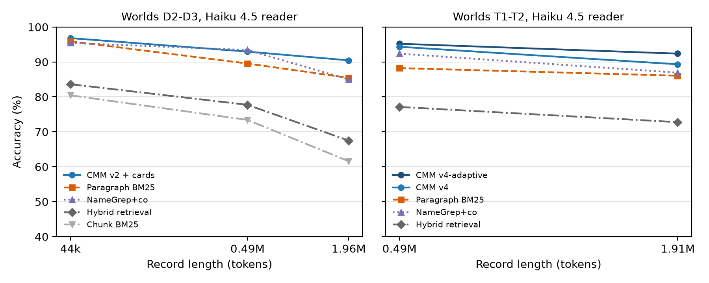

# Entity and Event Indexes for State, Continuity and Counting Questions over Verbatim Million-Token Records

## Abstract

Long-running work with language models leaves records longer than a context window. Common remedies decide early what to keep (compaction, fact extraction) or select passages by similarity (retrieval). We keep the record verbatim and index it by entity (names, aliases and resolved descriptions, verified at idle time) and event kind. The answering model gets the indexed set within a 4k-token budget, plus event aggregates for counting. On synthetic records with exact answers, the entity index answers 94–97% of state-tracking questions at about 0.5M tokens, against 88–91% for paragraph retrieval and 77–83% for hybrid retrieval. The order holds for readers from four model families, at 1.9M tokens and against re-implemented HippoRAG 2, contextual and small-to-big retrieval; among nine local reader settings, the lead over paragraph retrieval is significant only for Gemma 4 31B and 8-bit Qwen3-14B with thinking on. The event index answers 67–81% of counting questions, against 25–55% for retrieval and the entity index. On real game transcripts (Oolong-real, 0.72–1.25M-token windows), event tables beat same-budget BM25 by 0.204 on the official 0–1 score (95% confidence interval 0.176–0.232), over half of it from exact answers about names and kinds; exact counts in the hundreds remain rare. Within a 1M-token window, full-context reading is not detectably different from the index. The index shows no advantage on held-out novels, agent trajectories or chat, and paragraph retrieval is ahead on synthetic code-change records. Indexing pays when many questions need every passage about the people or events they name.

**Keywords:** Long-context language models; Agent memory; Retrieval-augmented generation; Entity indexing; Context compression; Benchmark

## 1 Introduction

Writers, programmers and researchers now work with language models over sessions whose combined record often exceeds the context window. Later work depends on details fixed much earlier: who married whom and who has since died, which interface changed, how often an operation was run. When those details are lost, the work contradicts its own past.

Three kinds of question show the problem:
- *State.* Where does a person live now, after a dozen moves? The answer is in the latest of many passages, and the passage that records the change is often not lexically similar to the question.
- *Continuity.* Is a drafted paragraph consistent with the record? A contradiction is often established by what did *not* happen afterwards, so only the complete history of the entities involved can settle it.
- *Aggregation.* How many births in a family, how many dice rolls by a player? The answer needs every event of a kind, and an explicit zero when there are none.

The usual remedies decide relevance too early or too loosely. Agent-style compaction and fact extraction choose what to keep before any question exists, and what they drop cannot be recovered unless the raw record is also kept and searched. Retrieval keeps the text but returns a fixed number of similar passages, so it cannot support "this is everything" or "this never happened". Reading the whole record at every question (full-context reading) is expensive when many questions are asked and impossible beyond the window.

We keep the text verbatim, index it by what the questions name, namely people and kinds of events, and hand the *reader* (the language model that answers) the indexed set, all of it when it fits the *token budget* (the number of record tokens the reader is given per question). Two indexes cover the three question kinds. Identity is stable while facts change, so an *entity index* (Certified Mention Memory, CMM) registers every paragraph that names or refers to a person, with names, aliases and descriptions verified at *idle time*, between uses of the record, when no question is waiting (the "sleep time" of Lin et al., 2025). An *event index* registers every paragraph that narrates an event of a given kind; on long transcripts with thousands of events it stores the events themselves and computes aggregates.

The parts of this design have precedents (Section 2). This paper measures three things:
1. **Which memory form keeps facts usable as the record grows?** We compare compaction, extracted facts, chunk, paragraph, graph and contextual retrieval, and the two indexes at matched token budgets, with full-context reading where the record fits, on records whose events and questions are held fixed while length grows 180-fold.
2. **What does early compression cost?** We trace each needed fact through hundreds of compaction steps.
3. **Where does an index stop helping?** We test it on real transcripts, against a 1M-token full-context reader, on real novels, agent trajectories, chat and code-change records, and account for cost by question arrival.

Contributions:
- **Benchmarks with exact gold and fixed content across length**: LongState-Saga (state tracking from 11k to 2M tokens), LongState-Continuity (paired consistent and contradicting continuations) and LongState-Aggregate (counting, including a family-restricted set).
- **Controlled comparisons with token accounting** on data not used to develop the methods, replicated with readers from four model families and with eleven reader settings that vary model size, quantization and reasoning, and extended to re-implementations of three further baselines.
- **A real-text test and a long-context contrast** on Oolong-real, with a decomposition of where the index loses and of where its lead comes from.
- **Boundaries**: the data on which the indexes show no advantage or lose.

The main finding is that for questions that need every passage about a person or every event of a kind, an index over the verbatim record gives the reader a better context than compaction, extracted facts or similarity retrieval at the same budget. The advantage disappears for questions that ask about a scene or name neither a person nor a kind of event, and on our code-change records paragraph retrieval does better.

## 2 Related work

*Benchmarks.* BABILong hides the facts of bAbI tasks in background text of almost arbitrary length, with predefined splits up to 10M tokens (Kuratov et al., 2024; Weston et al., 2015). LongMemEval tests chat memory with knowledge updates and abstention (D. Wu et al., 2025); MemoryAgentBench, RECON, BEAM and EverMemBench test overwritten facts, invalidation chains and conversations past a million tokens (Y. Hu et al., 2026; Arya, 2026; Tavakoli et al., 2026; C. Hu et al., 2026). The closest benchmark, StateMemBench, renders symbolic state programs into dialogue of about 3k–15k tokens and grades answers as current or superseded (Fan et al., 2026). LongState-Saga keeps the same events and the same questions at every length over a 180-fold range (11k–2M tokens), with gold evidence closed over the references needed to interpret it, and combines kinship, knowledge state, rumour, unrealised plans and abstention with state tracking.

*Entities and events before language models.* Organising information around entities is the subject of entity-oriented search (Balog, 2018). An entity catalogue gives each entity an identifier and its names, and aliases (surface forms) make it findable by more than one name. The closest classical task to our entity index is entity-centric document filtering, studied at the TREC Knowledge Base Acceleration track (2012–2014): for a target entity, a system scans a time-ordered stream, keeps the documents that contain one of the entity's known surface forms by string match, and ranks them by whether they would change the entity's knowledge-base entry (Balog, 2018, Sect. 6.2). Entity-based document retrieval stores entity annotations in an inverted index and uses them to rank documents for entity-bearing queries (Balog, 2018, Ch. 8), and entity cards summarise an entity's key facts (Balog, 2018, Sect. 9.2). The Automatic Content Extraction (ACE) program defined entity detection as collecting every mention of an entity, whether a name, a description or a pronoun, into one class, which makes coreference part of the task; ACE events have a type, participants with roles and a modality that separates real from not-real events (Doddington et al., 2004). Neural systems learn these steps from annotated corpora: coreference over documents of 454 words on average and at most about 4,000 (K. Lee et al., 2017), linking of given mentions to a knowledge base of millions of entries (L. Wu et al., 2020), and joint extraction of entities, relations and events whose arguments lie in the trigger's sentence (Wadden et al., 2019). Our indexes reuse these ideas inside one long record. The registry is an entity catalogue built from the record itself, without an external knowledge base; descriptions such as "the husband of X" are resolved by a language model at idle time, while pronouns are not (Supplementary Appendix B.5); and the event index labels paragraphs with kinds and a narrated, reported or earlier status, a coarse form of ACE's type and modality. String matching on known names, as in the filtering task, is our NameGrep+co baseline. What differs is the use: the indexed set is passed whole, in record order, to a reader with a statement of what it covers, and it is judged by the reader's answers over records of up to 2M tokens.

*Memory systems.* Raw-preserving or paging memories (MemGPT, Packer et al., 2023; ReadAgent, K.-H. Lee et al., 2024), hierarchical summaries (RAPTOR, Sarthi et al., 2024), graph memories (HippoRAG 2, Gutiérrez et al., 2025; GraphRAG, Edge et al., 2024), temporal knowledge graphs (Zep, Rasmussen et al., 2025; MemStrata, Yadav, 2026), fact stores (Mem0, Chhikara et al., 2025) and sleep-time consolidation (Lin et al., 2025) cover most of the design space. The closest systems are these:
- *EnSIMem* (Meng et al., 2026) builds an entity-structured index over preserved source turns and stops retrieval by coverage: a planner turns the request into evidence requirements, and a deterministic check expands the evidence until they are covered. CMM instead checks the set of paragraphs registered under a verified entity, built once at idle time. We did not compare with EnSIMem directly and claim no advantage over it.
- *Engram* (Wang, 2026) writes lossless episodes, consolidates a fact graph asynchronously and finds that a lean retrieved context beats the full history for a strong reader.
- Yuan et al. (2026) cross write strategies with retrieval methods on LoCoMo and find that raw chunks match or beat fact extraction and summarisation, while the retrieval method matters more than the write strategy.

CMM differs from these systems in consolidating identity rather than facts at idle time and in stating which paragraphs its context covers. Removing the statement produced no detectable change in accuracy in our tests (Section 7.5).

*Structured and contextual retrieval.* StructRAG routes each question at inference time to one of five structures (table, graph, algorithm, catalogue or plain chunks; Z. Li et al., 2025), and ChatDB keeps symbolic memory in a database (C. Hu et al., 2023). Our event index is a fixed, question-independent structure built at write and idle time. Contextual retrieval prepends a model-written context to each chunk (Anthropic, 2024); small-to-big retrieval searches small units and returns their surrounding window (LlamaIndex, n.d.). We re-implement HippoRAG 2, contextual retrieval and small-to-big retrieval as baselines.

*Length and evidence.* Accuracy falls with input length well inside the advertised window (RULER, Hsieh et al., 2024; NoLiMa, Modarressi et al., 2025; HELMET, Yen et al., 2025). Models that can recite the evidence perfectly still lose accuracy as filler grows (Du et al., 2025), and with a single oracle passage, 2023 models answer 76–89% of multi-document questions (Liu et al., 2024). Position effects exist but are weaker for current models: a reproduction with recent models did not recover the U-shaped curve (Gabín et al., 2026), and in realistic retrieval the effect is marginal (Cuconasu et al., 2025). We take "length alone hurts" and "oracle evidence is not a ceiling" as established and measure their size on records whose content is fixed.

*Continuity.* NoCha pairs true and false claims about 67 English fiction books, 63 of them recently published, and credits a pair only when both labels are right; GPT-4o reaches 55.8% pair accuracy (Karpinska et al., 2024). FlawedFictions and ContraDoc study injected contradictions and self-contradiction in shorter documents (Ahuja et al., 2025; J. Li et al., 2024), ConStory-Bench measures consistency in long stories that models generate (J. Li et al., 2026), and STALE tests stale memory in dialogue histories of up to 150k tokens (Chao et al., 2026). Our continuity test takes NoCha's paired design, derives every label from the world state, and keeps the record at 0.5M tokens.

*Compaction and extraction.* Coding and research agents compress their working context when it fills (MemGPT; ACON, Kang et al., 2026; Context-Folding, Sun et al., 2025). Mem0 reports extracted facts above chunk retrieval on LoCoMo (Chhikara et al., 2025; Maharana et al., 2024), while AMA-Bench finds the opposite on real agent trajectories: Mem0 0.210 against 0.344 for BM25 and 0.423 for dense retrieval over raw segments (Zhao et al., 2026). In agent memory, missing content outnumbers fabricated content (HaluMem, Chen et al., 2025).

*Aggregation and long-context reading.* Oolong tests aggregation over long contexts; its real part uses Critical Role transcripts with tallies from the fan project CritRoleStats (Bertsch et al., 2026). Models with a 1M-token window can read whole records from which our indexes select about 4k tokens, provider prompt caching lowers the price of reading the same prefix again (Anthropic, n.d.), and reusing attention states lowers its latency (Gim et al., 2024); cost break-even between memory and long-context reading has been derived for fact-based memory (Pollertlam & Kornsuwannawit, 2026). We compare with full-context reading directly and account for cached prices.

## 3 Benchmarks

### 3.1 LongState-Saga

**World.** Ten families of three generations (four in worlds D2, T1 and T2) with fictitious names, first names that recur across families, and epithets; 16 places, 12 named objects, 8 secrets; and three rules (a vault, a toll bridge, and an heirloom that passes on death to the eldest living child, a transfer that is never narrated). A seeded simulator runs 40 chapters of moves, marriages, deaths, births, gifts, inheritances, secrets, promises, changes of trade, false rumours and unrealised plans, and keeps the exact world state and its history.

**Rendering and length.** Each event is rendered once into prose. People are referred to by full name, first name, nickname or a relational description unique at that time ("the husband of Karine Prydaby"); every non-name reference records the events needed to resolve it, and gold evidence is closed over these dependencies. The record is padded at a filler density *d* with state-neutral sentences naming people present in the scene and paragraphs of public-domain novels from Project Gutenberg, following BABILong's construction. Event text, event order and questions are identical across densities; world D1 gives 11k, 43k, 131k, 522k and 1.99M tokens at *d* = 0, 1, 4, 16, 64.

**Worlds used.** We name the generated worlds by use (Supplementary Table S2 gives the generator seeds). D1–D6 were used to develop the methods. T1–T2 test the entity index and were not used in its development. E1–E2 were used in the development of the event index, and E3–E4, generated after its development, test it.

**Questions.** Before exclusions, 261–262 per world in worlds D1–D3 and 267 and 270 in worlds T1 and T2, in 14 types: current and past residence, spouse, alive (including targets of false death rumours), current and previous holder of an object, grandparent, knowledge of a secret, promise status, rule application, places ever lived in, birthplace and trade. Answers are canonical strings scored deterministically. Every error a strong reader made with the oracle evidence was read and the generator or answer key was fixed; ill-posed questions are excluded with the reason recorded (Supplementary Appendix A).

### 3.2 LongState-Continuity and LongState-Aggregate

*Continuity.* A writer drafts a paragraph about the end state of the world; the system says whether it is consistent with the record or contradicts it, either with a value that was true earlier and has since changed (stale) or with one that was never true. Items come in minimal pairs with the same template and, where possible, the same subject, one consistent and one contradicting. Labels are derived from the world state and re-derived by an independent checker with zero disagreements. Worlds T1 and T2 give 216 pairs.

*Aggregate.* LongState-Aggregate adds 146 questions to worlds T1 and T2: 100 anchored on a person (children, residences in order, marriages, holders in order, who died first) and 46 global counts. Because half of the filler is prose from novels that narrates deaths and weddings of its own characters, global counts over the whole record are ambiguous; we therefore wrote a second set, **G2**, restricted to the world's families by surname (deaths, births and weddings in total, per family and per chapter range, and counts per place), with gold re-derived from the world state.

### 3.3 Oolong-real

Oolong-real (Bertsch et al., 2026) asks aggregation questions over transcripts of the game show Critical Role: counts of dice rolls or spells, in total, per character or player, per roll type or natural value, cumulative to an episode, and the first, k-th, most or least common item. A context window holds 1–24 episodes (about 31k to 1.25M tokens); episodes need not be consecutive broadcasts, and "episode k" is the k-th episode within the window. The gold tallies come from the fan project CritRoleStats, aligned with the CRD3 transcripts (Rameshkumar & Bailey, 2020); some may be hard to reconstruct from the text alone. We use the validation split (campaign 2) for development and the test split once, with the first 20 questions by identifier in every window (110 windows, 2,200 questions).

### 3.4 Other records

- *Novels.* NovelHopQA (Gupta et al., 2025) asks multi-hop questions over Project Gutenberg novels; we use three novels (160–213k tokens) not used in any design decision.
- *Agent trajectories.* From AMA-Bench (Zhao et al., 2026) we take the 14 GAIA (Mialon et al., 2024) level-2 and level-3 trajectories of at least 150k tokens (0.19M–1.06M tokens, 168 questions) and the 12 longest SWE-bench (Jimenez et al., 2024) trajectories (69k–90k tokens, 144 questions). A GPT audit flags 86 of 144 SWE-bench reference answers and 14 of 168 GAIA answers as contradicting the trajectory, and a blind check of a sample by the same model at high reasoning effort confirmed 22 of 24 and 10 of 14 flags, so we also report the questions the audit labels correct (GAIA: 80 correct, 59 ambiguous, 15 not auditable, 14 contradicting; SWE-bench: 48 correct, 10 ambiguous, 86 contradicting).
- *Chat.* LoCoMo (Maharana et al., 2024): 10 two-speaker conversations, 300 questions.
- *Code-change records.* LongState-Code, a second generator of ours, renders a simulated software project (renames, argument changes, moves, configuration values, owners, bug states, reversed decisions, unmerged proposals and false chat claims) into a log, with exact answers. Two test worlds give 479 questions at four lengths up to 1.56M tokens (Supplementary Appendix A.4).

## 4 Methods compared

All methods answer through the same reader prompt with a budget of 4,000 tokens per question, counted with the cl100k_base tokenizer (OpenAI, 2022). The budget is the middle of the planned range of 2k to 8k tokens: below 1% of a 0.5M-token record and well within the 16,384-token context used for the local readers. With Claude Haiku 4.5, GPT-6.1 Sol and Claude Sonnet 5.5 as readers, a sweep from 2k to 16k tokens (Section 7.1) leaves the order of CMM v4, paragraph BM25 and hybrid retrieval on state tracking unchanged. Table 1 lists the methods; measured rendered inputs per question at 0.5M are 3,974 tokens for paragraph BM25, 4,095 for CMM v4, 4,157 for chunk BM25 and 4,422 for the state ledger.

*Table 1. Compared conditions.*

| Condition | What the reader receives |
|---|---|
| Hybrid retrieval | 300-token chunks ranked by reciprocal rank fusion (Cormack et al., 2009) of BM25 (Robertson & Zaragoza, 2009) and Qwen3-Embedding-0.6B (Zhang et al., 2025) scores |
| Paragraph BM25 | paragraphs ranked by BM25 |
| NameGrep+co | every paragraph containing a name from the question, plus first and latest paragraphs of co-mentioned people (no language model) |
| State ledger | (subject, attribute, value, status) facts extracted at write time, latest marked; no raw text (Mem0- and MemStrata-style) |
| Compaction 4k / 16k | a rolling summary rewritten after every 2k (8k) new tokens, plus the recent raw tail (agent-style context compression) |
| Gold-evidence paragraphs | only the paragraphs containing the gold evidence, an oracle condition (with or without a completeness statement) |
| Full-context reading | the whole record where it fits the reader's window |
| HippoRAG 2 (Gutiérrez et al., 2025), contextual retrieval (Anthropic, 2024), small-to-big (LlamaIndex, n.d.), post hoc | our re-implementations (Section 8) |
| CMM v4 and variants; event index v5 | Section 5 |

## 5 Memory

### 5.1 Certified Mention Memory (entity index)

**Write time.** The record is kept verbatim; the unit of recall is the paragraph. For each segment of about 1,500 tokens the *builder* (the language model that builds the index) lists names, alias declarations and referring phrases (entities referred to by description). No facts are extracted.

**Idle time.** A name or alias enters the *registry* (the verified list of entities and their names) only if it occurs verbatim in the record; an entity's type is fixed by the majority of its write-time types; lower-case "names" become descriptions and epithets are demoted to aliases. Referring phrases, from the write pass and from generic constructions ("the ⟨words⟩ of ⟨person⟩"), are resolved by the builder from the paragraph, the introductions of the named anchors and the preceding anchor paragraphs. Every paragraph containing a registry name, alias or resolved phrase is then indexed under its entity, and co-mention links are kept.

**Query time.** Entities named in the question are mapped to the registry. If all their paragraphs fit in 85% of the budget, the reader receives them in record order under a statement of what is guaranteed: all paragraphs in which a registered name, alias or resolved description of the entity occurs. The statement covers the registry, not mentions the build missed, and not every paragraph a question needs (Section 7.5). The first and latest paragraphs of linked people follow (up to 35%), with the introductions of the people named in the entity's own introduction first; any remaining budget is filled by paragraph BM25. Over budget, no statement is given and the entity's paragraphs are ranked together with the 300 paragraphs ranked highest over the whole record (v4). **CMM-adaptive** rebuilds the context once at three times the budget when no statement can be given. **Cards** are short profile notes written once per entity by the builder and shown for questions about a present state. Implementation limits and the version history (v1–v4) are in Supplementary Section 5.1.

### 5.2 Event-type index

Counting, listing and absence questions name no single entity; they need every passage that narrates one kind of event and a statement that the set is complete.

**Saga version.** At write time the builder lists, per labelled paragraph, every change it reports with its kind and status: *narrated*, *reported* (rumoured, claimed or planned) or *earlier* (before the record begins). At idle time, kind labels naming the same kind are grouped, and kinds that imply another (burial → death) also count as it (v5). At query time one builder call (routing) maps the question to the kinds and to the restricting names that occur in it; the selected set is every paragraph with a narrated event of those kinds whose text, or whose people resolved by CMM, match the names. It is shown in record order under a statement that the set is complete or that there is no such event; reported and earlier events follow, labelled.

**Transcript version.** An Oolong window holds thousands of events, so the index stores the events and counts them. Once per episode the builder lists every roll and spell with player, character, roll type, natural value (the die face before modifiers), total, spell name and level from numbered lines; each player's character is fixed by majority at idle time; episode tables are cached by text hash and reused by every window. At query time one routing call chooses the event kind and episode range, and the aggregates of that range (totals, per episode, character, player, roll type, natural value, spell, and spells in order) are computed from the tables and given to the reader. Each by-kind list keeps its 60 most frequent entries and the context is cut at 4,000 tokens; on the test split the cut applied to 133 of 2,200 questions and a list was shortened for 975, and the completeness statement was not removed in these cases, so for these questions it holds for the event tables, not for the context the reader received.

## 6 Evaluation measures and protocol

Table 2 gives the score of each task.

*Table 2. Scoring of each task.*

| Task | Score | Notes |
|---|---|---|
| State tracking (saga, code) | accuracy: canonical string match, deterministic | a hedged answer naming another person is wrong |
| Continuity | Youden's J = true-positive rate − false-positive rate for "contradiction"; pair accuracy (both members of a pair right) | always giving the same verdict gives J = 0 and pair accuracy 0; random guessing gives pair accuracy 25% |
| Counting (Aggregate, G2) | accuracy: the first number in the answer equals the gold count; list answers compare the sequence of known names in the answer with the gold list (a negated name still counts) | a bare "no" counts as zero |
| Oolong-real | the authors' rule: a number scores 0.75^\|error\|, a string by exact match, a list by the share of gold items; answer taken from `\boxed{}` | partial credit: answering 9 for a gold 10 scores 0.75 |
| Free-form (novels, agent trajectories, chat) | binary verdict of a GPT-6.1 Sol judge against the gold answer | AMA-Bench wording; model judge, not human |

**Readers and builder.** The primary readers are Claude Haiku 4.5 (Anthropic, 2025) and GPT-6.1 Sol (OpenAI, n.d.), the replication readers Gemini 4 Argon and gpt-oss-120b, and the weak readers the local Qwen3-8B and Qwen3-14B (Yang et al., 2025). Haiku, GPT, Argon and Sonnet stand for Claude Haiku 4.5, GPT-6.1 Sol, Gemini 4 Argon and Claude Sonnet 5.5. A robustness study (Section 7.2) adds Haiku with extended thinking, Qwen3-14B at 8-bit quantization and with thinking on, Qwen3-32B and three Gemma 4 models (Google DeepMind, 2026). The budget sweep (Section 7.1) also uses Sonnet as a reader. Claude Haiku 4.5 builds every memory unless stated otherwise (one Oolong variant is built by Claude Sonnet 5.5), so memories are identical across readers. Table 3 gives the settings. Every condition answers each question once; there are no repeated samples. The Gemini web application was the one exception: a window was asked again, at most once, when no answer came back or the reply covered fewer episodes than the window holds (Supplementary Appendix D).

*Table 3. Models, access and settings. "Input limit" is the limit as we reached the model; Ollama identifiers are the first 12 characters of the model digest. Effort and reasoning levels are given for the models that have them; Claude Haiku 4.5 and the Ollama models have none and are set by thinking on or off or by a thinking budget.*

| Model (identifier) | Role | Access | Input limit | Reasoning and sampling |
|---|---|---|---|---|
| Claude Haiku 4.5 (claude-haiku-4-5-20251001) | reader, builder | Anthropic API through the Claude Code command-line client | 200k tokens | no effort level (not supported by the model); extended thinking off (robustness study also on, 8,000-token thinking budget); prompt caching off; default sampling |
| Claude Sonnet 5.5 (claude-sonnet-5-5) | builder of one Oolong index; reader of the budget sweep (Section 7.1); second judge and gold-answer audit in Supplementary Appendix C; judge of the judge check (Section 8) | as Haiku | not reached | effort high (the model's API default); its thinking is adaptive and set by the effort level; prompt caching off; default sampling |
| GPT-6.1 Sol (gpt-6.1-sol) | reader, judge, builder of two post-hoc baselines, gold-answer audit | Codex command-line client, ChatGPT account | model 1,050,000 tokens; client 1,048,576 characters per message | reasoning effort low (set in every call); default sampling |
| GPT-6.1 Sol (gpt-6.1-sol) | blind second judgment in the check of the judge (Section 8) | Codex command-line client, reading the question, gold answer and prediction | – | reasoning effort high (the judge itself runs at low) |
| Gemini 4 Argon (gemini-4-argon; Google, 2026) | replication reader | Antigravity command-line client, Google AI Ultra account | not reached (4k contexts) | thinking level low (client model gemini-4-argon-low) |
| Gemini 4 Argon (gemini-4-argon) | Oolong full-context reader | Gemini API; Gemini web application | 1M tokens | thinking level medium (API temperature 1.0) |
| gpt-oss-120b | replication reader | Antigravity command-line client | not reached (4k contexts) | reasoning effort medium (client model gpt-oss-120b-medium) |
| Qwen3-8B, Qwen3-14B (Ollama qwen3:8b 500a1f067a9f, qwen3:14b bdbd181c33f2; 4-bit Q4_K_M) | weak readers | local, Ollama | context set per call (16,384 tokens) | thinking off (robustness study: Qwen3-14B also on); temperature 0; seed 0 |
| Qwen3-14B 8-bit (qwen3:14b-q8_0 304bf7349c71), Qwen3-32B (qwen3:32b-q4_K_M 030ee887880f) | robustness readers | local, Ollama | as above | Qwen3-14B off and on, Qwen3-32B off; as above |
| Gemma 4 E4B, 12B, 31B (gemma4:e4b-it-q4_K_M dc35e8d9c606, gemma4:12b 4eb23ef187e2, gemma4:31b-it-q4_K_M 17ba34c06c80) | robustness readers | local, Ollama | as above | thinking off; as above |

For the Ollama readers the generation limit was 400 tokens, and 8,192 when Qwen3's thinking was on (thinking and answer together). No output limit of ours was passed to the Claude Code, Codex or Antigravity clients; those runs used the clients' defaults, so the comparisons hold the input budget fixed, not the amount of generated text. Models larger than one 16 GB graphics card were split over two cards.

**Development and test data.** The methods were developed on worlds D1–D6, novel sets A and B, worlds E1–E2 (event index) and the validation split of Oolong (Supplementary Section 6.0). The reported test results come from data that no design decision used: worlds T1 and T2 for state tracking and continuity, worlds E3 and E4 for counting with the event index, the test split of Oolong, novel set C, LoCoMo and two LongState-Code records. Further conditions on these data are diagnostics (Supplementary Section 6.0).

**Statistics.** Accuracies are reported with 95% confidence intervals from a cluster bootstrap over question subjects (2,000 resamples); intervals for continuity J and for the statement-ablation controls resample pairs or questions, as stated where they are reported. Paired comparisons use exact McNemar tests (McNemar, 1947) over discordant questions, with Holm correction (Holm, 1979) over the comparisons of each table; uncorrected values are marked. "w/l" (also written +w/−l) gives the questions won and lost by the first method. Because questions share people, families and evidence, we also resample larger dependence units (families, groups of questions sharing evidence) as a sensitivity analysis. Oolong intervals come from a bootstrap over windows; windows share episodes, so these intervals are conditional on the episodes of the split.

## 7 Results

### 7.1 State tracking

Table 4 gives state-tracking accuracy on the held-out worlds.

*Table 4. State tracking on held-out worlds T1–T2 (459 questions), accuracy %, 4k-token budget.*

| Method | GPT-6.1 Sol | Haiku 4.5 | Qwen3-14B | Qwen3-8B |
|---|---|---|---|---|
| CMM v4-adaptive (6.2k tokens) | 96.9 | 95.2 | 65.1 | 60.3 |
| CMM v4 | 96.7 | 94.3 | 65.4 | 58.4 |
| Paragraph BM25 | 90.6 | 88.2 | 68.0 | 59.7 |
| Hybrid retrieval | 82.6 | 77.1 | 62.1 | 61.0 |
| State ledger | 74.7 | 71.0 | 61.2 | 55.3 |

With the strong readers, CMM is significantly better than paragraph BM25, hybrid retrieval and the ledger. Against hybrid retrieval adaptive CMM wins 89 questions and loses 6 with Haiku, and wins 68 and loses 2 with GPT. Name search without a large language model (LLM; NameGrep+co) comes close at this length (92.4 Haiku, 96.3 GPT) and is not significantly below adaptive CMM.

*Dependence between questions.* Resampling questions by world family, CMM v4 minus paragraph BM25 is +6.1 [+3.0, +9.1] points with Haiku, and the interval stays above zero with the readers of all four model families. Questions can also share evidence across families. When questions that share a core evidence event are resampled together, the lower bounds against paragraph BM25 stay above zero for all four readers (+0.4 to +4.4). When any shared evidence event links questions, including the events needed to resolve references, the 459 questions fall into 121 groups (the largest has 170 questions) and the lower bounds reach −1.5 (Haiku) and 0.0 (GPT, Argon); only gpt-oss-120b stays clear (+3.5). The lead over paragraph BM25 therefore depends on how dependence is defined and rests on two worlds. The lead over hybrid retrieval stays above zero under every grouping (lower bounds +4.3 or more).

A larger budget does not close the gap. We ran this sweep with three readers (Supplementary Table S6). With Haiku, accuracy at 2k, 4k, 8k and 16k tokens is 91.5, 94.3, 93.7 and 93.7 for CMM v4, 86.9, 88.2, 89.8 and 89.1 for paragraph BM25, and 69.5, 77.1, 85.2 and 85.6 for hybrid retrieval. With GPT and Sonnet the two baselines gain more from a larger budget than with Haiku (paragraph BM25 90.2 → 93.7 and 88.9 → 92.6, hybrid retrieval 72.3 → 91.1 and 71.9 → 90.2), but CMM v4 stays ahead at every budget (95.2–97.4 and 93.9–97.2), significantly in all 24 same-budget comparisons of the three readers (Holm correction within each reader). CMM at 4k is significantly more accurate than paragraph BM25 at 16k with all three readers (exact McNemar, uncorrected p): 94.3 against 89.1 with Haiku (+31/−7, p < 0.001; difference 5.2 points, 95% confidence interval 2.6–8.0), 96.7 against 93.7 with GPT (+17/−3, p = 0.003; 3.1 points, 1.1–5.2) and 96.1 against 92.6 with Sonnet (+21/−5, p = 0.002; 3.5 points, 1.3–5.9).

**Across length.** Fig. 1 follows the same questions, method versions and reader across length. In development worlds D2–D3 (440 questions, Haiku), from 44k to 1.96M tokens, CMM v2 with cards loses 6.4 points (96.8 → 90.5), paragraph BM25 and NameGrep+co 10.5, hybrid retrieval 16.1 and chunk BM25 18.9; with the Qwen readers hybrid retrieval loses 8.4 (Qwen3-8B) and 8.6 (Qwen3-14B). In worlds T1–T2, from 0.5M to 1.9M tokens, CMM v4 loses 5.0 (Haiku) and 3.5 (GPT) points, paragraph BM25 2.2 and 1.5, and hybrid retrieval 4.4 and 7.2: the entity index stays ahead, but over this range it does not lose less than paragraph BM25. Rolling summaries cut to the same budget score 22–26% already at 44k. Reading granularity is the largest single factor for the strong reader: the same BM25 over paragraphs instead of 300-token chunks raises Haiku from 80.5% to 95.9% at 44k and from 68.5% to 88.5% at 470k. Full-context reading is not clearly better either: at 44k, Haiku reading the whole record (46k tokens) scores 92.0% on the 201 questions it was run on, against 94.0–96.5% for the paragraph-level memories on the same questions, none of the four differences being significant after Holm correction.

*Fig. 1. State-tracking accuracy (Haiku 4.5 reader, 4k base budget; adaptive CMM reads 6.2k and 9.2k tokens on average on T1–T2) against record length, on the same questions at every length. Left: development worlds D2–D3, 440 questions, at 44k, 0.49M and 1.96M tokens. Right: held-out worlds T1–T2, 459 questions, at 0.49M and 1.91M tokens.*

Table 5 repeats the main comparison with readers from four model families.

*Table 5. Replication with readers from four model families (worlds T1–T2), accuracy % (state) and pair accuracy % (continuity).*

| Reader | State: CMM / paragraph BM25 / hybrid | Continuity: CMM / paragraph BM25 / hybrid |
|---|---|---|
| Haiku 4.5 | 94.3 / 88.2 / 77.1 | 90.3 / 81.0 / 69.0 |
| GPT-6.1 Sol | 96.7 / 90.6 / 82.6 | 99.1 / 91.2 / 71.8 |
| Gemini 4 Argon | 97.4 / 91.5 / 81.0 | 91.2 / 88.0 / 73.6 |
| gpt-oss-120b | 92.6 / 83.4 / 76.9 | 86.1 / 85.6 / 63.9 |

**At 1.9M tokens** (same 459 questions), CMM v4 scores 93.2 (GPT) and 89.3 (Haiku), paragraph BM25 89.1 and 86.1, hybrid retrieval 75.4 and 72.8. The complete set fits the budget for 30.9% of the questions (67.5% at 0.5M); adaptive CMM (9.2k tokens) reaches 95.0 and 92.4 and beats every other condition except v4 with cards. NameGrep+co falls to 89.8 and 86.9, below adaptive CMM.

**Weak readers.** For the Qwen readers no method without consolidation is reliably better than paragraph BM25: they misuse even correct evidence. Cards written by Haiku help them (Qwen3-14B: 75.6 with v4+cards against 65.4 without). Section 7.2 shows that for Qwen3-14B this result holds only with its thinking mode off.

**Post-hoc baselines.** Our re-implementations of HippoRAG 2 and contextual retrieval were built by GPT-6.1 Sol; small-to-big needs no generative builder (Table 6). All three score below the indexes on every task with both readers (Holm over the 18 added comparisons). They are re-implementations with one fixed setting each, while CMM went through several development versions; the differences from the original systems are listed in Section 8.

*Table 6. Post-hoc baselines (accuracy %; continuity as pair accuracy; w/l and p against our index, Holm-corrected over the 18 comparisons of the table: paper/tables_revision.md).*

| Task (reader) | Our index | HippoRAG 2 | Contextual retrieval | Small-to-big |
|---|---|---|---|---|
| State (Haiku) | 94.3 | 88.7 (36/10, p = 8×10⁻⁴) | 78.0 | 75.8 |
| State (GPT) | 96.7 | 92.4 (24/4, p = 8×10⁻⁴) | 81.3 | 78.9 |
| Continuity (Haiku) | 90.3 | 77.8 (39/12, p = 8×10⁻⁴) | 70.4 | 68.5 |
| Continuity (GPT) | 99.1 | 87.5 (26/1, p = 2.5×10⁻⁶) | 73.6 | 69.4 |
| G2 counting (Haiku) | 78.7 | 58.7 (20/5, p = 0.008) | 32.0 | 28.0 |
| G2 counting (GPT) | 73.3 | 57.3 (18/6, p = 0.023) | 28.0 | 26.7 |

### 7.2 Readers of different size, quantization and reasoning setting

The weak-reader result above could reflect model size, 4-bit quantization or the thinking mode, which was off. We therefore ran the same state-tracking questions with eleven reader settings (Table 7). Every setting receives the contexts of the same three methods at the same 4k budget; CMM breaks ties in set order, so its packed paragraphs can differ slightly between runs (Section 8).

*Table 7. Reader robustness, worlds T1–T2 (459 questions), accuracy %, 4k budget. Thinking on: Haiku with an 8,000-token extended-thinking budget (set as a number of tokens, not as an effort level); Qwen3 in Ollama's thinking mode, with up to 8,192 output tokens against 400 with thinking off. Q4 and Q8: 4-bit and 8-bit quantization. Answers cut: answers that reached the output limit. Settings in Table 3. Holm-corrected p over the 22 comparisons of the table.*

| Reader | CMM v4 | Paragraph BM25 | Hybrid | Answers cut (of 1,377) | CMM vs BM25: w/l, Holm p | CMM vs hybrid: w/l, Holm p |
|---|---|---|---|---|---|---|
| Haiku 4.5, thinking off | 94.3 | 88.2 | 77.1 | 0 | 38/10, 9×10⁻⁴ | 87/8, 1×10⁻¹⁶ |
| Haiku 4.5, thinking on (8k) | 94.1 | 86.9 | 76.3 | 0 | 42/9, 5×10⁻⁵ | 89/7, 7×10⁻¹⁸ |
| Gemma 4 31B Q4, thinking off | 94.3 | 88.0 | 78.6 | 17 | 37/8, 2×10⁻⁴ | 82/10, 7×10⁻¹⁴ |
| Gemma 4 12B Q4, thinking off | 86.5 | 82.1 | 73.0 | 117 | 46/26, 0.29 | 88/26, 8×10⁻⁸ |
| Gemma 4 E4B Q4, thinking off | 68.0 | 67.8 | 63.4 | 20 | 44/43, 1 | 73/52, 0.66 |
| Qwen3-32B Q4, thinking off | 74.7 | 72.1 | 69.9 | 4 | 45/33, 1 | 62/40, 0.40 |
| Qwen3-14B Q8, thinking on | 91.5 | 85.8 | 77.6 | 1 | 42/16, 0.011 | 79/15, 2×10⁻¹⁰ |
| Qwen3-14B Q4, thinking on | 91.1 | 87.6 | 77.8 | 1 | 34/18, 0.40 | 74/13, 3×10⁻¹⁰ |
| Qwen3-14B Q8, thinking off | 68.0 | 70.4 | 64.1 | 0 | 32/43, 1 | 57/39, 0.66 |
| Qwen3-14B Q4, thinking off | 65.4 | 68.0 | 62.1 | 0 | 31/43, 1 | 63/48, 1 |
| Qwen3-8B Q4, thinking off | 58.4 | 59.7 | 61.0 | 0 | 30/36, 1 | 46/58, 1 |

With Haiku, extended thinking leaves the results unchanged (94.1, 86.9 and 76.3). Gemma 4 31B, a local 4-bit model, reaches Haiku's level with every method, and CMM leads both baselines significantly. The other settings without thinking (Gemma 4 E4B and 12B, Qwen3-8B, Qwen3-14B and Qwen3-32B) show no significant lead of CMM over paragraph BM25 after correction. Turning Qwen3-14B's thinking on raises CMM from 65.4 to 91.1 (4-bit) and from 68.0 to 91.5 (8-bit), and CMM moves ahead of paragraph BM25 by 3.5 and 5.7 points, significantly after correction only at 8-bit. The step from 4-bit to 8-bit adds 2.6 points with thinking off and 0.4 with thinking on. In these runs the reasoning setting therefore matters far more than quantization: for Qwen3-14B the weak-reader result of Section 7.1 holds only with thinking off and does not come from 4-bit quantization. The other small models were run only with thinking off. Two qualifications apply. Gemma 4 12B reached the 400-token output limit in 117 of its 1,377 answers, usually before the final answer line, and 113 of them were scored wrong and 4 right; its scores hold under that limit, and accuracy with a larger allowance was not measured. With thinking on, Qwen3 may write up to 8,192 tokens per answer against 400 without, so the thinking settings differ in output allowance as well as in reasoning.

### 7.3 Continuity checking

Table 8 gives Youden's J for each method.

*Table 8. Continuity checking, worlds T1–T2 (216 pairs), Youden's J ×100.*

| Method | Haiku 4.5 | GPT-6.1 Sol | Qwen3-14B | Tokens |
|---|---|---|---|---|
| CMM v4 | 90.3 [86, 94] | 99.1 [98, 100] | 38.9 | 4.2k |
| CMM v4 + cards (Haiku-written) | 87.0 | 96.8 | 70.4 | 4.2k |
| Paragraph BM25 | 80.1 | 91.2 | 40.7 | 4.0k |
| Paragraph BM25 at 8k | 84.7 | 96.3 | – | 7.9k |
| Gold evidence paragraphs only | 70.8 | 88.0 | 63.4 | 0.1k |
| Hybrid retrieval | 64.4 [56, 71] | 68.1 [61, 75] | 27.3 | 4.2k |
| Compaction 4k | 11.6 | 13.4 | – | 4.0k |

At the pair level CMM beats paragraph BM25 (28/8 with Haiku, 17/0 with GPT), hybrid retrieval (54/8, 60/1) and the gold evidence alone (61/5, 22/0), significantly after Holm correction. It beats the gold evidence because a contradiction is often established by what did not happen afterwards: the gold paragraphs show a move, only the complete history shows that no later move followed. CMM at 4k also scores above paragraph BM25 at 8k (J +5.6 [+0.5, +10.6] with Haiku, +2.8 [+0.9, +5.1] with GPT; intervals from resampling the 216 pairs). With the two replication readers, CMM beats hybrid retrieval but not paragraph BM25 (Argon 13/6, p = 0.17; gpt-oss-120b 16/15, p = 1), so the continuity claim against paragraph retrieval is limited to Haiku and GPT. For Qwen3-14B the memory alone does not help (38.9); Haiku-written cards lift it to 70.4.

### 7.4 Counting

On the anchored Aggregate questions, CMM v4 scores 78.0 (Haiku) and 84.0 (GPT) against 77.0 and 83.0 for paragraph BM25 and 63.0 and 65.0 for hybrid retrieval; adaptive CMM reaches the gold-evidence level (86.0 and 92.0 against 84.0 and 89.0, not significantly different). At 8k, paragraph BM25 scores 81.0 and 89.0, so a budget saving on counting is not established. Global counts need an index of events rather than of entities (Table 9).

*Table 9. Event-kind counting (G2), fresh worlds E3–E4, 75 questions, accuracy %.*

| Method | Haiku 4.5 | GPT-6.1 Sol | Gemini 4 Argon | gpt-oss-120b |
|---|---|---|---|---|
| Event index v5 | **78.7** | **73.3** | **81.3** | **66.7** |
| v5 without the identity index | 58.7 | 58.7 | – | – |
| Gold evidence paragraphs only | 48.0 | 53.3 | 50.7 | 46.7 |
| CMM v4 | 44.0 | 42.7 | 54.7 | 42.7 |
| Paragraph BM25 | 41.3 | 37.3 | 42.7 | 41.3 |
| Hybrid retrieval | 25.3 | 30.7 | 30.7 | 29.3 |

The event index beats CMM, paragraph BM25 and hybrid retrieval with readers from every model family, and the intervals stay well above zero when questions sharing gold events are resampled together. Without the identity index the same event set loses 15–20 points, because family restriction needs resolved names.

Against the gold evidence paragraphs the lead is smaller and depends on the reader. Much of it comes from the 13 questions whose true count is zero: the event index answers 12 of them (11 with gpt-oss-120b), the gold condition none, because its context is empty and says nothing about absence. On the 62 non-zero questions the event index is ahead with every reader but significantly (uncorrected) only with Haiku (47 against 36) and Argon (49 against 38). A control gives the gold paragraphs a completeness statement ("anything not shown here did not happen"). The event index then stays ahead with Haiku (59 against 35, Holm p = 4×10⁻⁵), which, given an empty context with the statement, still answers none of the zero-count questions, but not with GPT (55 against 50, p = 0.42), which uses the statement to answer 11 of them. With the replication readers the index stays ahead overall (uncorrected), but intervals reach zero when questions sharing evidence are resampled together. We therefore do not claim that the index beats the gold evidence in general. It beats gold paragraphs shown without a completeness statement; with the statement added, it stays ahead with Haiku but not with GPT.

### 7.5 Where the gain comes from

The controls above vary several components of the method; their effects are only partly separable.

1. **Paragraph granularity** explains most of the gap to ordinary retrieval. With Haiku, moving from hybrid chunk retrieval to paragraph BM25 raises state tracking from 77.1 to 88.2, continuity J from 64.4 to 80.1 and anchored counting from 63.0 to 77.0. Both show their passages in record order, so this step changes the retrieval unit and the ranking, not the order.
2. **Entity-indexed packing** (CMM v4 against paragraph BM25 at the same budget) adds +6.1 points on state tracking with both strong readers and +10.2 (Haiku) and +7.9 (GPT) J points on continuity; on anchored counting the difference (+1) is not resolved. The package includes priority for the entity's paragraphs, joint ranking when they exceed the budget and the introductions of linked people, so the gain belongs to the package as a whole and cannot be credited to complete coverage alone.
3. **The completeness statement** makes no measurable difference. CMM v4 minus its no-statement control (the same packing code without the statement) is +0.5 [−1.9, +2.8] J points (Haiku) and +1.4 [0.0, +3.2] (GPT) on continuity, and −2.0 [−6.0, +2.0] and +2.0 [0.0, +5.0] points on anchored counting. Effects beyond about 3 J points or 6 counting points are unlikely; smaller ones are not excluded. Its role is operational: it tells the system when all registered mentions of the person fit the budget; it does not certify that the context holds all evidence the question needs. Against the generator's event records, the certified set missed an event in which the queried person took part in 9 of 578 certified questions that have core gold evidence (98.4%; worlds D4–D5 with v2 and T1–T2 with v4; Supplementary Appendix B.3), and it alone contained all core evidence for 88.6% of them; the rest are events the person does not take part in.
4. **The trigger for reading more.** CMM-adaptive reads three times the budget when no completeness statement can be given. Reading three times the budget whenever the reader answers "unknown" does as well on state tracking and reads fewer tokens (reader trigger minus statement trigger: +0.7 [−0.7, +2.1] points at 0.5M and −1.1 [−2.9, +0.7] at 1.9M). On the novels the statement trigger is 8.0 [4.3, 12.3] points higher but reads 2.4 times as many tokens. The adaptive gains on counting and on the novels may therefore be largely budget gains.
5. **Consolidation** matters for weak readers only: Haiku-written cards lift Qwen3-14B on continuity from 38.9 to 70.4, and on state tracking in the development worlds, cards that the reader writes itself help less (Qwen3-14B: 75.5, against 80.7 with Haiku's cards and 67.2 without). Thinking at answer time does more for the same reader (Section 7.2).
6. **Order.** Giving the same paragraphs newest first made every reader worse (Haiku 94.3 → 91.3, p = 0.02; Qwen3-14B 65.4 → 58.4, p < 0.001), so chronological order with the latest state last is the better default. Placing the question before the context as well helps weak readers (Qwen3-8B with paragraph BM25: 57.7 → 66.4, development worlds).

### 7.6 Real transcripts: Oolong

Table 10 gives the official scores on the test split.

*Table 10. Oolong-real test, official score (0–1), mean over questions.*

| Reader | Method | All 2,200 | 16 + 24 episodes (400) |
|---|---|---|---|
| Haiku 4.5 | Event index (Haiku-built) | 0.388 | 0.333 |
| | Event index (Sonnet-built) | 0.451 | 0.358 |
| | BM25, 300-token chunks | 0.168 | 0.129 |
| | No context | 0.000 (1-episode windows) | – |
| GPT-6.1 Sol | Event index (Haiku-built) | 0.371 | 0.307 |
| | BM25 | 0.167 | 0.128 |

**Primary analysis**: index minus BM25 on the 16- and 24-episode windows with the Haiku reader, **+0.204 [+0.176, +0.232]**; over all windows +0.220 [+0.202, +0.239]; with the GPT reader +0.178 [+0.149, +0.209] and +0.205 [+0.186, +0.223]. Windows share episodes (187 of the 190 pairs of 16- and 24-episode windows share one), so these intervals are conditional on the episodes of the split; in sets of windows chosen so that no episode is used twice, the index is ahead of BM25 in every window (for example 10 of 10 one-episode windows). Fig. 2 shows the scores by window size.

*Fig. 2. Oolong-real test: mean official score by window size (20 questions per window, 10 windows per size). "(4k) → Haiku 4.5": Haiku reads the 4k-token context chosen by the index or by BM25. "Full context →": the model reads the whole window. Full-context reading needs the whole window within the reader's input limit (Table 3). Haiku 4.5 (200k tokens) read the 1–3-episode windows (up to 179k tokens; one 3-episode window exceeded the limit and its 20 questions are left out). GPT-6.1 Sol, reached through a client that accepts at most 1,048,576 characters per message (windows of up to 4–5 episodes), read the same 1–3-episode windows. Gemini 4 Argon (1M tokens) read only the 16-episode windows (0.72–0.86M tokens), because the 1M-token contrast uses the windows of the primary analysis. No model read the 4–10-episode windows in full. The 24-episode windows (1.09–1.25M tokens) exceed Gemini's 1M-token limit; the web application accepted them but answered for only part of the window in 6 of 13 answers, so that point shows what the application returned for an input larger than the model can read, not the model's accuracy.*

**What the lead consists of.** Table 11 splits the difference by the type of the gold answer. More than half of the primary-analysis lead comes from questions with a string answer, such as the most or least common roll type or spell: the index answers 48 of 81 exactly and BM25 2. Counts contribute through partial credit only; both methods give the exact count for 28 of the 253 count questions. With the GPT reader the string share is 63%. Exact counts stay rare where counts are large: over all 1,378 numeric questions, 13.6% of the index's answers and 13.1% of BM25's are exact; for gold counts of five or more, BM25 is almost never exact (0–1.5%) and the index is exact for 3–11%, while for counts of 0–4 BM25 is exact as often or more often, because keyword search finds the few lines and the reader counts them (Supplementary Section 6.4).

*Table 11. Index minus BM25 (Haiku reader) by type of gold answer: contribution to the mean official score, and answers that receive an official score of 1.0. For lists, the official score is the number of distinct items shared by the gold and predicted lists divided by the length of the gold list: order and extra predicted items are not penalised, and a gold list with repeated items cannot reach 1.0 even when predicted exactly.*

| Answer type | Primary analysis (400): contribution | Score 1.0, index / BM25 | All 2,200: contribution | Score 1.0, index / BM25 |
|---|---|---|---|---|
| String (81; 437) | +0.115 (56%) | 48 / 2 | +0.100 (46%) | 241 / 20 |
| Number, exact (253; 1,378) | +0.000 (0%) | 28 / 28 | +0.004 (2%) | 188 / 180 |
| Number, partial credit | +0.060 (30%) | – | +0.075 (34%) | – |
| List (66; 385) | +0.028 (14%) | 0 / 0 | +0.041 (19%) | 19 / 1 |
| Total | +0.204 | | +0.220 | |

**Source of the lead.** The transcript index is a task-specific attribute table. On the 1,352 questions that the tables answer by a fixed rule, the tables' own answer scores 0.345, the index reader 0.344 and BM25 0.097; on the other 848 questions the index reader scores 0.458 and BM25 0.280. Routing and reading change the score little on average (reading makes 44 questions worse and 42 better, and leaves 1,266 unchanged); most of the shortfall is already in the tables, a mix of missed and wrongly extracted events, split names (the transcripts say "Vax", the header "Vax'ildan") and tallies that may differ from the text. A stronger builder helps (Sonnet-built index 0.451 against 0.388). The comparison is therefore between a pipeline built for known question kinds and generic retrieval at the same budget. It is not evidence that the index transfers to unseen question kinds.

**Short windows.** On the 1–3-episode windows (up to 179k tokens, within Haiku's 200k-token limit; GPT-6.1 Sol read the same windows), full-context reading by GPT scores 0.545 against 0.425 for the index on the same windows, while full-context reading by Haiku scores 0.334, below the index.

### 7.7 A 1M-token full-context reader

The 16-episode test windows (0.76–0.91M Gemini tokens; 0.72–0.86M cl100k tokens) fit the 1M-token context of Gemini 4 Argon. Each window was read once through the API with its 20 questions at a medium thinking level (at the highest level, the first call spent its whole output allowance on thinking and returned no answer), and earlier through the Gemini web application (Table 12).

*Table 12. Full-context reading against the index on the 10 windows of 16 episodes (200 questions).*

| Condition | Score | Index (Haiku) − condition |
|---|---|---|
| Gemini, full context, API | 0.309 | +0.022 [−0.041, +0.074] |
| Gemini, full context, web application | 0.340 | −0.010 [−0.089, +0.061] |
| Index, Haiku reader | 0.330 | |
| Index, GPT reader | 0.311 | |
| BM25, GPT reader | 0.131 | |

Within the window, full-context reading and the index show no detectable difference, through either interface; both are far above BM25. The index reads about 0.5% of the window per question. The two interfaces differ by up to 0.11 on single windows, so one full-context run at 20 questions per window is itself noisy. The 24-episode windows (1.09–1.25M tokens) are larger than the model's 1M-token window, so we did not send them through the API. The web application accepted them; the provider states that inputs beyond the limit may lead to responses that do not take all content into account (Google, n.d.), and in 6 of 13 answers the reply covered only 12–18 of the 24 episodes, without warning. The 24-episode score therefore describes what the application does with an input the model cannot read in full; it is not a measure of the model's accuracy.

### 7.8 What compaction loses

Agent-style compaction rewrites the previous summary together with every 2k (or 8k) new tokens. With Haiku as compactor and reader, reading the uncut summary scores 88.0% on an 11k-token record (91.0 for hybrid retrieval), falls behind as records grow, and reaches 5.9% on world T1 at 0.5M tokens (93.6 for CMM v4); its continuity J is 11.1, against 90.3 for CMM v4. Results vary with the world and the compactor (Supplementary Section 6.7). On the novels and the AMA-Bench GAIA trajectories it stays at 5–31%, the lowest of all methods. We replayed each compaction step and checked whether the answer string was still in the summary, for the questions whose answer can be checked as a string: 34–59% of these answers were present after their evidence was first compacted, and 4–29% remained in the final summary; older answers were lost more often. This string check is a proxy: it misses paraphrased answers and does not judge meaning. Giving the compactor the list of all questions in advance raises world T2 from 25.1% to 37.7%, still far below CMM (95.1%). Our runs do not separate record length, number of rewrites and summary size.

### 7.9 Cost and break-even

A CMM question costs about half a cent at Haiku list prices at every length from 44k to 1.84M tokens; building the index costs $11–13 per million record tokens, most of it idle consolidation, so against uncached full-context reading the index pays off after 11–13 questions at every length from 470k to 1.84M. On the Oolong transcripts, in a cost model at one price level (input-token equivalents; cached full-context reading writes the cache once and reads it at 0.1 times the input price), the index pays off after about 9 questions per window when questions arrive one at a time, and is 4.7 times cheaper at 100 questions and 18.6 times at 1,000. When the full-context reader answers 20 questions per call, the index is cheaper only from 341–581 questions per window on the 16-episode windows that a 1M-token reader can read (281 when the 24-episode windows are included), and is 1.3 times cheaper at 1,000 (Fig. 3). An index therefore saves cost when many questions arrive over a long-lived record.

*Fig. 3. Cost per question in input-token equivalents of one price level, averaged over the 20 Oolong windows of 16–24 episodes, against questions per window, for one question per full-context call and for 20.*

### 7.10 Where the indexes do not help

The indexes help when a question names a person or a kind of event and its answer needs every passage about it. In the data below that condition holds weakly or not at all, and on the code-change records it holds and the index still loses.
- **Real novels.** On the three held-out NovelHopQA novels (GPT judge), hybrid retrieval stays ahead of CMM v4 at 4k (63.9 against 58.5). Adaptive CMM is highest (70.5) at about three times the tokens, and hybrid retrieval that reads three times the budget on "unknown" reaches 67.9 at 5.1k tokens, not significantly below. The questions ask about scenes and events, which an entity index does not localise.
- **Agent trajectories.** On all 168 GAIA questions, CMM v4 scores 48.8 / 60.1 (Haiku / GPT reader) and hybrid retrieval 55.4 / 60.7, with no significant difference. On the SWE-bench questions the audit labels correct, full-context reading by GPT scores highest (85.4 against 68.8 for adaptive CMM; p = 0.02 uncorrected, 0.26 after Holm correction). These questions are rarely anchored on a named entity, and we detect no advantage of the entity index over retrieval. An address index for step-numbered records did not beat strong baselines in its pre-registered primary analyses (Supplementary Appendix C).
- **Chat.** On LoCoMo (300 questions, GPT judge), CMM v4 is level with hybrid retrieval (Haiku 61.7 against 62.0; GPT 69.0 against 71.7), and GPT reading each whole conversation (about 30k tokens) scores 76.7, significantly above CMM v4 (29 against 6 questions, Holm-corrected). With two speakers, an entity index narrows the record little.
- **Code-change records.** On LongState-Code (479 questions), paragraph BM25 is ahead of adaptive CMM at all four lengths with Haiku (82.7 against 77.5 at the shortest, 77.7 against 74.5 at the longest), significantly after Holm correction at two of them; with GPT, CMM v4 and paragraph BM25 are level (82.7 and 82.7; 80.0 against 80.8). Both stay far above hybrid retrieval (42.8–57.6). These questions name functions and owners, so naming alone does not predict a gain. We have not established the cause; one candidate is rename chains, in which older paragraphs use a name other than the one in the question.
- **Weak readers** run without thinking gain little from any memory form without consolidation by a stronger model (Section 7.2).

## 8 Limitations

*Benchmark.*
- **Synthetic length.** LongState-Saga grows by filler: events and questions stay fixed while unrelated text is added. This isolates length and distraction but does not test a record whose knowledge, relations and updates grow with it, nor questions asked during the record. Claims about long-running work are therefore claims about question answering at the end of such records, and the cost of keeping cards current while the record grows is not measured.
- **Easier than real text in some respects.** Event sentences come from a few templates per event type, filler never contradicts the state, and names are unique non-dictionary strings, which favours string matching; NameGrep+co measures how far that alone goes. Filler names the people present in a scene, so part of the difficulty at long lengths comes from distractor mentions rather than from length itself.
- **Corrections under inspection.** The generator and its answer key were corrected while strong readers' errors on gold evidence were inspected, which may leave interpretations that suit those readers and the templates.
- **Statistical units.** Questions share people, families and evidence. The main tests are question-level, with dependence-aware resampling as a sensitivity analysis; the lead over paragraph BM25 on state tracking does not survive the most conservative grouping (Section 7.1), and the fresh-world results rest on two worlds and one campaign.

*Method.*
- **Coverage is relative to the registry.** An entity the write pass never lists, or a fact that reaches an entity only through unresolved coreference, is outside the completeness statement.
- **Non-deterministic ties.** CMM packing breaks ties in set order, so a rerun changes the packed paragraphs of about one question in ten, and the no-statement control is approximate.
- **One builder.** Claude Haiku 4.5 builds every memory except in the named variants; a stronger builder raised the Oolong score (0.451 against 0.388), so builder strength is part of the result.

*Real data and comparisons.*
- **Real transcripts.** The event index is only as complete as its extraction. In the primary analysis, exact string answers contribute 56% of its lead, partial credit on counts 30% and list-overlap scores 14%; exact counts of five or more events are rare (3–11%). Players and characters are matched by name strings, and we did not separate extraction errors from fan tallies that differ from the transcripts.
- **Long-context comparison.** The 1M-token reader read each window once, at a medium thinking level, with 20 questions per call. One question per call, or a larger output allowance at the highest level, may score higher; we did not run these. Ten windows give wide intervals. Windows of 4–10 episodes (0.18–0.53M tokens) were read in full by no model: they exceed Haiku's limit and, from 6 episodes on, the character limit of the client through which we reached GPT-6.1 Sol, and the 1M-token contrast was limited to the windows of the primary analysis. The comparison with full-context reading therefore rests on the shortest windows and on the 16-episode windows.
- **Reasoning settings.** The main readers ran with extended thinking off (Claude, Qwen) or at low to medium reasoning (GPT-6.1 Sol, Gemini 4 Argon, gpt-oss-120b; Table 3). Thinking did not change Haiku's results, and it changed Qwen3-14B's results greatly (Section 7.2); higher reasoning settings of the API readers were not tested. In the 1M-token contrast the full-context reader used medium thinking and the index reader none.
- **Post-hoc baselines** are re-implementations, and how much the differences change their scores is not known. HippoRAG 2 uses a 0.6B embedding model instead of the paper's 7B encoder, triples extracted for ten paragraphs per call, and our own filter prompt without the paper's examples or its four-fact limit. Contextual retrieval writes each chunk's context from the 3,000 preceding tokens, not from the whole record, and the written contexts count against the 4k reading budget. Small-to-big works over fused paragraph rankings with up to 500 tokens of neighbours on each side.
- **Judges are models.** Free-form answers are judged by GPT-6.1 Sol at reasoning effort low, which is also a reader. On 238 answers of a stratified random sample of the free-form domains, it agrees with a blind judgment by the same model at high reasoning effort on 93.7% (κ = 0.87) and with Claude Sonnet 5.5 at effort high, a model of another family given the same prompts, on 96.2% (κ = 0.92; Cohen, 1960). Four people (one of the authors and three of that author's colleagues, who are not authors), blind to method, reader and verdicts, labelled 102 of these answers. They agree closely with each other (Fleiss' κ = 0.84 on the 83 answers all four decided; Fleiss, 1971), and their majority agrees with the GPT judge on 85.6% of 90 answers (κ = 0.58). The people accept more answers than the judge (76 against 65), and in 12 of the 13 disagreements they accepted an answer that the judge rejected, mostly answers giving one part of a two-part gold answer. The judge is therefore stricter than people, so the free-form accuracies are conservative; the check has too few answers per method to test whether this changes method comparisons (Supplementary Section 6.9). The synthetic tasks and Oolong are scored deterministically. Only English questions are tested.

*Reproduction.*
- **What can be reproduced.** A replay script regenerates the 39 reported tables and analyses listed in the released replay report and the three figures from the stored outputs with model calls blocked, and checks each against the stored table; all 42 checks passed, also in a copy of the release in which the third-party data were prepared from their sources. The exact reading contexts of past runs were not stored, so re-running a condition reproduces the method, not identical inputs.

## 9 Conclusion

Table 13 lists the claims and the conditions under which they were measured.

*Table 13. Scope of the claims.*

| Task and data | Length | Readers | Compared with (4k budget) | Result |
|---|---|---|---|---|
| State tracking, worlds T1–T2 | about 0.5M | 4 model families | paragraph BM25, hybrid retrieval | entity index higher with all four when world families are resampled; against paragraph BM25 the interval reaches zero when questions sharing any evidence are resampled together |
| same, budgets 2k–16k | 0.5M | Haiku, GPT, Sonnet | paragraph BM25 and hybrid retrieval at the same budget; paragraph BM25 at 16k | index higher at every budget; index at 4k higher than paragraph BM25 at 16k |
| same | 1.9M | Haiku, GPT | same | all lower; index still higher |
| same | 0.5M | 11 settings of size, quantization, thinking | same | higher with Haiku, Gemma 4 31B and Qwen3-14B with thinking on (significant at 8-bit); no statistically resolved lead over paragraph BM25 for the other settings, all with thinking off |
| same | 0.5M | Haiku, GPT | re-implemented HippoRAG 2, contextual retrieval, small-to-big | index higher |
| Continuity, worlds T1–T2 | 0.5M | 4 model families | paragraph BM25 | higher with Haiku and GPT only |
| Counting (G2), worlds E3–E4 | about 0.46M | 4 model families | CMM, BM25, hybrid; gold paragraphs | event index higher; against gold paragraphs mostly through zero counts and reader-dependent |
| Oolong-real | 0.72–1.25M | Haiku, GPT | BM25 | higher, mostly through exact string answers from task-specific tables; exact counts rare |
| same | within 1M | Gemini 4 Argon, full context | index | no detectable difference |
| Real novels (held-out) | 160–213k | Haiku | hybrid retrieval | index lower at 4k |
| Agent trajectories, chat | ≤1.06M | Haiku, GPT, Argon | retrieval, agents, full context | no consistent advantage; full context higher on chat |
| Code-change records | up to 1.56M | Haiku, GPT | paragraph BM25 | index lower (Haiku) or level (GPT) |
| Cost (Oolong) | 0.72–1.25M | one price level | cached full-context reading | cheaper after about 9 questions arriving singly; after 341–581 in batches of 20 on the 16-episode windows |

Some questions need every passage about a person or every event of a kind. Memories that decide early what to keep lose these passages (in our compaction runs 4–29% of the checked answer strings were left in the final summary), and retrieval by similarity does not return all of them. Keeping the record verbatim and indexing it by entity and by event kind lets the index do the collecting and counting, so that the model reads only a small part. At the same budget this answered such questions on synthetic records more accurately than similarity retrieval (state tracking up to 1.9M tokens, continuity and counting at about 0.5M; continuity against paragraph retrieval only with two of four readers), and far more accurately than compaction and extracted facts where these were tested. On real transcripts it stayed ahead of retrieval of the same size, and inside a 1M-token window it did not differ detectably from full-context reading while reading about 0.5% of the window per question.

The results also show where the approach stops. An index is only as complete as its extraction, and exact counts on real text stayed rare. Short records and questions about scenes are served as well or better by full-context reading or retrieval, Qwen3-14B needed its thinking mode (the other small models were run only without it), and on our code-change records paragraph retrieval was better. The cost advantage needs many questions over a long-lived record. Future experiments could test whether extra extraction passes and checks against known totals improve event recall, whether raw-line retrieval improves small counts, and how to select evidence for questions that name neither a person nor a kind of event.

## Declaration of generative AI and AI-assisted technologies in the manuscript preparation process

During the preparation of this work, the authors used ChatGPT (OpenAI), Claude (Anthropic) and Gemini (Google) to assist with language editing and translation of the manuscript and with writing code for running the experiments and analysing the data. All experimental designs, core scientific judgments, and final validations of the code and results were conducted by the authors. After using these tools, the authors reviewed and edited the content as needed and take full responsibility for the content of the publication. Separately, language models are the object of study in this work and serve as readers, index builders and judges, as described in Sections 4–6.

## Data availability

The benchmark generators, generated records, questions and gold answers, method and baseline code, stored model outputs, judge verdicts, and a script that replays the reported tables and figures from the stored outputs are available at https://anonymous.4open.science/r/longtext_paper-6523. Oolong-real, AMA-Bench, NovelHopQA, LoCoMo and the Project Gutenberg texts are third-party data and are not redistributed: the release leaves out their source records and their question and gold-answer fields, and passages that repeat the source data word for word were removed from the stored model reasoning; the final answers, which the stored verdicts judged, are kept as produced. The repository names the sources and includes the scripts that prepare them and restore the removed fields by identifier.

## References

Ahuja, K., Sclar, M., & Tsvetkov, Y. (2025). Finding flawed fictions: Evaluating complex reasoning in language models via plot hole detection. In *Conference on Language Modeling (COLM 2025)*. https://arxiv.org/abs/2504.11900

Anthropic. (n.d.). *Prompt caching* [Claude Platform documentation]. Retrieved October 19, 2026, from https://docs.anthropic.com/en/docs/build-with-claude/prompt-caching

Anthropic. (2024, September 19). *Introducing contextual retrieval*. https://www.anthropic.com/news/contextual-retrieval

Anthropic. (2025, October 15). *Introducing Claude Haiku 4.5*. https://www.anthropic.com/news/claude-haiku-4-5

Arya, M. S. (2026). *RECON: Benchmarking agent memory for compositional reasoning over long contexts* (arXiv:2607.16716). arXiv. https://doi.org/10.48550/arXiv.2607.16716

Balog, K. (2018). *Entity-oriented search* (The Information Retrieval Series, Vol. 39). Springer. https://doi.org/10.1007/978-3-319-93935-3

Bertsch, A., Pratapa, A., Mitamura, T., Neubig, G., & Gormley, M. R. (2026). *Oolong: Evaluating long context reasoning and aggregation capabilities* (arXiv:2511.02817v2) [Conference paper, COLM 2026]. arXiv. https://doi.org/10.48550/arXiv.2511.02817

Chao, H., Bai, Y., Sheng, R., Li, T., & Sun, Y. (2026). *STALE: Can LLM agents know when their memories are no longer valid?* (arXiv:2605.06527). arXiv. https://doi.org/10.48550/arXiv.2605.06527

Chen, D., Niu, S., Li, K., Liu, P., Zheng, X., Tang, B., Li, X., Xiong, F., & Li, Z. (2025). *HaluMem: Evaluating hallucinations in memory systems of agents* (arXiv:2511.03506). arXiv. https://doi.org/10.48550/arXiv.2511.03506

Chhikara, P., Khant, D., Aryan, S., Singh, T., & Yadav, D. (2025). *Mem0: Building production-ready AI agents with scalable long-term memory* (arXiv:2504.19413). arXiv. https://doi.org/10.48550/arXiv.2504.19413

Cohen, J. (1960). A coefficient of agreement for nominal scales. *Educational and Psychological Measurement, 20*(1), 37–46. https://doi.org/10.1177/001316446002000104

Cormack, G. V., Clarke, C. L. A., & Buettcher, S. (2009). Reciprocal rank fusion outperforms Condorcet and individual rank learning methods. In *Proceedings of the 32nd International ACM SIGIR Conference on Research and Development in Information Retrieval* (pp. 758–759). ACM. https://doi.org/10.1145/1571941.1572114

Cuconasu, F., Filice, S., Horowitz, G., Maarek, Y., & Silvestri, F. (2025). Do RAG systems really suffer from positional bias? In *Proceedings of the 2025 Conference on Empirical Methods in Natural Language Processing* (pp. 28022–28036). Association for Computational Linguistics. https://doi.org/10.18653/v1/2025.emnlp-main.1422

Doddington, G., Mitchell, A., Przybocki, M., Ramshaw, L., Strassel, S., & Weischedel, R. (2004). The Automatic Content Extraction (ACE) program: Tasks, data, and evaluation. In *Proceedings of the Fourth International Conference on Language Resources and Evaluation (LREC'04)* (pp. 837–840). European Language Resources Association. http://www.lrec-conf.org/proceedings/lrec2004/pdf/5.pdf

Du, Y., Tian, M., Ronanki, S., Rongali, S., Bodapati, S. B., Galstyan, A., Wells, A., Schwartz, R., Huerta, E. A., & Peng, H. (2025). Context length alone hurts LLM performance despite perfect retrieval. In *Findings of the Association for Computational Linguistics: EMNLP 2025* (pp. 23281–23298). Association for Computational Linguistics. https://doi.org/10.18653/v1/2025.findings-emnlp.1264

Edge, D., Trinh, H., Cheng, N., Bradley, J., Chao, A., Mody, A., Truitt, S., Metropolitansky, D., Ness, R. O., & Larson, J. (2024). *From local to global: A Graph RAG approach to query-focused summarization* (arXiv:2404.16130). arXiv. https://doi.org/10.48550/arXiv.2404.16130

Fan, X., Liu, M., Yang, R., Ouyang, S., & Han, J. (2026). *Can agent memory systems track evolving state?* (arXiv:2608.19652). arXiv. https://doi.org/10.48550/arXiv.2608.19652

Fleiss, J. L. (1971). Measuring nominal scale agreement among many raters. *Psychological Bulletin, 76*(5), 378–382. https://doi.org/10.1037/h0031619

Gabín, J., Pérez, A., & Parapar, J. (2026). Lost in the evidence? Reproducing document position and context size effects in RAG. In *Proceedings of the 49th International ACM SIGIR Conference on Research and Development in Information Retrieval* (pp. 2901–2910). ACM. https://doi.org/10.1145/3805712.3808569

Gim, I., Chen, G., Lee, S.-s., Sarda, N., Khandelwal, A., & Zhong, L. (2024). Prompt cache: Modular attention reuse for low-latency inference. *Proceedings of Machine Learning and Systems, 6*, 325–338. https://proceedings.mlsys.org/paper_files/paper/2024/hash/a66caa1703fe34705a4368c3014c1966-Abstract-Conference.html

Google. (n.d.). *Gemini Apps limits & feature availability* [Gemini Apps Help]. Retrieved October 19, 2026, from https://support.google.com/gemini/answer/16275805

Google. (2026). *Gemini Developer API pricing* [Gemini API documentation; lists Gemini 4 Argon, model code gemini-4-argon]. Retrieved October 19, 2026, from https://ai.google.dev/gemini-api/docs/pricing

Google DeepMind. (2026). *Gemma 4 model card* [Google AI for Developers; last updated July 30, 2026]. Retrieved October 22, 2026, from https://ai.google.dev/gemma/docs/core/model_card_4

Gupta, A., Zhu, K., Sharma, V., O'Brien, S., & Lu, M. (2025). NovelHopQA: Diagnosing multi-hop reasoning failures in long narrative contexts. In *Proceedings of the 2025 Conference on Empirical Methods in Natural Language Processing* (pp. 26134–26151). Association for Computational Linguistics. https://doi.org/10.18653/v1/2025.emnlp-main.1328

Gutiérrez, B. J., Shu, Y., Qi, W., Zhou, S., & Su, Y. (2025). From RAG to memory: Non-parametric continual learning for large language models. In *Proceedings of the 42nd International Conference on Machine Learning* (PMLR Vol. 267, pp. 21497–21515). PMLR. https://proceedings.mlr.press/v267/gutierrez25a.html

Holm, S. (1979). A simple sequentially rejective multiple test procedure. *Scandinavian Journal of Statistics, 6*(2), 65–70. https://www.jstor.org/stable/4615733

Hsieh, C.-P., Sun, S., Kriman, S., Acharya, S., Rekesh, D., Jia, F., Zhang, Y., & Ginsburg, B. (2024). RULER: What's the real context size of your long-context language models? In *Conference on Language Modeling (COLM 2024)*. https://arxiv.org/abs/2404.06654

Hu, C., Fu, J., Du, C., Luo, S., Zhao, J., & Zhao, H. (2023). *ChatDB: Augmenting LLMs with databases as their symbolic memory* (arXiv:2306.03901). arXiv. https://doi.org/10.48550/arXiv.2306.03901

Hu, C., Li, T., Gao, X., Chen, H., Bai, Y., Xu, D., Lin, T., Li, X., Han, Y., Pei, J., & Deng, Y. (2026). *Evaluating long-horizon memory for multi-party collaborative dialogues* (arXiv:2602.01313). arXiv. https://doi.org/10.48550/arXiv.2602.01313

Hu, Y., Wang, Y., & McAuley, J. (2026). Evaluating memory in LLM agents via incremental multi-turn interactions. In *International Conference on Learning Representations (ICLR 2026)* (pp. 156259–156291). https://proceedings.iclr.cc/paper_files/paper/2026/hash/fd1eff9dd295df50a41f2521942fa31d-Abstract-Conference.html

Jimenez, C. E., Yang, J., Wettig, A., Yao, S., Pei, K., Press, O., & Narasimhan, K. (2024). SWE-bench: Can language models resolve real-world GitHub issues? In *International Conference on Learning Representations (ICLR 2024)* (pp. 54107–54157). https://proceedings.iclr.cc/paper_files/paper/2024/hash/edac78c3e300629acfe6cbe9ca88fb84-Abstract-Conference.html

Kang, M., Chen, W.-N., Han, D., Inan, H. A., Wutschitz, L., Chen, Y., Sim, R., & Rajmohan, S. (2026). ACON: Optimizing context compression for long-horizon LLM agents. In *Proceedings of the 43rd International Conference on Machine Learning* (PMLR Vol. 306, pp. 55321–55375). PMLR. https://proceedings.mlr.press/v306/kang26b.html

Karpinska, M., Thai, K., Lo, K., Goyal, T., & Iyyer, M. (2024). One thousand and one pairs: A "novel" challenge for long-context language models. In *Proceedings of the 2024 Conference on Empirical Methods in Natural Language Processing* (pp. 17048–17085). Association for Computational Linguistics. https://doi.org/10.18653/v1/2024.emnlp-main.948

Kuratov, Y., Bulatov, A., Anokhin, P., Rodkin, I., Sorokin, D., Sorokin, A., & Burtsev, M. (2024). BABILong: Testing the limits of LLMs with long context reasoning-in-a-haystack. In *Advances in Neural Information Processing Systems 37 (Datasets and Benchmarks Track)* (pp. 106519–106554). https://doi.org/10.52202/079017-3381

Lee, K., He, L., Lewis, M., & Zettlemoyer, L. (2017). End-to-end neural coreference resolution. In *Proceedings of the 2017 Conference on Empirical Methods in Natural Language Processing* (pp. 188–197). Association for Computational Linguistics. https://doi.org/10.18653/v1/D17-1018

Lee, K.-H., Chen, X., Furuta, H., Canny, J., & Fischer, I. (2024). A human-inspired reading agent with gist memory of very long contexts. In *Proceedings of the 41st International Conference on Machine Learning* (PMLR Vol. 235, pp. 26396–26415). PMLR. https://proceedings.mlr.press/v235/lee24c.html

Li, J., Guo, X., Wu, Y., Lee, R. K.-W., Li, H., & Xie, Y. (2026). Lost in stories: Consistency bugs in long story generation by LLMs. In *Findings of the Association for Computational Linguistics: ACL 2026* (pp. 8400–8428). Association for Computational Linguistics. https://doi.org/10.18653/v1/2026.findings-acl.410

Li, J., Raheja, V., & Kumar, D. (2024). ContraDoc: Understanding self-contradictions in documents with large language models. In *Proceedings of the 2024 Conference of the North American Chapter of the Association for Computational Linguistics: Human Language Technologies (Volume 1: Long Papers)* (pp. 6509–6523). Association for Computational Linguistics. https://doi.org/10.18653/v1/2024.naacl-long.362

Li, Z., Chen, X., Yu, H., Lin, H., Lu, Y., Tang, Q., Huang, F., Han, X., Sun, L., & Li, Y. (2025). StructRAG: Boosting knowledge intensive reasoning of LLMs via inference-time hybrid information structurization. In *International Conference on Learning Representations (ICLR 2025)* (pp. 36107–36124). https://proceedings.iclr.cc/paper_files/paper/2025/hash/5975754c7650dfee0682e06e1fec0522-Abstract-Conference.html

Lin, K., Snell, C., Wang, Y., Packer, C., Wooders, S., Stoica, I., & Gonzalez, J. E. (2025). *Sleep-time compute: Beyond inference scaling at test-time* (arXiv:2504.13171). arXiv. https://doi.org/10.48550/arXiv.2504.13171

Liu, N. F., Lin, K., Hewitt, J., Paranjape, A., Bevilacqua, M., Petroni, F., & Liang, P. (2024). Lost in the middle: How language models use long contexts. *Transactions of the Association for Computational Linguistics, 12*, 157–173. https://doi.org/10.1162/tacl_a_00638

LlamaIndex. (n.d.). *Recursive retriever + node references* [LlamaIndex documentation]. Retrieved October 19, 2026, from https://docs.llamaindex.ai/en/stable/examples/retrievers/recursive_retriever_nodes/

Maharana, A., Lee, D.-H., Tulyakov, S., Bansal, M., Barbieri, F., & Fang, Y. (2024). Evaluating very long-term conversational memory of LLM agents. In *Proceedings of the 62nd Annual Meeting of the Association for Computational Linguistics (Volume 1: Long Papers)* (pp. 13851–13870). Association for Computational Linguistics. https://doi.org/10.18653/v1/2024.acl-long.747

McNemar, Q. (1947). Note on the sampling error of the difference between correlated proportions or percentages. *Psychometrika, 12*(2), 153–157. https://doi.org/10.1007/BF02295996

Meng, X., Fan, X., Fan, X., Guo, C., Xie, Y., & Han, J. (2026). *EnSIMem: Entity-structured indexing for long-term agent memory* (arXiv:2609.27279). arXiv. https://doi.org/10.48550/arXiv.2609.27279

Mialon, G., Fourrier, C., Swift, C., Wolf, T., LeCun, Y., & Scialom, T. (2024). GAIA: A benchmark for general AI assistants. In *International Conference on Learning Representations (ICLR 2024)* (pp. 9025–9049). https://proceedings.iclr.cc/paper_files/paper/2024/hash/25ae35b5b1738d80f1f03a8713e405ec-Abstract-Conference.html

Modarressi, A., Deilamsalehy, H., Dernoncourt, F., Bui, T., Rossi, R. A., Yoon, S., & Schuetze, H. (2025). NoLiMa: Long-context evaluation beyond literal matching. In *Proceedings of the 42nd International Conference on Machine Learning* (PMLR Vol. 267, pp. 44554–44570). PMLR. https://proceedings.mlr.press/v267/modarressi25a.html

OpenAI. (n.d.). *GPT-6.1 Sol* [Model documentation, model ID gpt-6.1-sol]. Retrieved October 19, 2026, from https://developers.openai.com/api/docs/models/gpt-6.1-sol

OpenAI. (2022). *tiktoken* [Computer software; cl100k_base encoding]. GitHub. https://github.com/openai/tiktoken

Packer, C., Wooders, S., Lin, K., Fang, V., Patil, S. G., Stoica, I., & Gonzalez, J. E. (2023). *MemGPT: Towards LLMs as operating systems* (arXiv:2310.08560). arXiv. https://doi.org/10.48550/arXiv.2310.08560

Pollertlam, N., & Kornsuwannawit, W. (2026). *Beyond the context window: A cost-performance analysis of fact-based memory vs. long-context LLMs for persistent agents* (arXiv:2603.04814). arXiv. https://doi.org/10.48550/arXiv.2603.04814

Rameshkumar, R., & Bailey, P. (2020). Storytelling with dialogue: A Critical Role Dungeons and Dragons dataset. In *Proceedings of the 58th Annual Meeting of the Association for Computational Linguistics* (pp. 5121–5134). Association for Computational Linguistics. https://doi.org/10.18653/v1/2020.acl-main.459

Rasmussen, P., Paliychuk, P., Beauvais, T., Ryan, J., & Chalef, D. (2025). *Zep: A temporal knowledge graph architecture for agent memory* (arXiv:2501.13956). arXiv. https://doi.org/10.48550/arXiv.2501.13956

Robertson, S., & Zaragoza, H. (2009). The probabilistic relevance framework: BM25 and beyond. *Foundations and Trends in Information Retrieval, 3*(4), 333–389. https://doi.org/10.1561/1500000019

Sarthi, P., Abdullah, S., Tuli, A., Khanna, S., Goldie, A., & Manning, C. D. (2024). RAPTOR: Recursive abstractive processing for tree-organized retrieval. In *International Conference on Learning Representations (ICLR 2024)* (pp. 32628–32649). https://proceedings.iclr.cc/paper_files/paper/2024/hash/8a2acd174940dbca361a6398a4f9df91-Abstract-Conference.html

Sun, W., Lu, M., Ling, Z., Liu, K., Yao, X., Yang, Y., & Chen, J. (2025). *Scaling long-horizon LLM agent via context-folding* (arXiv:2510.11967). arXiv. https://doi.org/10.48550/arXiv.2510.11967

Tavakoli, M., Salemi, A., Ye, C., Abdalla, M., Zamani, H., & Mitchell, J. R. (2026). Beyond a million tokens: Benchmarking and enhancing long-term memory in LLMs. In *International Conference on Learning Representations (ICLR 2026)* (pp. 133343–133429). https://proceedings.iclr.cc/paper_files/paper/2026/hash/d7f0cfa0fe759b033d5262e1bb7d4065-Abstract-Conference.html

Wadden, D., Wennberg, U., Luan, Y., & Hajishirzi, H. (2019). Entity, relation, and event extraction with contextualized span representations. In *Proceedings of the 2019 Conference on Empirical Methods in Natural Language Processing and the 9th International Joint Conference on Natural Language Processing* (pp. 5784–5789). Association for Computational Linguistics. https://doi.org/10.18653/v1/D19-1585

Wang, L. (2026). *Less context, more accuracy: A bi-temporal memory engine for LLM agents where a lean retrieved context beats the full history* (arXiv:2606.09900). arXiv. https://doi.org/10.48550/arXiv.2606.09900

Weston, J., Bordes, A., Chopra, S., Rush, A. M., van Merriënboer, B., Joulin, A., & Mikolov, T. (2015). *Towards AI-complete question answering: A set of prerequisite toy tasks* (arXiv:1502.05698). arXiv. https://doi.org/10.48550/arXiv.1502.05698

Wu, D., Wang, H., Yu, W., Zhang, Y., Chang, K.-W., & Yu, D. (2025). LongMemEval: Benchmarking chat assistants on long-term interactive memory. In *International Conference on Learning Representations (ICLR 2025)* (pp. 86809–86836). https://proceedings.iclr.cc/paper_files/paper/2025/hash/d813d324dbf0598bbdc9c8e79740ed01-Abstract-Conference.html

Wu, L., Petroni, F., Josifoski, M., Riedel, S., & Zettlemoyer, L. (2020). Scalable zero-shot entity linking with dense entity retrieval. In *Proceedings of the 2020 Conference on Empirical Methods in Natural Language Processing* (pp. 6397–6407). Association for Computational Linguistics. https://doi.org/10.18653/v1/2020.emnlp-main.519

Yadav, N. (2026). *Temporal validity in retrieval memory: Eliminating stale-fact errors for AI agents over evolving knowledge* (arXiv:2606.26511). arXiv. https://doi.org/10.48550/arXiv.2606.26511

Yang, A., Li, A., Yang, B., Zhang, B., Hui, B., Zheng, B., Yu, B., Gao, C., Huang, C., Lv, C., Zheng, C., Liu, D., Zhou, F., Huang, F., Hu, F., Ge, H., Wei, H., Lin, H., Tang, J., . . . Qiu, Z. (2025). *Qwen3 technical report* (arXiv:2505.09388). arXiv. https://doi.org/10.48550/arXiv.2505.09388

Yen, H., Gao, T., Hou, M., Ding, K., Fleischer, D., Izsak, P., Wasserblat, M., & Chen, D. (2025). HELMET: How to evaluate long-context models effectively and thoroughly. In *International Conference on Learning Representations (ICLR 2025)* (pp. 98914–98965). https://proceedings.iclr.cc/paper_files/paper/2025/hash/f5332c8273d02729730a9c24dec2135e-Abstract-Conference.html

Yuan, B., Su, Y., & Yao, K. (2026). *Diagnosing retrieval vs. utilization bottlenecks in LLM agent memory* (arXiv:2603.02473). arXiv. https://doi.org/10.48550/arXiv.2603.02473

Zhang, Y., Li, M., Long, D., Zhang, X., Lin, H., Yang, B., Xie, P., Yang, A., Liu, D., Lin, J., Huang, F., & Zhou, J. (2025). *Qwen3 Embedding: Advancing text embedding and reranking through foundation models* (arXiv:2506.05176). arXiv. https://doi.org/10.48550/arXiv.2506.05176

Zhao, Y., Yuan, B., Huang, J., Yuan, H., Yu, Z., Xu, H., Hu, L., Shankarampeta, A., Huang, Z., Ni, W., Tian, Y., & Zhao, J. (2026). AMA-Bench: Evaluating long-horizon memory for agentic applications. In *Proceedings of the 43rd International Conference on Machine Learning* (PMLR Vol. 306, pp. 162781–162809). PMLR. https://proceedings.mlr.press/v306/zhao26bs.html
