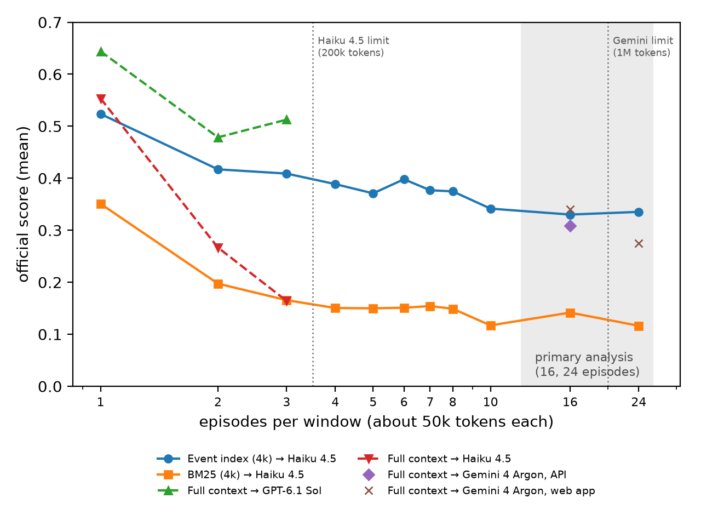
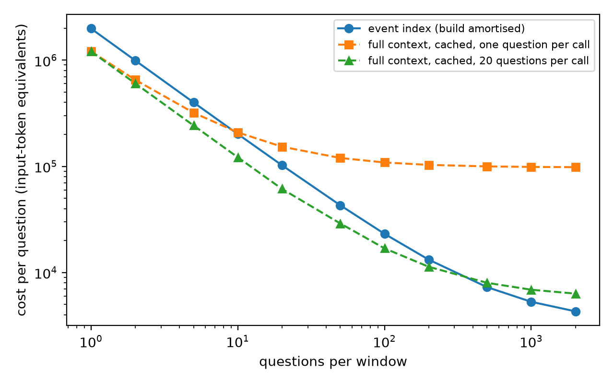

# Supplementary material for "Entity and Event Indexes for State, Continuity and Counting Questions over Verbatim Million-Token Records"

This supplement gives the details of the benchmarks, the memory implementations, every experiment and the limitations, followed by Appendices A–D and a list of the works cited in this supplement. Section and appendix references point inside this supplement unless stated otherwise; Table S1 gives the correspondence with the main paper.

*Table S1.* Correspondence between the sections of this supplement and of the main article.

| This supplement | Main paper |
|---|---|
| Section 3 Benchmarks | Section 3 |
| Section 4 Methods compared | Section 4 (Table 1) |
| Section 5 Memory (implementation details, version history) | Section 5 |
| Section 6.0 Development and test data | Section 6 |
| Sections 6.1–6.10 Experiments (full tables, all paired tests) | Section 7 |
| Section 7 Limitations (full) | Section 8 |
| Appendices A–D | cited as Supplementary Appendix A–D |

*Table S2.* World names and generator seeds of LongState-Saga.

| Name | Generator seed | Use |
|---|---|---|
| D1–D6 | 1–6 | development of the methods |
| T1–T2 | 7–8 | test of the entity index |
| E1–E2 | 9–10 | development of the event index |
| E3–E4 | 11–12 | test of the event index |

Data identifiers keep the seed (saga_v5_s7 is world T1).

Terms: the *certificate* in this supplement is the *completeness statement* of the main paper; *full-context reading* means giving the reader the whole record or window; Haiku, GPT, Argon and Sonnet stand for Claude Haiku 4.5, GPT-6.1 Sol, Gemini 4 Argon and Claude Sonnet 5.5.

## 3 Benchmarks

### 3.1 LongState-Saga

**World.**
- Ten families of three generations (four in worlds D2, T1 and T2), with fictitious names to prevent recall from pre-training.
- First names deliberately shared across families, and epithets ("Old Ismor").
- 16 places, 12 named objects and 8 secrets.
- Three rules:
  - a vault opens only for a living person holding two specific objects;
  - a toll bridge may be crossed only by those born into a family or presently married into it;
  - an heirloom passes on death to the holder's eldest living child, a transfer that is never narrated.

**Dynamics.** A seeded simulator runs 40 chapters of events:
- moves, marriages, deaths, births, gifts and inheritances;
- secrets told, promises made, kept or broken;
- changes of trade;
- false rumours (e.g. that a living person drowned);
- plans that were never carried out.

Each event updates an exact world state and records the state's history.

**Rendering.** Each event is rendered once into prose with varied templates. People are referred to by full name, unique first name, nickname, or a relational description that is unique at that time ("the second daughter of Thiric Corrwood", "the husband of Karine Prydaby"). Every non-name reference records the events needed to resolve it, and gold evidence is closed over these dependencies.

The record is then assembled at a filler density *d* (filler units per event), following BABILong's construction of padding fixed facts with unrelated text (Kuratov et al., 2024); unlike BABILong, the padded content is a single evolving world, and evidence ids are closed over the references needed to interpret them. Filler mixes state-neutral sentences that mention people present in the scene with paragraphs of public-domain novels. Event text, event order and questions are identical across densities. World D1 gives 11k, 43k, 131k, 522k and 1.99M tokens at *d* = 0, 1, 4, 16, 64.

**Questions.** Before exclusions, 261–262 per world in worlds D1–D3 and 267 and 270 in worlds T1 and T2, in 14 types:
- current residence; residence at the time of another person's death;
- current spouse; alive (including targets of false death rumours);
- current and previous holder of an object (including inheritance by rule);
- a paternal or maternal grandparent (one type);
- whether a person knows a secret;
- promise status;
- vault and bridge rule application;
- whether a person ever lived somewhere (versus only planned to);
- birthplace (including "unknown");
- current trade.

Answers are canonical strings scored deterministically. A hedged answer that also names another person is scored wrong.

**Validation and answer-key revisions.** We read every error a strong reader (Claude Haiku 4.5) made when given the oracle evidence and fixed the generator or the key; the revision history is in Appendix A. Questions found ill-posed are excluded, with the reason recorded per question. The excluded cases are:
- residence of children after their parents move, which the text never narrates;
- knowledge or pending promises of people who died;
- marital questions after a move narrated as following a quarrel.

After exclusions, the final key keeps 218/218/222 questions in worlds D1/D2/D3. With the oracle evidence and a completeness statement, Haiku answers 99.1% of world D1 correctly.

**Splits.** Worlds D1–D3 are development worlds (Section 6.0).

**Robustness variant.** In real prose, facts are often stated in paragraphs that refer to their subject only by a pronoun. The *pronoun variant* rewrites 18% (world D1, 71/392) and 24% (world D2, 94/399) of story events so that a fact-free paragraph names the actor and the fact follows in a paragraph beginning with *He* or *She* (Section B.5).

### 3.2 LongState-Continuity and LongState-Aggregate

Both are built on the saga worlds; their construction and checks are in Sections 6.2 and 6.3 and Appendix A.5–A.6.

### 3.3 Oolong-real

Oolong-real (Bertsch et al., 2026; arXiv:2511.02817v2, checked against the full text) asks aggregation questions over transcripts of the tabletop game show Critical Role:
- counts of dice rolls or spells, in total, per character or player, per roll type or natural value;
- cumulative counts "by the end of episode k";
- the first or k-th spell, and the most or least common roll type or spell.

A context window holds 1–24 episodes of the campaign, which need not be consecutive broadcast episodes; in the questions and the aggregates, "episode k" is the k-th episode within the window, not the broadcast number (about 31k to 1.25M cl100k tokens). The gold answers come from a fan-maintained tally (CritRoleStats) made from the broadcasts, aligned with the CRD3 transcripts (Rameshkumar & Bailey, 2020); the benchmark authors describe the cleaning this needed (repeated mentions, damage discussion, cancelled rolls), so some tallies may be hard to reconstruct from the text alone. We did not check the transcripts against the tally row by row. We use the authors' scoring rule, re-implemented from their evaluation code (commit 0bb7eab): the answer is taken from `\boxed{}`; a number scores 0.75^|error|, a string scores by exact match, a list by the share of gold items it contains, and an answer without a box is scored as raw text.

We use the validation split (campaign 2) for development and the test split once, with the first 20 questions by identifier in every window (110 windows, 2,200 questions). Windows of the same size share episodes, so intervals come from a bootstrap over windows and are conditional on these windows.

## 4 Methods compared

All methods answer through the same reader prompt and receive an evidence budget of 4,000 tokens per question (cl100k; OpenAI, 2022). The budget limits the retrieved or packed text. Section headers, paragraph labels and the question are added afterwards, so the rendered user input is not capped exactly.

Measured rendered inputs (worlds T1–T2, 0.5M, mean per question):
- 3,974 tokens for paragraph BM25;
- 4,095 for CMM v4;
- 4,157 for chunk BM25;
- 4,422 for the state ledger, whose fact labels add the most.

All tables report these measured means. Three exceptions are noted:
- full-context reading reads everything;
- oracle reads only the gold evidence;
- the adaptive and re-reading variants spend more by design.

The conditions are:
- **Recent**: the last 4k tokens of the record.
- **Full**: the whole record, where it fits the reader's window.
- **Rolling summary**: notes of fixed size, rewritten after every 3k-token segment by the builder model and cut to the budget.
- **Fact store** (Mem0-style; Chhikara et al., 2025): (subject, relation, object, status) facts extracted per segment, retrieved by BM25 and shown in chronological order.
- **BM25 / dense / hybrid**: 300-token chunks; BM25 (Robertson & Zaragoza, 2009); dense embeddings from Qwen3-Embedding-0.6B (Zhang et al., 2025; Qwen Team, 2025c); hybrid uses reciprocal rank fusion (RRF; Cormack et al., 2009).
- **Paragraph BM25**: BM25 over paragraphs.
- **NameGrep**: every paragraph that contains a proper name copied from the question, with a completeness statement for that exact string. **NameGrep+co** adds the first and latest paragraphs of people co-mentioned with the queried names, using a zero-cost capitalised-name registry. Neither needs an LLM.
- **Hybrid+claim**: hybrid retrieval with an *unverified* completeness statement. This controls for the confidence effect of the statement alone.
- **Gold-evidence chunks (± guarantee)**: the 300-token chunks containing the gold evidence, without and with a true completeness statement.
- **Gold-evidence paragraphs (± guarantee)**: only the paragraphs that contain the gold evidence.

These conditions are *not* upper bounds. Minimal gold evidence omits the rest of an entity's history. A careful reader then cannot rule out a later change, so it abstains. On the held-out worlds, a strong reader given the entity's *complete* paragraph history (CMM) outperforms the same reader given only the gold paragraphs (Section B.3).
- **Closed book**: no record at all. Used on real novels to measure what the reader already knows from pre-training.
- **State ledger** (extraction-based competitor in the style of Mem0 and MemStrata; Chhikara et al., 2025; Yadav, 2026). At write time the builder extracts `subject | attribute | value | status` lines from each 1,500-token segment, resolving pronouns and descriptions to names. It is given a suggested attribute vocabulary for people, objects and rules (lives in, married to, holds, knows, promised, rule, …). No raw text is kept. At query time the facts about the entities named in the question are shown grouped by subject and attribute in record order. The last entry of each group is marked *(latest)*, a deterministic supersession over attribute synonyms (e.g. *lives in / moved to / location*). The remaining budget is filled by BM25 over all facts. Its build costs about as much as CMM's write pass ($1.6 at 484k tokens).
- **Re-read on "unknown"**: CMM v4, paragraph BM25 or hybrid retrieval, run once more at three times the budget when the reader answers "unknown" or gives no answer; reader tokens count both readings. This model-side trigger, in the style of adaptive retrieval, is the alternative to CMM-adaptive's certificate trigger (Section 6.6).
- **CMM** and its ablations (Section 5).
- **Event-type index** (Section 5.2).
- **Post-hoc baselines** (Section 6.1): re-implementations of HippoRAG 2 (Gutiérrez et al., 2025) and contextual-header retrieval (Anthropic, 2024), built by GPT-6.1 Sol, and of small-to-big retrieval (LlamaIndex, n.d.), which needs no generative builder.

## 5 Memory

### 5.1 Certified Mention Memory (entity index)

**Raw store.** The record is kept verbatim. The unit of recall is the paragraph, with absolute character spans.

**Write time.** For each segment of about 1,500 tokens, the builder lists:
- names (`N|excerpt|name|type`);
- alias declarations (`A|alias|name`);
- referring phrases, which refer to an entity by description instead of by name (`R|excerpt|phrase`).

No facts are extracted. The output is short, so this pass is cheap and parallel.

**Idle time (consolidation).**
1. *Grounding.* A name or alias enters the registry only if it occurs verbatim, case-sensitively, in the record.
2. *Type verification by consistency.* An entity's type is the majority of the types assigned at its write-time occurrences. A "person name" containing lower-case words is a description and is moved to the referring phrases. An alias whose extra words are not another person's surname is an epithet, and the registry entry it created is demoted to an alias.
3. *Anchored reference detection and resolution.* Referring phrases come from the write-time R lines, plus every occurrence of the generic English constructions "the ⟨1–4 words⟩ of ⟨verified person⟩" and "⟨verified person⟩'s ⟨1–2 words⟩". Each occurrence is resolved by the builder from the paragraph where it occurs, the paragraphs that introduce the named anchors, and the four anchor paragraphs that precede it. Rumours are not facts.
4. *Exhaustive mention scan.* Every paragraph containing a registry name, a registered alias or a resolved phrase is indexed under its entity.
5. *Co-mention links* between verified persons.

**Query time.**
- **Entity mapping.** Entities named in the question, or their aliases, are mapped to the registry.
- **Within budget.** If all their paragraphs fit in 85% of the budget, the reader receives them in record order, under a statement of exactly what is guaranteed: *all paragraphs in which X is named or referred to by name, alias or resolved description; events that affect X without naming X appear only under the other person.*
- **Linked people.** Next come the first and latest paragraphs of linked people, up to 35% of the budget. They are ranked by co-mentions, with bonuses for co-mention in the entity's introduction and in its three latest paragraphs. From v4 on, the introductions (first paragraphs) of the people named in the entity's own introduction come first. Introductions state identity and relations such as parents, employer or owning module, so these are the paragraphs a two-step relational question needs. An entity's introduction is its first two indexed paragraphs; a linked person's introduction is that person's first indexed paragraph. "First" is selection priority: the selected paragraphs are shown in record order within their blocks.
- **Fill.** Any remaining budget is filled by paragraph BM25. The lean variant **CMM-lean** omits this fill.
- **Over budget** (no guarantee is given). The packing differs by version (the failures that led to each change are in Sections B.2, B.6 and B.8):
  - v1: the entity's first paragraph and its most recent ones. On development novel set A this scored 24.2%: main characters are named in thousands of paragraphs, so recency packing showed only the end of the book (Section B.6).
  - v2: first and two latest paragraphs, then the entity's paragraphs ranked by BM25 relevance to the question. It recovered on set A (60.8%) but stayed below hybrid retrieval on set B (54.8 against 64.1; Section B.6).
  - v3: relevance is the reciprocal rank fusion of BM25 and dense scores, and candidates also include the 300 globally top-ranked paragraphs. This matters when a protagonist is named in thousands of paragraphs. On set A it reached 65.5, level with hybrid retrieval (66.1).
  - v4: v3, plus up to 12% of the budget reserved for the introductions of the people named in the entity's introduction. It answers the two-step kinship failure of v2 on worlds D4–D5, where the parents' introductions were crowded out when the person's own paragraphs exceeded the budget (Haiku: 49% on grandparent questions against 97% for NameGrep+co; Sections B.2 and B.8).
- **Adaptive budget** (CMM-adaptive). If no guarantee can be given at the base budget although the question names indexed entities, the context is rebuilt once at three times the budget. Questions whose entity set fits pay nothing extra. The guarantee thus decides when a question deserves more reading. The rebuild happens before the reader is called. A question in which no registry name or alias of at least four characters is found gets hybrid paragraph retrieval over the whole record (the v3 ranking with an empty entity set) at the base budget and is not rebuilt.
- **Implementation limits** (methods/cmm.py). Reference resolution sees at most 20 context paragraphs per phrase; the general co-mention list of linked people includes only persons named in at most 200 paragraphs (the v4 introduction path has no such limit: it takes the first paragraph of every person named in the first two paragraphs of a queried entity); in v3 and v4 the first-and-latest-paragraph priority of the over-budget case applies only to entities named in at most 400 paragraphs; cards are shown only for entities named in at most 300 paragraphs, and at most three cards are shown per question (cards for all eligible entities are generated or looked up before the list is cut to three).
- **Ranking and budget flow of v4** (methods/cmm.py, pack_v4). BM25 is scored on paragraphs; each paragraph inherits the dense score of its 300-token chunk. With zero-based ranks the fused score is 1/(60 + r_BM25) + 1/(60 + r_dense); the 300 global candidates are chosen by this score alone, and in the final candidate set a paragraph indexed under a queried entity gets +0.01 and one indexed under at least two queried entities another +0.01. Over budget, the first and two latest paragraphs of queried entities named in at most 400 paragraphs come first, then introductions within an allowance of 12% of the paragraph budget on top of them, then the ranked candidates until about 85% of the budget is used, then linked paragraphs up to the full budget; this branch leaves no budget for a separate BM25 fill. Within budget, linked paragraphs use at most the smaller of the remaining budget and 35%, and the BM25 fill runs only when more than 200 tokens remain. When cards are shown, their tokens are deducted first and the fractions apply to the remaining paragraph budget (at least 800 tokens).

**Variants.**
- **CMM-nocert**: the same packing code with the statement removed. Because of the tie-breaking described below, the packed paragraphs are not guaranteed to be identical to those of the matching CMM run.
- **CMM+cards**: on the first question about an entity that shows cards, the builder writes a profile card from its most recent paragraphs (up to about 9k tokens) plus its first two, and the first 16 paragraphs of the list of linked people's first and latest paragraphs. The card covers relations two steps away, the current value of every changing state with paragraph citations, and the history of changes. It is cached and its cost is amortised; it is written at that first question, not precomputed at idle time. The header shown to the reader says the card was consolidated from all paragraphs naming the entity, even when the builder saw only the selected first and recent paragraphs; card results should be read with this in mind.
  - In v1 and v2 the card is always shown.
  - From v3 on it is shown only when the question asks about a present or final state. This is detected by a fixed list of English cues (*now, currently, current, at the end, still, latest, presently, today, these days*), extended in v4 with *by the end, as of, so far, anymore, any longer, yet*. On real novels, always-on cards displaced scene paragraphs (Section B.6).
- **CMM+pron**: paragraphs that open with a third-person pronoun right after a paragraph naming a person are indexed under that person.

**What the guarantee means.** It is a *mention-completeness* guarantee relative to the verified registry. It does not guarantee state completeness. Appendix B.3 reports three separate checks: whether the certified block holds every core evidence event in which the queried person takes part, whether it holds all core evidence, and whether the whole delivered context does.

**Determinism.** Ties between registry names of equal length, and between linked people, are broken in Python's set-iteration order, which changes with the per-process hash seed. Rebuilding the contexts offline under hash seeds 0 and 1 (Python 3.14.4) changes the packed paragraph list of 19 of the 208 continuity questions of world T1 with v4 and 26 with the adaptive variant, or 27 and 35 if any change in the context text (such as the order of names in the header) is counted; the baselines are unaffected under either count. Each reported CMM run is therefore one draw of this tie-breaking (methods/tiebreak_context_check.py measures how much the contexts change).

### 5.2 Event-type index

The entity index answers "everything about X". Counting, listing and absence questions ("how many births in the Harrow family", "who died between chapters 10 and 20") name no single entity. They need every passage that narrates one *kind* of event, and a statement that the set is complete.

**Saga form (paragraph sets).**
- *Write time.* For segments of about 800 tokens of labelled paragraphs, the builder lists every change a paragraph reports: `E|¶n|event kind|status|who|where`. The status is *narrated* (the text states that it happens), *reported* (rumoured, claimed or planned) or *earlier* (it happened before the record begins). States, opinions and scenery are not events; the example kinds in the prompt are generic. Implied changes are listed too (a burial implies a death).
- *Idle time.* A line counts only if its paragraph lies in its segment (grounding). One builder call groups kind labels that name the same kind of event. A second call (v5) states which kinds necessarily include another listed kind ("an event of kind B cannot happen to someone unless an event of kind A happens to them": burial → death, execution → death); a paragraph with a B event then also counts as an A event of the same status.
- *Query time.* One routing call maps the question to the kinds it counts, lists or orders, and to the names (families, people, places) that restrict them; only strings that occur in the question are accepted, and the reader's answer is never seen. The selected set is every paragraph with a narrated event of those kinds that matches a restricting name in the text or among the people the identity index (CMM) resolved in it. It is shown in record order, each paragraph followed by the resolved people, under a statement that the set is complete or that there is no such event. Paragraphs where the kinds are only reported or earlier follow, labelled as such; CMM v4 fills the rest of the budget. If the set exceeds 60% of the budget, no statement is given and the paragraphs most relevant to the question are kept.

- *Versions* (v1–v4 developed on worlds D4–D5; methods/eventindex.py). v1 mapped the question to event kinds only, without restricting names. v2 added the restricting names, the people resolved by CMM and an explicit "no such event": about 40% of death sentences and most wedding sentences name a person by first name only, so a count per family needs identity resolution. v3 made the write prompt name the change itself rather than its cause and keep *earlier* for explicit statements (in world D4, v2 had tagged 5 of 21 deaths by their cause and 2 as earlier), and reduced restricting names to the proper names they contain. v4 also lists implied changes, uses segments of about 800 tokens and includes related kinds; it was kept over v3 for its higher G2 total on worlds D4–D5 (56 of 75 against 55), frozen and tested on the new worlds E1–E2 (68.0 Haiku, 73.3 GPT). There the selected set was complete for only 1 of 10 death-total and death-per-chapter-range questions: "a fever took X; X was buried" was tagged as illness and burial, and routing chose only death. v5, motivated by this failure on E1–E2, adds the implication call of the idle-time step; it was kept because its G2 total on worlds D4–D5 exceeded v4's (67 against 56), frozen and tested on worlds E3–E4. On E1–E2, v5 scores 76.0 (Haiku) and 84.0 (GPT).

**Transcript form (aggregates).** In an Oolong window there are thousands of events, so they are counted rather than shown.
- *Write time, once per episode.* The transcript is cut into chunks of about 1,500 tokens of numbered lines. The builder lists every roll and every spell: `R|line|player|character|roll type|natural value|total` and `S|line|player|character|spell|level`. A line counts only if its number lies in its chunk.
- *Idle time.* Each player's character in that episode is fixed by majority over the lines that name it (the window header maps players to their campaign-final characters, which is wrong for early episodes).
- *Reuse.* Episode tables are cached by text hash and reused by every window that contains the episode, so write cost scales with the number of distinct episodes, not with windows or questions.
- *Query time.* One routing call maps the question to the event kind (rolls or spells) and the episode range (one episode, episodes 1 to k, or the whole window). The aggregates of that range are computed exactly from the tables (totals, per episode, by character, by player, by roll type, by natural value, by spell, and the spells in order) and given to the reader under a statement that they come from a complete index of the transcripts. Two limits apply to what the reader receives: each by-kind list keeps its 60 most frequent entries, and the context is cut to its first 4,000 tokens. On the 2,200 test questions the cut applied to 133 (all spell questions on 16- and 24-episode windows; longest uncut context 7,156 tokens), and a list was shortened for 975 (516 spell, 459 roll questions; the same spells can remain in the ordered list). The completeness statement was not removed in these cases, so "complete" holds for the tables, not always for the context.

Both forms keep the record verbatim. The saga form stores only where events are and what kind they are; the transcript form is an attribute table extracted per event (player, character, roll type, natural value and total, spell name and level), whose character field is filled from the idle-time vote only where the extraction left it empty.

## 6 Experiments

**Readers:**
- Qwen3-8B and Qwen3-14B (Yang et al., 2025; Qwen Team, 2025a, 2025b), local through Ollama (Ollama, 2023), temperature 0, thinking off;
- Claude Haiku 4.5 (Anthropic, 2025b) via the API, thinking and prompt caching off (the model has no effort setting);
- GPT-6.1 Sol (OpenAI, n.d.) through the Codex command-line client (OpenAI, 2025), reasoning effort low;
- for replication, Gemini 4 Argon (Google, 2026; low reasoning) and gpt-oss-120b (medium) through the Antigravity command-line client.

**Builder:** Claude Haiku 4.5 builds every memory, so memories are identical across readers, except where a section says otherwise: cards written by Qwen (Section B.7), the GPT compactor (Section 6.7) and the GPT verifier of the idle-time index review (Section 6.10).

**Hardware:** an RTX 5080 (16 GB) and an RTX 5060 Ti (16 GB); models larger than one card were split over both.

**Cost is reported as:**
- reader-input tokens per question (cl100k, method-dependent);
- billed USD at list price, after subtracting the constant overhead of the command-line client;
- build, idle and lazy (card) costs per record.

**Statistics:**
- Questions about the same person share evidence, so 95% confidence intervals for accuracies and paired differences come from a cluster bootstrap that resamples question subjects (each subject identified within its world) from the pooled questions (2,000 resamples; not stratified by world).
- Paired method comparisons use exact McNemar tests (McNemar, 1947), pooled over worlds by summing discordant counts. p-values are Holm-corrected (Holm, 1979) over each family of comparisons reported in a table; uncorrected values are given where noted.
- Per-world accuracies are reported alongside pooled ones, because world-to-world variation is comparable to many method differences (e.g. full-context reading: 95.0 vs 89.1 on worlds D2 and D3).

### 6.0 Development and test data

The methods were developed on part of the data and tested on data that no design decision used (Table S3). Each revision of a method was designed on data that had been evaluated with the previous frozen version; such data count as held-out for that earlier version only.

*Table S3.* Data used to develop the methods and data used to test them.

| Data | Role |
|---|---|
| Saga world D1 (11k–2M tokens) | development of CMM v1 |
| Saga worlds D2–D3 (44k, 494k, 1.9M) | first evaluated with the frozen CMM v1; then development of v2 and v4 |
| Saga worlds D4–D5 (470k, 1.84M) | first evaluated with the frozen CMM v2, where the two-step kinship failure that led to v4 was found; development of event index v1–v5 |
| Saga world D6 (length series, 11k–142k) | development: where memory starts to pay off; compaction analysis |
| Novels A (4 books) | first evaluated with the frozen CMM v1; then development of v2 and v3, and a check of v4 |
| Novels B (3 books) | first evaluated with the frozen CMM v2; then development of the card gating of v3 |
| Saga worlds T1–T2 (0.5M, 1.9M) and the names-free filler variant of world T1 | test of CMM |
| Novels C (3 books), LongState-Code seeds 2–3, LoCoMo | test of CMM |
| Worlds E1–E2 | test of the frozen event index v4; then development of v5 (Section 5.2) |
| Worlds E3–E4 | test of event index v5 |
| Oolong-real validation split / test split | development / test of the transcript index |
| AMA-Bench development and validation trajectories / new trajectories | development / test of the address index (Appendix C) |

**The core comparison.** Section 6.1 evaluates CMM v4 and the baselines on the test data. Numbers from development data, among them several in Sections B.1–B.9, describe development, not generalisation. On AMA-Bench every method answers with the same domain-neutral reader instruction.

**Further conditions.** The conditions in Table S4 answer questions raised by the results. They are diagnostics or additional baselines, not part of the method.

*Table S4.* Conditions beyond the core comparison, with their data and role.

| Condition | Data | Role |
|---|---|---|
| Storage-time ablations of v4 | worlds T1–T2 | diagnostics |
| Reader-triggered re-reading at three times the budget | worlds T1–T2, novels C | baseline |
| Compaction 4k/16k, GPT compactor, question-aware compaction, full-summary reading | all test domains | baselines and diagnostics |
| Reading-order control, compacted summary as a map, verified and corrected cards, idle-time index review, question before and after the context | development and test worlds | diagnostics |
| CMM without the completeness statement, budget-matched baselines at 8k, status-aware fact ledger | worlds T1–T2 | diagnostics and baseline |
| Second judge, checks of the judge, AMA-Bench gold-answer audit | free-form domains | checks of the evaluation |
| Budget sweep with GPT and Sonnet as readers | worlds T1–T2 | replication of the Haiku budget sweep |

### 6.1 State tracking on held-out worlds

**Budgets and statistics.** Reading budgets are counted in cl100k tokens of the context. The full tables, with 95% subject-cluster bootstrap confidence intervals (2,000 resamples) and Holm-corrected exact McNemar tests, are in paper/tables_final.md.

At about 0.5M tokens (459 questions), with about 4k reading tokens (Table S5):

*Table S5.* State tracking at about 0.5M tokens (459 questions, about 4k reading tokens): accuracy (%) by reader.

| Method | GPT-6.1 Sol | Haiku 4.5 | Qwen3-14B | Qwen3-8B |
|---|---|---|---|---|
| CMM v4-adaptive (6.2k tokens) | 96.9 | 95.2 | 65.1 | 60.3 |
| CMM v4 | 96.7 | 94.3 | 65.4 | 58.4 |
| Paragraph BM25 | 90.6 | 88.2 | 68.0 | 59.7 |
| Hybrid retrieval (chunks) | 82.6 | 77.1 | 62.1 | 61.0 |
| State ledger (extracted facts) | 74.7 | 71.0 | 61.2 | 55.3 |

Accuracy at different reading budgets, with three readers (Table S6; methods/budget_sweep_report.py, runs/budget_sweep_SETTINGS.md, paper/tables_budget_sweep.md):

*Table S6.* State tracking on worlds T1–T2 (459 questions): accuracy (%) by reading budget and reader. Haiku 4.5 has no effort setting and runs with extended thinking off; GPT-6.1 Sol runs at reasoning effort low; Claude Sonnet 5.5 runs at effort high, its thinking adaptive and set by the effort level. Memories are built by Haiku for all readers. The mean rendered input per question is within 5% of the budget for every method.

| Reader | Method | 2k | 4k | 8k | 16k |
|---|---|---|---|---|---|
| Haiku | CMM v4 | 91.5 | 94.3 | 93.7 | 93.7 |
| | Paragraph BM25 | 86.9 | 88.2 | 89.8 | 89.1 |
| | Hybrid retrieval | 69.5 | 77.1 | 85.2 | 85.6 |
| GPT | CMM v4 | 95.2 | 96.7 | 96.9 | 97.4 |
| | Paragraph BM25 | 90.2 | 90.6 | 91.9 | 93.7 |
| | Hybrid retrieval | 72.3 | 82.6 | 88.9 | 91.1 |
| Sonnet | CMM v4 | 93.9 | 96.1 | 96.7 | 97.2 |
| | Paragraph BM25 | 88.9 | 89.5 | 91.3 | 92.6 |
| | Hybrid retrieval | 71.9 | 81.3 | 88.7 | 90.2 |

**Strong readers.** Adaptive CMM is significantly better than paragraph BM25, hybrid retrieval and the fact ledger (Holm-corrected over the 48 tests of the table). Against hybrid retrieval it wins 89 questions and loses 6 with Haiku, and wins 68 and loses 2 with GPT.

It is not significantly better than v4 without the adaptive budget, nor than name search with co-mentioned people (NameGrep+co: 24/11 with Haiku, 8/5 with GPT). CMM at 4k is significantly more accurate than paragraph BM25 at 16k with each reader: Haiku 94.3 against 89.1 (+31/−7, p < 0.001; difference 5.2 points, 95% subject-cluster bootstrap confidence interval 2.6–8.0), GPT 96.7 against 93.7 (+17/−3, p = 0.003; 3.1 points, 1.1–5.2) and Sonnet 96.1 against 92.6 (+21/−5, p = 0.002; 3.5 points, 1.3–5.9). At 2k it is still ahead of paragraph BM25 at 16k (91.5 against 89.1, 95.2 against 93.7 and 93.9 against 92.6), but not significantly (p = 0.16, 0.25 and 0.39); against paragraph BM25 at 8k it is significantly ahead only with GPT (95.2 against 91.9, +24/−9, p = 0.014; Haiku p = 0.34, Sonnet p = 0.081). With GPT and Sonnet, paragraph BM25 gains more from 2k to 16k than with Haiku (+3.5 and +3.7 points against +2.2), and hybrid retrieval gains 16–19 points with every reader, but CMM v4 is ahead at every budget with every reader, and all 24 same-budget comparisons are significant (exact McNemar, Holm correction over the 11 tests of each reader). Its gain over paragraph retrieval is therefore not a matter of reading more.

**Weak readers.** For the Qwen readers no method without consolidation is reliably better than paragraph BM25. They fail on use rather than on retrieval (Section B.2). Consolidation by Haiku does help them: Qwen3-14B reaches 81.7 with v2+cards and 75.6 with v4+cards, and Qwen3-8B 67.5 with v2+cards, against paragraph BM25 at 68.0 (Qwen3-14B) and 59.7 (Qwen3-8B) (82/19, 64/29 and 71/35; exact McNemar p = 2×10⁻¹⁰, 4×10⁻⁴ and 6×10⁻⁴, below 0.05 after Bonferroni correction (Dunn, 1961) over the 48 tests of the table). v4+cards with Qwen3-8B is not (65.8).

**At about 1.9M tokens.** The same 459 questions were also asked over the 1.9M-token versions of worlds T1 and T2 (1.91M and 1.92M tokens). Qwen3-8B was not run at this length, and Qwen3-14B only with the methods shown (Table S7):

*Table S7.* State tracking at about 1.9M tokens (worlds T1–T2, 459 questions): accuracy (%) by reader.

| Method | GPT-6.1 Sol | Haiku 4.5 | Qwen3-14B |
|---|---|---|---|
| CMM v4-adaptive (9.2k tokens) | 95.0 | 92.4 | – |
| CMM v4 | 93.2 | 89.3 | 67.3 |
| CMM v4+cards (Haiku-written) | – | 90.0 | 73.0 |
| NameGrep+co | 89.8 | 86.9 | – |
| Paragraph BM25 | 89.1 | 86.1 | 63.8 |
| Hybrid retrieval (chunks) | 75.4 | 72.8 | 55.6 |
| State ledger (extracted facts) | – | 63.2 | 51.9 |

- From 0.5M to 1.9M, CMM v4 loses 3.5 (GPT) and 5.0 (Haiku) points, paragraph BM25 1.5 and 2.2, and hybrid retrieval 7.2 and 4.4.
- The guarantee now holds for 30.9% of questions (67.5% at 0.5M), and the adaptive budget matters. Adaptive CMM beats v4 (8/0 with GPT, 19/5 with Haiku) as well as paragraph BM25, NameGrep+co, hybrid retrieval and the ledger (Holm-corrected over the 13 tests of the full table). It does not significantly beat v4 with cards (90.0; 18/7). This repeats the development result at 1.9M (Section B.9) on worlds not used in any design decision. Adaptive CMM reads 9.2k tokens against about 4k for the others; Section 6.6 compares it with a cheaper trigger.
- At the same 4k budget, v4 beats paragraph BM25 with GPT (+22/−3, p < 0.001) and with Haiku (+29/−14, p = 0.03; exact McNemar, uncorrected).
- For Qwen3-14B, Haiku-written cards help (73.0 against 67.3; +44/−18, p = 0.001), and v4 is not significantly better than paragraph BM25 (+45/−29, p = 0.08).

**Post-hoc baselines** (settings in release/ADDED_BASELINES_SETTINGS.md; same reader prompt and 4k budget). HippoRAG 2 and contextual retrieval were built by GPT-6.1 Sol, a stronger model than our Haiku-built indexes; small-to-big uses the shared paragraph embeddings and no generative builder. Accuracy %, continuity as pair accuracy; w/l and exact McNemar p against CMM v4 (state, continuity) or event index v5 (counting), Holm-corrected over the 18 added comparisons together (3 baselines × 3 tasks × 2 readers); correcting instead within each reader and task, with or without the earlier baselines, changes no conclusion (Table S8):

*Table S8.* Post-hoc baselines with the same reader prompt and 4k budget: accuracy (%) by task and reader.

| Task (reader) | Our index | HippoRAG 2 (re-impl.) | Contextual retrieval (re-impl.) | Small-to-big (re-impl.) | Paragraph BM25 | Hybrid retrieval |
|---|---|---|---|---|---|---|
| State, 459 q (Haiku) | 94.3 | 88.7 (36/10, p = 8×10⁻⁴) | 78.0 | 75.8 | 88.2 | 77.1 |
| State (GPT) | 96.7 | 92.4 (24/4, p = 8×10⁻⁴) | 81.3 | 78.9 | 90.6 | 82.6 |
| Continuity, 216 pairs (Haiku) | 90.3 | 77.8 (39/12, p = 8×10⁻⁴) | 70.4 | 68.5 | 81.0 | 69.0 |
| Continuity (GPT) | 99.1 | 87.5 (26/1, p = 2.5×10⁻⁶) | 73.6 | 69.4 | 91.2 | 71.8 |
| G2 counting, 75 q (Haiku) | 78.7 | 58.7 (20/5, p = 0.008) | 32.0 | 28.0 | 41.3 | 25.3 |
| G2 counting (GPT) | 73.3 | 57.3 (18/6, p = 0.023) | 28.0 | 26.7 | 37.3 | 30.7 |

Contextual retrieval and small-to-big are significantly below our index in every cell (p < 10⁻⁷ under the same correction). All three are our re-implementations with one fixed setting each, while CMM went through several development versions; the result is a comparison with these re-implementations (differences from the original systems in Section 7 of this supplement), and building them with a stronger model does not by itself make the comparison conservative. HippoRAG 2 is the strongest added baseline; it is close to paragraph BM25 on state tracking and above it on counting, and below our index everywhere.

**Replication across reader families** (state tracking and continuity, worlds T1–T2; Gemini 4 Argon at low reasoning through the Antigravity client, gpt-oss-120b at medium; methods/agy_replication_report.py; Table S9):

*Table S9.* Replication across reader families: state tracking and continuity on worlds T1–T2.

| Reader | State: CMM / paragraph BM25 / hybrid | Continuity pairs: CMM / paragraph BM25 / hybrid |
|---|---|---|
| Haiku 4.5 | 94.3 / 88.2 / 77.1 | 90.3 / 81.0 / 69.0 |
| GPT-6.1 Sol | 96.7 / 90.6 / 82.6 | 99.1 / 91.2 / 71.8 |
| Gemini 4 Argon | 97.4 / 91.5 / 81.0 | 91.2 / 88.0 / 73.6 (CMM vs BM25 13/6, p = 0.17) |
| gpt-oss-120b | 92.6 / 83.4 / 76.9 | 86.1 / 85.6 / 63.9 (CMM vs BM25 16/15, p = 1) |

- State tracking: CMM > paragraph BM25 > hybrid retrieval with all four reader families (all significant).
- Continuity: CMM > hybrid with all four; CMM significantly above paragraph BM25 only with Haiku and GPT (its score is also higher with the two replication readers, not significantly). The continuity claim against paragraph retrieval is therefore limited to those two readers.
- Counts are over the questions answered under every method by that reader: 459 state questions and 216 continuity pairs for each reader (paper/tables_replication_4readers.md).

### 6.2 Continuity checking: does a drafted continuation contradict the record?

**Task.** A writer continuing the record drafts a paragraph about the end state of the world. The system must say whether it is consistent with the record or contradicts it. Contradictions are of two kinds:
- stale: a value that was true earlier and has since changed (a former residence, spouse, holder or trade, or a person who has died);
- never true.

**Paired design.** Each item comes in a minimal pair with the same sentence template and, where the type allows, the same subject: one member is consistent, the other contradicts.
- Labels are derived from the world state. Our checker parses every paragraph and re-derives its label, with zero disagreements; a second, independent re-derivation agreed on all 432 labels.
- A reader that always gives the same verdict scores 0% pair accuracy, and one that guesses each item at random scores 25% in expectation.
- Without the record, the readers give no informative verdict (J between −1.9 and 0.5).

The verdict is the first word of the answer line, for both accuracy and J.

**Results.** Worlds T1 and T2, about 0.5M tokens each, 216 pairs. J = true-positive rate (TPR) − false-positive rate (FPR) on 'contradiction' (Table S10):

*Table S10.* Continuity checking on worlds T1–T2 (216 pairs): 100 × J by reader.

| Method | Haiku 4.5 | GPT-6.1 Sol | Qwen3-14B | Tokens per question |
|---|---|---|---|---|
| CMM v4 | 90.3 [86, 94] | 99.1 [98, 100] | 38.9 | 4.2k |
| CMM v4 without the completeness statement | 89.8 | 97.7 | – | 4.2k |
| CMM v4 at 8k | 90.7 | 97.7 | – | 8.2k |
| CMM v4 + idle-time index review | 91.7 | – | – | 4.2k |
| CMM v4 + cards (Haiku-written) | 87.0 | 96.8 | 70.4 | 4.2k |
| NameGrep+co | 81.9 | 93.1 | 39.4 | 4.1k |
| Paragraph BM25 | 80.1 | 91.2 | 40.7 | 4.0k |
| Paragraph BM25 at 8k | 84.7 | 96.3 | – | 7.9k |
| Gold evidence paragraphs only | 70.8 | 88.0 | 63.4 | 0.1k |
| Hybrid retrieval | 64.4 [56, 71] | 68.1 [61, 75] | 27.3 | 4.2k |
| Hybrid retrieval at 8k | 71.8 | 81.9 | – | 8.3k |
| State ledger | 56.5 | – | – | 4.6k |
| Compaction 4k (summary cut / read in full) | 11.6 / 11.1 | 13.4 / 13.4 | – | 4.0k / 6–8k |
| No record | −0.5 | 0.5 | −1.9 | – |

At the pair level (both members right), CMM v4 beats the following with both strong readers, significantly after Holm correction over the 27 tests of the table:
- paragraph BM25: 28 pairs won and 8 lost with Haiku, 17 won and 0 lost with GPT;
- hybrid retrieval: 54/8 and 60/1;
- the gold evidence alone: 61/5 and 22/0;
- compaction and the no-record condition.

**Why it beats the gold evidence.** A contradiction is often established by what did *not* happen afterwards. The gold paragraphs show that a person moved to a town. Only the complete set of that person's paragraphs shows that she never moved again, so the drafted "she spent the winter at home in the old town" is stale.

This comparison changes the amount of text, its time span and the reading tokens together. The two controls in the table separate content from the statement and from the budget:
- *The statement.* Removing the completeness statement changes J by −0.5 (Haiku) and −1.4 (GPT). The control is approximate: in 66 of the 1,156 answers of this control and the counting control, the paragraph count or the token count differed beyond the removed sentence. The tie-breaking described in Section 5 produces such differences, but the contexts of the original runs were not stored, so it is the likely rather than a proven cause. All 66 were scored the same in both conditions. We detect no effect of being told that the set is complete.
- *The budget.* At 8k tokens, paragraph BM25 comes closer but stays below CMM at 4k: J 84.7 against 90.3 (Haiku; difference +5.6 [+0.5, +10.6]) and 96.3 against 99.1 (GPT; +2.8 [+0.9, +5.1]), resampling the 216 pairs. The budget saving is stated on J; on pair accuracy the Haiku interval for the same comparison includes zero (+4.6 [−0.4, +11.2]). Pair-level tests are conditional on two worlds.

**Weak readers.** For Qwen3-14B, the memory alone does not help much (38.9). The same memory with Haiku-written cards reaches 70.4, above the gold evidence alone (63.4). Cards written once per entity by a stronger model are what make the record usable for a weak reader.

### 6.3 Counting and enumeration

LongState-Aggregate adds 146 questions with exact gold to worlds T1 and T2:
- **Entity-anchored (100):** a person's children, residences in order, marriages, the holders of an object in order, and which of two people died first.
- **Global (46):** total deaths, weddings and births, counts per place, and counts per chapter range (20 of them are ambiguous; see the correction below).

The gold answers are re-derived by independent checks against the world state:
- residence histories must end at the final residence and include moves by marriage;
- marriage counts must equal the number of distinct spouses;
- holder sequences must end with the final owner.

An independent replay of the event records agreed on all 146 answers. Counts are scored by the first number written in digits in the answer; if there is none, by the first number word, and a bare "no" counts as zero. Lists are scored by the order of known names in the answer, so a name mentioned in a negation ("not X") still counts as listed. Re-scoring all 3,053 stored count answers with the current parser, which also handles thousands separators and compound number words, changed none of them. Table S11 gives the results.

*Table S11.* Counting and enumeration: accuracy (%) on anchored and global questions.

| Method | Anchored, Haiku / GPT | Global, Haiku / GPT | Tokens (anchored) |
|---|---|---|---|
| CMM v4-adaptive | 86.0 / 92.0 | 32.6 / 39.1 | 7.7k |
| CMM v4 | 78.0 / 84.0 | 37.0 / 39.1 | 4.1k |
| CMM v4 at 8k | 84.0 / 89.0 | 39.1 / 41.3 | 8.0k |
| CMM v4 without the completeness statement | 80.0 / 82.0 | 32.6 / 41.3 | 4.1k |
| Gold evidence paragraphs only | 84.0 / 89.0 | 80.4 / 82.6 | 0.1k |
| Paragraph BM25 | 77.0 / 83.0 | 34.8 / 34.8 | 4.0k |
| Paragraph BM25 at 8k | 81.0 / 89.0 | 32.6 / 34.8 | 7.8k |
| Hybrid retrieval | 63.0 / 65.0 | 28.3 / 28.3 | 4.2k |
| Hybrid retrieval at 8k | 70.0 / 78.0 | 30.4 / 30.4 | 8.3k |
| State ledger | 54.0 / – | 28.3 / – | 4.4k |
| Compaction 4k | 5.0 / 2.0 | 8.7 / 8.7 | 4.0k |

With Qwen3-14B, anchored accuracy is 60.0 for CMM v4, against 43.0 for paragraph BM25, 46.0 for hybrid retrieval and 84.0 for the gold evidence.

**Anchored questions.** Adaptive CMM reaches the level of the gold evidence. The difference is a point estimate and not significant: 10 wins and 8 losses with Haiku, 5 and 2 with GPT. It beats hybrid retrieval by 23 points with Haiku and 27 with GPT (27/4 and 27/0, both significant).

v4 at 8k scores 84.0 and 89.0, so much of the adaptive gain may be budget. At 8k, paragraph BM25 scores 81.0 and 89.0. CMM v4 at 4k minus paragraph BM25 at 8k is −3.0 [−11.6, +5.9] points with Haiku and −5.0 [−13.1, +2.0] with GPT (subject-cluster bootstrap), so a budget saving on counting is not established. Removing the statement makes no consistent difference.

**Global counts and the filler.** Half of the filler is Project Gutenberg prose, which narrates deaths and weddings of its own characters. In world D4 an LLM event tagger marks 57 filler paragraphs as narrating a death, against 21 deaths in the world. The 20 global questions on total deaths and weddings, and on deaths and weddings within a chapter range, therefore have an ambiguous literal reading, while their gold counts the world's events only. The gold-evidence condition answers 19 (Haiku) and 20 (GPT) of these 20 only because it shows the world's events alone; every memory and retrieval method answers at most 4.

On the other 26 global questions (counts per place and total births; place names are invented and the prose narrates no births of the world), the memory and retrieval methods reach 46–65% at 4k (CMM v4 61.5 with both readers, paragraph BM25 57.7, hybrid retrieval 46.2), against 69.2 for the gold evidence, which answers none of the 8 questions whose true count is 0. Compaction reaches 15.4% and chunk BM25 30.8% (Haiku). The global column of the table pools both groups. Counting over a whole record needs an index of events rather than of entities (Section 5.2 and the G2 results below).

**Event-kind questions (G2).** Because half of the saga filler is prose from novels that narrates its own deaths and weddings, we wrote a second question set, G2, whose questions are restricted to the world's families by surname (total, per family and per chapter range of deaths, births and weddings, and the earlier counts per place). Gold answers are re-derived from the world state (deaths from the final alive state, births and weddings from the paragraph text). About 40% of death sentences and most wedding sentences name only the person, so the family must be resolved through identity.

*Protocol.* The event index was developed on worlds D4–D5. Version 4 was tried on worlds E1–E2; version 5 adds an implication step (67 against 56 correct of 75 on D4–D5) and was tested once, with its two controls (no identity index, no completeness statement), on worlds E3–E4 (455k and 461k tokens), generated after its development.

*Results on fresh worlds E3–E4* (75 questions; accuracy %, reading tokens about 4k except the gold paragraphs; Table S12):

*Table S12.* Event-kind questions (G2) on fresh worlds E3–E4 (75 questions): accuracy (%) by reader.

| Method | Haiku 4.5 | GPT-6.1 Sol | Gemini 4 Argon (low) | gpt-oss-120b |
|---|---|---|---|---|
| Event index v5 | **78.7** | **73.3** | **81.3** | **66.7** |
| v5 without the completeness statement | 76.0 | 70.7 | – | – |
| v5 without the identity index | 58.7 | 58.7 | – | – |
| Gold evidence paragraphs only (0.2k tokens) | 48.0 | 53.3 | 50.7 | 46.7 |
| CMM v4 | 44.0 | 42.7 | 54.7 | 42.7 |
| HippoRAG 2 (post hoc) | 58.7 | 57.3 | – | – |
| Paragraph BM25 | 41.3 | 37.3 | 42.7 | 41.3 |
| Contextual retrieval (post hoc) | 32.0 | 28.0 | – | – |
| Small-to-big (post hoc) | 28.0 | 26.7 | – | – |
| Hybrid retrieval | 25.3 | 30.7 | 30.7 | 29.3 |

- The event index beats the gold evidence, CMM, paragraph BM25 and hybrid retrieval with every reader family (exact McNemar, Holm over the comparisons of each reader; for Haiku against the gold paragraphs 28/5, against hybrid 40/0; Argon 22/2 to 38/0, all p ≤ 4×10⁻⁵; gpt-oss-120b 25/10 to 30/2).
- Much of the lead over the *gold evidence* comes from the 13 questions whose true count is 0: the event index answers 12 of them (11 with gpt-oss-120b), the gold-evidence condition none, because its context is empty and carries no statement that nothing happened, so the reader answers "unknown". On the 62 questions with a non-zero count the event index is still ahead with every reader, but significantly only with Haiku (47 against 36 correct, 16/5, p = 0.03 uncorrected) and Argon (49 against 38, 14/3, p = 0.01); with GPT (43 against 40) and gpt-oss-120b (39 against 35) the difference is not significant. The comparison with the gold paragraphs is therefore one with a condition that lacks the completeness and zero information the index gives; the control that adds it follows.
- *Control: gold paragraphs with a completeness statement* (runs/g2_oracle_cert_control.sh). The gold paragraphs are given under the statement "the paragraphs below are ALL passages of the record that are relevant to the question; anything not shown here did not happen"; for a zero count the context is that statement alone. Primary analysis, event index against this control, Holm over the two primary readers:
  - Haiku: 59 against 35 correct (28/4, p = 4×10⁻⁵). The statement does not change Haiku's answers to the zero-count questions (0 of 13): given the statement alone, it answers that it has no access to the record. On the non-zero questions the index is also ahead (47 against 35, 16/4, p = 0.01 uncorrected).
  - GPT: 55 against 50 (15/10, p = 0.42). With the statement GPT answers 11 of the 13 zero-count questions correctly (0 without it), and on the non-zero questions the two do not differ (43 against 39).
  - So for GPT the earlier lead over the gold evidence matches the zero and completeness information: with a plain statement over the gold paragraphs, no difference is detected. Haiku did not answer the zero-count questions with the general statement alone, and did answer them with the event index, which states explicitly that no such event is narrated; we did not test the gold paragraphs with that explicit sentence, so we do not claim it as the cause.
  - *Dependence.* With the 19 evidence-linked groups of the counting questions resampled, the lead over this control is clear for Haiku (+32.0 points [+15.7, +55.8]), not detected for GPT (+6.7 [−14.5, +28.2]), and at or across zero for the secondary readers (Argon +13.3 [−2.0, +25.5], gpt-oss-120b +21.3 [0.0, +48.9]; methods/cluster_stats.py). These are diagnostics on two worlds.
  - Secondary readers (same plan, uncorrected): Gemini 4 Argon uses the statement (13 of 13 zero-count questions right) and the event index is still ahead, 61 against 51 (15/5, p = 0.04), also on the non-zero questions (49 against 38, 15/4, p = 0.02). gpt-oss-120b behaves like Haiku on the zero-count questions (0 of 13 with the statement) and is ahead overall (50 against 34, 26/10, p = 0.01) but not on the non-zero questions (39 against 34, 15/10, p = 0.42).
We therefore do not describe the event index as better than the gold evidence in general: it is better than gold paragraphs given without, or with only a general, completeness statement, with the effect depending on the reader.
- *Dependence.* Questions share gold events (the 75 questions use 105 events; 153 question pairs share one). Resampling the 19 groups of questions linked by shared evidence (the 13 zero-count questions, which have no evidence, are single groups; the other 62 form 6 groups), the lead over the gold paragraphs is +30.7 [+14.3, +54.9] points with Haiku, +20.0 [+0.8, +48.8] with GPT (close to zero), +30.7 [+15.3, +54.5] with Argon and +20.0 [−3.2, +48.9] with gpt-oss-120b (methods/cluster_stats.py, fixed resampling order); over paragraph BM25 and hybrid retrieval the intervals stay well above zero for every reader. By world, the lead over the gold paragraphs is large in world E4 and not significant in world E3 for any reader (Haiku 11/4, p = 0.12).
- Without the identity index the same event set loses 15–20 points: family restriction needs resolved names. Without the statement the loss is small and not significant (2/0 and 3/1).
- On the exposed worlds E1–E2 and T1–T2 the order is the same (v5 76.0–85.7%, gold paragraphs 54.7–64.9%).
- *Selection completeness.* On fresh worlds E3–E4 the selected set contained every gold paragraph for 62 of 75 questions (292 of 307 gold paragraphs). The misses concentrate on deaths in a chapter range (2/8 complete); the illness-and-burial tagging on E1–E2 that motivated v5 does not by itself explain these remaining misses. Selection misses are an important limiting factor. They are not the only one: 2 Haiku, 6 GPT and 10 gpt-oss-120b answers are wrong although every gold paragraph was in the context, and extra paragraphs in the selection can also mislead a count.

### 6.4 Real transcripts: Oolong

*Protocol.* The transcript index (Section 5.2) was developed on the validation split and run once on the test split using the first 20 test questions by identifier in each window. The primary analysis is the Haiku-read index against Haiku-read BM25 on the 16- and 24-episode windows (the windows that exceed every reader's context except a 1M-token model). Every reader answers with the benchmark's own instruction and is scored with the official rule.

*BM25 chunks.* BM25 cuts each window into 300-token chunks packed line by line and labelled with their episode; the chunks reproduce the window text exactly.

*Results* (test split, official scoring, mean score; 95% window-bootstrap confidence intervals, which are conditional on the episodes of this split because windows share episodes, not intervals for new episodes or campaigns; Table S13):

*Table S13.* Oolong-real test split: mean official score by reader and method.

| Reader | Method | All 2,200 | 16 + 24 episodes (400) |
|---|---|---|---|
| Haiku 4.5 | Event index (Haiku-built) | 0.388 | 0.333 |
| | Event index (Sonnet-built) | 0.451 | 0.358 |
| | BM25, 300-token chunks (4.1k tokens) | 0.168 | 0.129 |
| | No context | 0.000 (1-episode windows) | – |
| GPT-6.1 Sol | Event index (Haiku-built) | 0.371 | 0.307 |
| | BM25 | 0.167 | 0.128 |

- **Primary analysis.** Index minus BM25 on the 16–24-episode windows, Haiku reader: **+0.204 [+0.176, +0.232]** (n = 400). Over all windows: +0.220 [+0.202, +0.239]. With the GPT reader: +0.178 [+0.149, +0.209] and +0.205 [+0.186, +0.223].
- **Shared episodes.** Of the 190 pairs of 16- and 24-episode windows, 187 share an episode, so the window bootstrap is conditional on these episodes. Taking, for each window size, a set of windows that use every episode at most once (chosen by first episode, without looking at scores; methods/oolong_disjoint.py), the index is ahead of BM25 in every window of every set (for example 10 of 10 one-episode windows, +0.173; 8 of 8 two-episode windows, +0.227). These sets are small and come from one campaign; they show the direction, not an interval for new campaigns.
- **What carries the lead.** The index is a task-specific attribute table with exact aggregation, while BM25 must find and count events in raw text. On the 1,352 questions that the tables answer by a fixed rule (below), the tables' own answer scores 0.345, the index reader 0.344 and BM25 0.097: the lead is the precomputed aggregation. On the other 848 questions the index reader scores 0.458 and BM25 0.280. The comparison is therefore between a pipeline built for the known question kinds and generic retrieval at the same reading budget; it is not evidence for an index principle that would transfer to unseen question kinds.
- **Builder strength.** The Sonnet-built index scores higher than the Haiku-built one (all windows: Haiku minus Sonnet −0.063 [−0.080, −0.047]; 16–24 episodes −0.026 [−0.060, +0.007]). Extraction recall is low in a development check against gold per-episode totals (rolls 72/84, 147/164, 20/31).
- **Full reading of short windows** (1–3 episodes, up to 179k tokens). It depends on the reader:
  - GPT reading the whole window scores 0.545 against 0.425 for the index on the same windows (index minus full −0.121 [−0.154, −0.087]; by size 0.644/0.479/0.513 against 0.499/0.370/0.404);
  - Haiku reading the whole window scores 0.334 (20 of 600 questions over its window, left out), below the index (+0.113 [+0.050, +0.174]); with one episode it is close (0.553 against 0.524), with two and three it falls (0.267, 0.164).
- **No context** scores 0.000: these readers could not answer from what they may have seen in training (an observation about these readers, not a proof that the tallies are absent from their training data).
- By question type (Haiku, all windows), the index scores 0.277 on multi-episode roll counts, 0.458 on multi-episode spell questions and 0.458–0.576 on single-episode questions; BM25 0.124–0.408.
- Where the index loses (extraction, routing, name representation, reading) is decomposed below.

Figure S1 shows the mean official score by window size for each method.

*Figure S1.* Oolong-real test: mean official score by window size, rescored from the stored replies (20 questions per window, 10 windows per size; Haiku full-context reading at 3 episodes: 9 windows, 180 questions, one window being over its limit; data in paper/figures/fig_oolong_by_window.csv). Full-context reading is shown where the window fits the reader; the Gemini point at 24 episodes (web application) lies beyond the model's 1M-token window and is an observation of the application, not a test of the model (Section 6.5).

#### Where the index loses

For the 1,352 test questions whose answer is a deterministic function of the tables (totals, per character or player, per roll type or natural value, cumulative to an episode, the k-th spell; methods/oolong_error_decomp.py), we score three answers with the official rule: the tables' own answer over the range the question asks for, the tables' answer over the range the routing call chose, and the reader's answer. Table S14 gives the scores.

*Table S14.* Where the index loses on Oolong-real: routing accuracy and official scores at each stage.

| Subset | Questions | Routing correct | Tables, right range | Tables, chosen range | Reader | Tables, short names merged (post hoc) |
|---|---|---|---|---|---|---|
| All handled | 1,352 | 0.999 | 0.345 | 0.345 | 0.344 | 0.363 |
| 16–24 episodes | 248 | 1.000 | 0.287 | 0.287 | 0.278 | 0.296 |
| Totals | 272 | 1.000 | 0.162 | 0.162 | 0.162 | 0.162 |
| Natural values | 172 | 1.000 | 0.213 | 0.213 | 0.210 | 0.213 |
| Per character | 379 | 0.995 | 0.368 | 0.367 | 0.365 | 0.431 |

- On average, routing and reading change the score little; most of the shortfall is already in the tables' own answer. The mean hides changes in both directions: routing makes 1 question worse; reading makes 44 worse (mean loss 0.274) and 42 better (mean gain 0.252), and leaves 1,266 unchanged. The tables' own answer is exact for 256 of the 1,352.
- The shortfall of the tables (1 − 0.345) comes from a mix of missed events, wrongly extracted events, split names, mismatches between a question and the table fields, and gold tallies that may differ from the transcripts; we did not separate these by hand, so we do not attribute it to recall alone.
- Totals are the weakest (0.162): the score 0.75^|error| punishes even a small shortfall in a count of hundreds of rolls. The higher score of the Sonnet-built index is consistent with extraction being a large part of it.
- The 848 questions whose form the fixed rules do not parse are not decomposed.
- Representation: the header maps players to full names ("Vax'ildan", "Vex'ahlia"), while the transcripts mostly use short names ("Vax", "Vex"), which the tables keep apart. Merging a short name into the mapped name that begins with it, a post-hoc change not applied to the reported runs, raises per-character questions from 0.368 to 0.431.

#### Exact answers on numeric questions

The official score gives partial credit (0.75^|error|). Beside it we report the share of numeric questions answered exactly (1,378 test questions; methods/oolong_exact_report.py). A share within 10% of the gold is used only as a diagnostic of near misses. Table S15 gives the shares by gold count.

*Table S15.* Oolong-real numeric questions: share answered exactly, by gold count.

| Gold count | Questions | Index (Haiku-built) | Index (Sonnet-built) | BM25 | Index, GPT reader | BM25, GPT reader |
|---|---|---|---|---|---|---|
| 0 | 38 | 68.4% | 68.4% | 73.7% | 76.3% | 78.9% |
| 1 | 192 | 50.0% | 58.9% | 66.1% | 49.5% | 66.7% |
| 2–4 | 147 | 11.6% | 15.0% | 15.6% | 11.6% | 15.0% |
| 5–19 | 275 | 10.5% | 10.9% | 0.7% | 11.3% | 1.5% |
| 20 or more | 726 | 2.8% | 4.3% | 0.0% | 2.6% | 0.0% |
| All numeric | 1,378 | 13.6% | 16.1% | 13.1% | 13.9% | 13.4% |

- For small counts BM25 is exact as often as the index or more often: when an event occurs on a few lines, keyword search finds those lines and the reader counts the raw text.
- For counts of 5 or more (74% of the numeric questions) BM25 is almost never exact (0–1.5%); the index is exact for 3–11%. Within 10% of the gold (diagnostic): index 30.4%, Sonnet-built index 40.4%, BM25 13.2%.
- On the numeric questions, the index's lead on the official score therefore comes from counting close to the gold, not from exact counts of hundreds of rolls. Over all question types, exact string answers contribute 56% of the primary-analysis lead and 46% over all 2,200 questions with the Haiku reader (main text, Table 11). On real transcripts its exactness is bounded by extraction recall, unlike on the synthetic records, where the tagger found almost every event (Section 6.3).
- Directions this points to (not tested here): a recall pass that looks only for missed events, a stronger builder (the Sonnet-built index already gains), merging short names into mapped names (post hoc +0.063 on per-character questions), checking tables against known totals, and showing the raw lines for questions whose count is small.

### 6.5 Beyond the context window: a 1M-token reader

A memory that reads 4k tokens should be compared with a reader that can take the whole record. The 16-episode test windows (W01–W10, 0.76–0.91M Gemini tokens) fit the 1M-token context of Gemini 4 Argon; this is the comparison we make.

*API run* (the main full-context condition). One call per window through the Gemini Enterprise Agent Platform (global endpoint): the window text as the first part, labelled as the attached file, then the same prompt with the window's 20 test questions; thinking level "medium", temperature 1.0, output allowance 65,536 tokens (methods/gemini_api_contrast.py). The highest thinking level was tried first on W01 and spent the whole output allowance on thinking (65,533 tokens), returning no answer, and the level was lowered for all windows, as in the web run. At "medium", 8 of the 10 calls reported no thinking tokens, so this is a low-reasoning reading of the whole window, not the model's best effort. Cost: US$38.02 at list price for the 11 responses with recorded usage, including the empty one (per-response usage is not part of the release).

*Web run* (secondary). Before the API run, every 16- and 24-episode window was given to the same model through the consumer web application: one new chat per window, the window attached as a file and the 20 questions in one message, thinking level "medium" (the highest level reset without an answer on 20 and on 5 questions), chat mode, no tools, personalisation and activity history off. Attempt counts and outcomes are listed in Appendix D.

In the web run a window could be tried again only if no answer came back or the reply showed fewer episodes than the file contains, never for a low score (Appendix D). In the API run each window has one completed answer at the medium level; the empty W01 response at the highest level is included in the reported usage total.

*Results* (200 questions, official scoring, window means; differences are index minus whole window, window bootstrap; windows share episodes, so intervals are conditional on these windows; Table S16):

*Table S16.* Whole-window reading by a 1M-token model against the index (Oolong-real, 16-episode windows).

| 16-episode windows (10) | Score | Index (Haiku) − whole window | Windows where the index is ahead |
|---|---|---|---|
| Gemini, whole window, API | 0.309 | +0.022 [−0.041, +0.074] | 7/10 |
| Gemini, whole window, web | 0.340 | −0.010 [−0.089, +0.061] | 5/10 |
| Index, Haiku reader (≤4k tokens) | 0.330 | | |
| Index, GPT reader (≤4k tokens) | 0.311 | | |
| BM25, GPT reader (about 4.1k tokens) | 0.131 | | |

- Within the 1M-token window, reading the whole record with a 1M-token model and reading the index under 4k tokens are not distinguishable, through either interface; both are far above BM25 at the same 4k budget. The index reads about 0.5% of the window per question; per question, the full-context API call cost about $0.17 at list price ($3.31 per window of 20 questions on average), the index reading a small fraction of that (Section 6.8).
- The two interfaces differ by 0.031 on average and by up to 0.11 on single windows (W01 0.261 against 0.373), so a single full-context run is itself noisy at 20 questions per window.
- One API reply (W06) listed 15 items for a per-episode question over 16 episodes.

*Beyond 1M tokens* (24-episode windows, 1.09–1.25M tokens) the record does not fit the reader, which the provider states may lead to "responses that don't take into account all the content provided" (Google, n.d.). We therefore do not treat these windows as a test of long-context reading but as the regime that full-context reading is not designed for. The web application nevertheless accepted them: in 6 of the 13 answered attempts the reply covered only 12–18 of the 24 episodes without any warning, and the score fell to 0.274 against 0.335 for the index (Appendix D). The index works the same way at every length, since its reading context does not grow with the record.

### 6.6 Where the gain comes from

The controls above vary four components of the method. Their effects are only partly separable.

1. **Paragraph granularity.** The step from hybrid chunk retrieval to paragraph BM25 explains most of the gap to ordinary retrieval (Haiku; Table S17):

   *Table S17.* Paragraph granularity: hybrid chunk retrieval against paragraph BM25 (Haiku 4.5).

   | Task | Hybrid chunks | Paragraph BM25 |
   |---|---|---|
   | State tracking (accuracy) | 77.1 | 88.2 |
   | Continuity (100 × J) | 64.4 | 80.1 |
   | Anchored counting (accuracy) | 63.0 | 77.0 |

   Paragraph BM25 is our own baseline. Both methods show their passages in record order, so this step changes the retrieval unit and the ranking (BM25 instead of fused BM25 and dense scores), not the order.
2. **Entity-indexed packing** (CMM v4 against paragraph BM25 at the same budget). v4 changes several things at once: the paragraphs indexed under the queried entities are given priority and, when they exceed the budget, are ranked together with the 300 paragraphs ranked highest over the whole record, the introductions of linked people are added, and the set is complete only when it fits (67.5% of the questions at 0.5M, 30.9% at 1.9M). The gains below belong to this package, not to complete coverage alone:
   - state tracking: +6.1 (Haiku) and +6.1 (GPT). Paragraph BM25 at 16k still scores below CMM at 4k (5.2 points with Haiku, 3.1 with GPT and 3.5 with Sonnet; p ≤ 0.003), so within the budgets we tested (2k–16k) more retrieval budget did not close the gap;
   - continuity: +10.2 (Haiku) and +7.9 (GPT) at 4k. CMM at 4k also scores above paragraph BM25 at 8k: J +5.6 [+0.5, +10.6] (Haiku) and +2.8 [+0.9, +5.1] (GPT);
   - anchored counting: +1 (Haiku) and +1 (GPT) at 4k. Against paragraph BM25 at 8k: −3.0 [−11.6, +5.9] and −5.0 [−13.1, +2.0].

   The index therefore buys accuracy on state tracking and a budget saving on continuity. On anchored counting the data do not resolve the difference.
3. **The completeness statement.** Removing it makes no measurable difference in question answering (Section B.3), continuity or counting. Paired differences, v4 minus the no-statement control (approximate, Section 6.2), with 95% bootstrap intervals:
   - continuity J: +0.5 [−1.9, +2.8] (Haiku) and +1.4 [0.0, +3.2] (GPT), resampling the 216 pairs;
   - anchored counting: −2.0 [−6.0, +2.0] (Haiku) and +2.0 [0.0, +5.0] (GPT), resampling the 100 questions.

   Effects beyond these bounds (about 3 J points on continuity, 6 points on anchored counting) are unlikely; smaller ones are not excluded. This is an observation, not an equivalence test with a margin fixed in advance. Its role is operational: it tells the system when all registered mentions of the queried person fit the budget. The separate generator-based participant-event check reaches 98.4%; this is not a guarantee that all evidence needed for the question is present. As a trigger for reading more, we found no evidence that it is better than the reader's own "unknown" (item 4).
4. **Reading budget and its trigger.** The adaptive variant reads 6–12k tokens. On counting, v4 at the same budget does about as well, so the adaptive gain there is a budget gain. We also compared the certificate with a simpler trigger: re-reading at three times the budget whenever the reader answers "unknown", a baseline from the adaptive-retrieval literature (Table S4). Haiku reader, accuracy and reader tokens per question (Table S18):

   *Table S18.* Re-reading triggers: accuracy (%) with reading tokens per question in parentheses.

   | Split | CMM v4 | CMM v4, re-read on "unknown" | CMM v4-adaptive (certificate) | Paragraph BM25, re-read on "unknown" | Hybrid retrieval, re-read on "unknown" |
   |---|---|---|---|---|---|
   | State tracking, 0.5M | 94.3 (4.1k) | 95.9 (4.9k) | 95.2 (6.2k) | 90.4 (5.4k) | 81.9 (6.2k) |
   | State tracking, 1.9M | 89.3 (4.1k) | 91.3 (5.2k) | 92.4 (9.2k) | 88.7 (5.6k) | 78.4 (6.6k) |
   | Novels C (GPT judge) | 58.5 (4.1k) | 62.5 (4.9k) | 70.5 (11.7k) | 61.0 (5.4k) | 67.9 (5.1k) |

   Exact McNemar tests, uncorrected:
   - On state tracking we detect no difference between the triggers, and the reader trigger reads fewer tokens. Reader trigger minus certificate: +0.7 [−0.7, +2.1] points at 0.5M (+7/−4, p = 0.55) and −1.1 [−2.9, +0.7] at 1.9M (+8/−13, p = 0.38), subject-cluster bootstrap.
   - With the same reader trigger, CMM stays ahead of paragraph BM25 (+30/−5, p < 0.001, at 0.5M; +23/−11, p = 0.06, at 1.9M) and of hybrid retrieval (p < 0.001 at both lengths).
   - On the novels, the certificate trigger beats the reader trigger by 8.0 [4.3, 12.3] points (+44/−16, p < 0.001) but reads 2.4 times as many tokens. Hybrid retrieval with the reader trigger is not significantly below adaptive CMM (70.5 against 67.9, difference 2.6 [−2.0, +6.9]; CMM +36/−27, p = 0.31) at less than half the tokens.
   - Qwen3-14B on state tracking at 0.5M: 66.7 with the reader trigger against 65.1 with the certificate (p = 0.14).

   The adaptive gains on counting and on the novels may therefore be largely budget gains. We have no evidence that the certificate is a better trigger for reading more than the reader's own "unknown".

Consolidation is a fifth component that matters for weak readers only: Haiku-written cards lift Qwen3-14B on continuity from 38.9 to 70.4.

### 6.7 What compaction loses

**How compaction is run.** Agent-style compaction reads the record in order. Whenever 2k new tokens (8k for the 16k variant) have arrived, it rewrites the previous summary together with the new text into a new summary.
- The size limit is an instruction in the prompt and is not enforced. The compactor often overran it: 24 of the 54 cached final summaries present at the time of that analysis (some of them shared by test sets of the same world) are longer than their limit, by up to 4.2 times.
- The reader gets the final summary plus the most recent raw tail.
- We report two readings: *cut*, where the reader sees only the first 2k (or 8k) tokens of the summary, and *full*, where it sees the whole summary and the extra tokens are counted.

**Accuracy** (deterministic scoring; Table S19):

*Table S19.* Agent-style compaction, by record and reader: accuracy (%) for state tracking and 100 × J for continuity.

| Record and reader | Compaction, cut | Compaction, full (tokens) | Comparison |
|---|---|---|---|
| Saga world D6, no filler (11k tokens), Haiku | 51.5 | 88.0 (9.2k) | hybrid 91.0, full-context reading 95.3 |
| world D6, filler ratio 0.25 | 43.8 | 47.2 (4.6k) | hybrid 87.1 |
| world D6, filler ratio 0.5 | 42.9 | 59.7 (5.7k) | hybrid 86.3 |
| world D6, filler ratio 1 (38k tokens) | 24.0 | 64.4 (10.5k) | hybrid 85.8 |
| world T1 (0.5M), Haiku compactor, Haiku reader | 6.4 | 5.9 (5.9k) | CMM v4 93.6 |
| world T2 (0.5M), Haiku compactor, Haiku reader | 25.1 | 30.5 (8.4k) | CMM v4 95.1 |
| world T1, GPT compactor, GPT reader | 14.0 | 23.7 (7.0k) | CMM v4 95.3 |
| world T2, GPT compactor, GPT reader | 54.3 | 70.4 (6.5k) | CMM v4 98.2 |
| Continuity (100 × J), Haiku / GPT reader | 11.6 / 13.4 | 11.1 / 13.4 | CMM v4 90.3 / 99.1 |

On the novels and the AMA-Bench GAIA trajectories, compaction stays at 5–31% under the GPT judge. That is the lowest of all methods, and significantly below retrieval and CMM wherever tested.

Read in full, compaction is competitive on short records: on the 11k-token record its 7k-token summary barely compresses at all. It falls behind on longer records, which also need more compactions (our runs do not separate record length, number of rewrites and summary size), and it collapses at 0.5M tokens.

**Fact survival.** We replay every compaction step from the call cache and test, for the questions whose answer can be checked as a string with a located evidence span (yes/no, verdict and abstention questions and questions without such an answer are left out), whether the answer is still present in the stored, uncut summary. This is a string proxy, not semantic entailment:
- an answer with numbers counts as present when its numbers occur;
- an answer naming people counts as present when it occurs in the same sentence as the subject's name.

The proxy can over-count (a short number inside a longer one, or a value stated with a negation) and under-count (paraphrases, pronouns, other number formats). With that caveat:
- *First summary.* 34–59% of the needed facts enter the summary when their evidence is first compacted.
- *Final summary.* 4–29% are still present in the final summary: world T1 3.9%, world T2 29.0%.
- *Denominators* (questions whose answer the proxy can check and whose evidence was compacted): world T1, 154 of 267 questions (6 and 53 present in the final and first summary); world T2, 138 of 270 (40 and 81; two further checkable questions had their evidence only in the raw tail). Left out in world T1: 31 excluded questions, 75 yes/no, 6 abstention and 1 without an answer string; in world T2: 47 excluded, 74 yes/no, 9 abstention.
- *Age.* Older facts are lost more often. In world T2, among facts compacted 5–19 more times, 53% are still present and 59% are answered correctly. Among facts compacted 80 or more times, 21% are present and 4% are answered.
- *Effect on answers.* In world T2, when the fact is present in the final summary or the tail, the reader answers 40% correctly; when it is absent, 5%.

**Telling the compactor the questions.** We give the compactor, at every step, the list of all questions that will be asked. This is one heuristic oracle, not an upper bound on what compaction could achieve.
- On world T2: 40 → 86 of the 140 checkable answers present (the 138 compacted plus the two in the raw tail), and accuracy 25.1% → 37.7%, or 39.9% when the full summary is read. That is still far below CMM v4 (95.1%).

Not knowing the questions explains part of the loss. Our controls do not separate the rest among repeated rewriting, summary size, reading the cut summary and reader errors.

### 6.8 Cost and break-even

All dollar figures are Claude Haiku 4.5 list prices ($1 per million input tokens, $5 per million output tokens), computed from each method's own input and output tokens. The constant overhead of the command-line client is excluded. Build costs are per record. Embedding costs are zero because embeddings are computed locally. Table S20 gives the costs per record.

*Table S20.* Cost per record at Claude Haiku 4.5 list prices and break-even number of questions.

| Record (worlds) | Write | Idle consolidation | Cards (lazy) | Build total | Reading, CMM+cards | Full-context reading | Break-even Q* |
|---|---|---|---|---|---|---|---|
| 44k (worlds D2–D3) | $0.17 | not logged (est. $0.3–0.4) | $0.40 | ≈$0.9 | $0.0051/q | $0.0476/q (measured) | ≈21 |
| 470k (worlds D4–D5) | $1.46 | $3.30 | $0.51 | $5.27 | $0.0053/q | $0.47/q (counterfactual) | 11.2 |
| 494k (worlds D2–D3) | $1.54 | $4.15 | $0.47 | $6.16 | $0.0053/q | $0.49/q (counterfactual) | 12.6 |
| 1.84M (world D4) | $5.59 | $14.92 | $0.61 | $21.12 | $0.0054/q | $1.84/q (counterfactual) | 11.5 |

Q* is the number of questions after which build plus reading costs less than re-reading the whole record for every question. Beyond 44k, full-context reading does not fit the reader's window, so its cost is counterfactual: record tokens at the input price.

Four observations.
1. **Reading cost is flat in record length.** A CMM question costs about half a cent at 44k and at 1.84M. Full-context reading grows linearly: $0.048 per question at 44k. On the 201 questions it was run on it scores 92.0%; the comparisons with the memories on the same questions are in Section B.1. CMM-lean reads 1,910 tokens on average over its 440 questions.
2. **Break-even is roughly independent of length** from 470k to 1.84M tokens. For fact-based memory against cached long-context reading, Pollertlam and Kornsuwannawit (2026, §4.4) found that the break-even falls from 13 to 9 turns between 30k and 500k tokens and changes by at most one turn above 100k. Our comparison is against uncached full-context reading, is tied to ground-truth accuracy, and extends to 1.84M. Building and full-context reading both scale with the record. Q* is therefore close to the ratio of build cost per record token ($11–13 per million tokens) to the input price ($1 per million), i.e. 11–13 questions at every length from 470k to 1.84M. The 44k estimate is higher because card cost does not shrink with the record.
3. **Idle consolidation dominates the build.** It accounts for 63–71% of the build cost, mainly the resolution of anchored references with raw context (732 calls at 470k). It is therefore the first target for cost reduction (Section B.4).
4. **Prompt caching narrows, but does not remove, the gap.** Cached input on Haiku 4.5 costs $0.10 per million tokens, so a cache-hit re-read of a 44k record costs about as much as a CMM question. However, cache entries expire after minutes to an hour, while long work spans days. Caching changes the price, not the measured accuracy (Section B.1), and it does not help once the record exceeds the window.

#### With prompt caching, on transcripts

Prompt caching lowers the price of re-reading the same prefix, so the fair comparison for a full-context reader is a cached one. We computed, without model calls, the cost per question in input-token equivalents for the 20 Oolong windows of 16–24 episodes (methods/oolong_cache_cost.py):
- index: build tokens divided by the number of questions per window, plus the routing call and the reading context;
- full-context reading without a cache: the window and the question;
- cached full-context reading: the first question writes the cache, later ones read it.

Build input is counted in cl100k from what the method sends (instruction and line-numbered chunk per call), output tokens at five times the input price, cache writes at 1.25 times and cache reads at 0.1 times the input price (the Claude Haiku 4.5 list prices on Anthropic's prompt-caching page, Anthropic, n.d.: input $1, output $5, five-minute cache write $1.25 and cache read $0.10 per million tokens; other providers' discounts differ). All costs use one price level; a dollar comparison needs per-model prices, since the full-context reader must be a 1M-token model.

- Building the index costs about 2.0 times the window's tokens (1.5 for input, 0.1 × 5 for output). A question then costs 2.7–3.8k tokens.
- Against uncached full-context reading the index is cheaper from the third question in every window (break-even at 2.0–2.1 questions; 9.4 times cheaper at 20 questions per window, 183 times at 1,000).
- Against cached full-context reading the break-even is about 9 questions per window; the index is 1.5 times cheaper at 20 questions, 4.7 times at 100 and 18.6 times at 1,000.
- The gap widens if the build runs at idle time through a half-price batch interface (2.9 times at 20 questions) and if the full-context cache expires between questions (6.6 times at 20 questions when half of the later questions find it expired). Caching the build instruction as well would add a little (1.8 times alone; 3.4 and 7.8 times combined with the two cases above), but the instruction (about 430 tokens) is below the 4,096-token minimum cacheable prefix of Claude Haiku 4.5, so that case assumes a request layout we did not use.
- These are ratios in one price level with questions arriving one by one; they are not provider bills.
- *When questions arrive together* the picture changes. If the full-context reader answers 20 questions per call, as in the Gemini runs of Section 6.5, and the window is cached between calls, the index is the cheaper option only from 341–581 questions per window on the 16-episode windows that a 1M-token reader can read (281 when the 24-episode windows are included), depending on the window (the smallest number of questions from which it is cheaper at every larger number; because the last batch can be partly filled, the two can swap places a few times just below that point) (on average 0.6 times the index's cost at 20 questions, 0.9 at 200; the index is 1.3 times cheaper at 1,000 and 1.5 times at 2,000; paper/tables_oolong_cost_arrival.md). The saving is therefore reached quickly and is large when questions arrive one at a time; with known batches of questions it needs far more questions (Figure S2).

*Figure S2.* Cost per question in input-token equivalents of one price level, averaged over the 20 Oolong windows of 16–24 episodes, against the number of questions per window (methods/oolong_cache_cost.py; data in paper/figures/fig_cost_arrival.csv). Full-context reading uses a prompt cache that the first call writes and later calls read.

The reading advantage of about 190 times holds only against uncached reading; the cost argument for an index is therefore one of many questions over a long-lived record. Beyond the window, full-context reading is outside its design (Section 6.5), so a cost comparison there is not meaningful.

### 6.9 Real agent records

**Judging.** Free-form answers here and in the novels are judged by GPT-6.1 Sol. On AMA-Bench we use the benchmark's judging criteria and prompt wording, but not its full protocol: we request 5 output tokens and read a leading "yes", whereas the official script allows 2,048 tokens, strips reasoning, reads the last yes or no and falls back to F1.

We first used Claude Haiku 4.5 as the judge. GPT-6.1 Sol at high reasoning effort (the GPT judge itself runs at low) then judged 150 free-form answers blind, from the question, the gold answer and the prediction. Being the same model as the GPT judge, it shows whether the low setting changes verdicts, but it cannot separate agreement from a bias the two share. The sample was weighted toward items on which the two judges disagreed, so it does not estimate overall error rates.
- On it, the GPT judge agreed with the blind reading on 95.0% of 120 evaluable items (Cohen's κ = 0.87; Cohen, 1960).
- The Haiku judge agreed on 44.3% of 149 (κ = 0.02), mostly by rejecting correct answers.

We therefore re-judged every free-form answer with GPT. Method rankings are nearly unchanged and absolute accuracies rise; the free-form results reported here use the GPT judge unless a number is labelled as from the first judge.

In a second blind check, the same blind reader rated a stratified random sample of 300 further answers (35 domain × method strata, none from the first sample) without seeing the judges' labels. Method and reader names were visible. Leaving out 17 answers with known gold problems:
- GPT agreed on 94.3% of 283 answers (κ = 0.88), with 1 false acceptance and 15 false rejections;
- Haiku agreed on 83.8% of 272 (κ = 0.67), with 9 false acceptances and 35 false rejections.
- 45 of the 300 answers came from a domain the paper does not report. On the 238 answers of the paper's domains without a known gold problem, GPT agreed on 93.7% (κ = 0.87) and Haiku on 81.1% of 227 (κ = 0.61).

The GPT judge accepted none of the 22 wrong answers by GPT readers and none of the 42 by Haiku readers in the sample, so we see no sign that it favours its own family, but the sample cannot exclude it, and a preference shared with the blind reader, also a GPT model, would not show. It is also too small to settle method differences of a few points.

*Another model family and people* (methods/judge_check.py, runs/judge_check/SETTINGS.md, paper/tables_judge_check.md). We judged again the 255 answers of the second sample that belong to the paper's domains. Claude Sonnet 5.5 (effort high, which also sets its adaptive thinking), given the primary judge's prompts, agreed on the 238 answers without a known gold problem with the GPT judge on 96.2% (κ = 0.92), with the blind GPT reading on 94.1% (κ = 0.88) and with the Haiku judge on 85.5% of 227 (κ = 0.71). Four people labelled 102 of the 238 (17 per domain, drawn at random): one of the authors and three of that author's colleagues, who are not authors. All four hold a bachelor's degree. Each worked alone on a page that showed only the question, the gold answer and the prediction, in an order of its own, under the primary judge's criteria and with method, reader and every verdict hidden. Each person could not decide 9–16 answers, of which 5–8 were predictions saying that the information was not available (the judges count these as wrong); the others had a gold answer that was odd or could not be matched cleanly. The people agree closely with each other: pairwise on 94.0–97.8% (κ = 0.73–0.92), and Fleiss' κ = 0.84 on the 83 answers all four decided (Fleiss, 1971). Their majority (90 answers with at least two decisions and no tie) agrees with the GPT judge on 85.6% (κ = 0.58), with Sonnet on 85.6% (κ = 0.56), with the blind GPT reading on 87.8% (κ = 0.57) and with Haiku on 78.6% of 84 (κ = 0.44); single people agree with the GPT judge on 84.6–87.2% (κ = 0.58–0.63). The people accept 76 of the 90 answers, the GPT judge 65 and Sonnet 67. Of the 13 disagreements between the majority and the GPT judge, 12 are answers that the people accepted and the judge rejected, mostly answers that give one part of a two-part gold answer or a looser paraphrase. People agree with people, and models with models, more than people with models: in this checked sample the model judges accepted fewer answers than these readers, so some reported free-form accuracies may be lower than under their judgments; the sample does not establish the direction or size of this difference for every method or domain. With about 15 answers per domain and fewer per method, the check cannot tell whether the stricter standard changes the comparison between methods.

**AMA-Bench** (Zhao et al., 2026): real agent trajectories with expert-written questions. We use:
- all GAIA (Mialon et al., 2024) level-2 and level-3 trajectories of at least 150k tokens: 14 trajectories, 0.19M–1.06M tokens, 168 questions;
- the 12 longest SWE-bench (Jimenez et al., 2024) trajectories: 69k–90k tokens, 144 questions.

Lengths are cl100k_base counts of the records as we render them (task description, every action and observation, step labels; bench/ama_prepare.py), not the token statistics reported by AMA-Bench.

*Reference-answer audit.* A first look showed every method, including full-context reading, at 17–33% on SWE-bench. GPT then compared every reference answer with its trajectory. It flags as contradicting the trajectory:
- 86 of 144 SWE-bench answers;
- 14 of 168 GAIA answers.

The same blind reader later rated a stratified sample, before seeing the GPT labels:
- it confirmed 22 of 24 flagged SWE-bench answers and 10 of 14 flagged GAIA answers;
- it found three flagged answers correct, and three it could not decide;
- it agreed with 21 of 22 answers that GPT had labelled correct.

An open issue on the benchmark's repository (issue #15; Zelos-code, 2026) reports the same kind of conflict for the SOFTWARE domain. The flag rate is therefore a single-model audit, largely but not perfectly confirmed, and not an exact error rate. We report all questions and the subsets the GPT audit labels correct ("GPT-audit-ok"); these subsets were not checked answer by answer. The audit labels are, for GAIA, 80 correct, 59 ambiguous, 15 not auditable and 14 contradicting (168), and for SWE-bench 48 correct, 10 ambiguous and 86 contradicting (144); the GPT-audit-ok columns use the questions labelled correct, the same set for every method.

*Results* (GPT judge; Haiku / GPT reader; Table S21):

*Table S21.* Real agent records: accuracy (%) on GAIA and SWE-bench trajectories (GPT judge; Haiku / GPT reader).

| Method | GAIA, all 168 | GAIA, GPT-audit-ok 80 | SWE-bench, GPT-audit-ok 48 |
|---|---|---|---|
| CMM v4-adaptive | 53.0 / 62.5 | 63.8 / 76.2 | 60.4 / 68.8 |
| CMM v4 | 48.8 / 60.1 | 57.5 / 70.0 | 56.2 / 64.6 |
| Hybrid retrieval | 55.4 / 60.7 | 63.8 / 72.5 | 54.2 / 58.3 |
| Paragraph BM25 | 48.2 / 57.7 | 53.8 / 68.8 | 50.0 / 54.2 |
| Compaction 16k | 25.0 / – | 31.2 / – | 39.6 / – |
| Full-context reading (83k tokens) | – | – | 47.9 / 85.4 |

- **GAIA.** CMM and the retrieval methods do not differ significantly. Compaction is significantly worse.
- **SWE-bench.** On these records of at most 90k tokens, GPT reading the whole trajectory has the highest score (85.4 against 68.8 for adaptive CMM; 9/1, p = 0.02 uncorrected, 0.26 after Holm correction over the 12 tests of the table). With the Haiku reader, re-reading everything scores below memory (47.9 against 60.4).

On agent trajectories, whose questions are rarely anchored on a named entity, we detect no advantage of the identity index over retrieval. Absence of a detected difference is not evidence of equivalence.

An address index for agent trajectories (step-numbered entries) was developed and tested separately; its results are mixed and are reported in Appendix C.

### 6.10 Latency, cost accounting and post-hoc analyses

**Latency.** Median latency per question for uncached calls through the providers' command-line clients. Input sizes below are provider-reported tokens unless stated, and the Claude and GPT clients add their own prompt overhead.
- Haiku, full-context reading (83k cl100k context tokens, 103k provider input tokens): 13.1 s;
- Haiku, CMM v4 (3.6k context tokens, 5.0k provider input tokens): 8.7 s;
- GPT, full-context reading: 12.0 s;
- GPT, CMM v4: 11.0 s.

In these two settings, the API readers' latency changed little with input length. The advantage of memory there is reading cost: about one twentieth of the context tokens. Beyond the context window, full-context reading is not available at all. For a local Qwen3-14B reader, latency and memory grow with the input. CMM's context (4.1k cl100k tokens, 4.5k Qwen input tokens) takes 1.6 s, while a 100k-token context does not fit a 16 GB GPU.

**Build cost.** For world T1 (0.5M tokens), building CMM took 368 write-time calls ($1.63 at Haiku list prices) and 1,169 idle-time calls ($4.86). Within each stage the calls are independent and run in parallel, and the idle stage starts after the write stage. Compaction of the same record needs 270 sequential calls, because each step depends on the previous summary.

**What is not counted.** These figures exclude cache hits, retries, embeddings, the clients' fixed overheads, and the cost of keeping memories current as the record grows. GPT calls are recorded at USD 0 by our wrapper, and this is not their true price.

#### Post-hoc and negative analyses

**Position in the context.** These numbers come from an offline reconstruction of the contexts with the current code and caches. The run logs do not store the contexts. The position of the evidence is found by matching a 50-character snippet.
- Strong readers show no position effect. Within question type, the difference between evidence in the last 40% and the first 40% of the context ranges from −4.5 to +1.3 points.
- For the Qwen readers, accuracy falls with the position of the last evidence paragraph in CMM contexts. Qwen3-8B answers 75% when that paragraph is in the first fifth and 33% when it is in the last fifth. Within question type, the difference is −29 points for Qwen3-8B and −22 for Qwen3-14B.

**Reading-order control.** We gave the same paragraphs newest first. Every reader got worse:
- Haiku: 94.3 → 91.3 (p = 0.02);
- Qwen3-14B: 65.4 → 58.4 (p < 0.001);
- Qwen3-8B: 58.4 → 56.2 (n.s.).

This control changes temporal order, the distance between the latest state and the question, and position together. It shows that chronological order with the latest state last works better. It does not show what causes the weak readers' position effect. Questions whose evidence comes late also have more material about the queried entity.

**The question before and after the context.** Placing the question before the context as well helps weak readers here. Liu et al. (2024) analysed this query-aware contextualisation and found that it helped key-value retrieval but barely changed multi-document question answering. Development worlds D4–D5:
- Qwen3-8B with paragraph BM25: 57.7 → 66.4;
- Qwen3-14B with paragraph BM25: 65.5 → 70.3;
- Qwen3-14B with cards: 80.7 → 83.9;
- Haiku: +1.1 to +1.3.

It costs only the question's tokens and should be the default for weak readers.

**A compacted summary as a map.** Prepending the compacted summary to the CMM context did not help consistently:
- novels C: 58.5 → 60.7 (Haiku reader, GPT judge);
- AMA-Bench GAIA: 48.8 → 48.2;
- continuity: J 90.3 → 79.2 (Haiku), where the summary's stale statements apparently mislead the reader.

These results do not test maps that guide where to read.

**Cards written by the reader, then corrected.** On the development worlds, with Qwen3-14B reading:
- who writes the cards matters: Haiku's cards give 80.7, the reader's own cards 75.5, no cards 67.2;
- correcting the cards afterwards did not help: corrected by Haiku 73.5, by the reader itself 74.4, and with the reader dropping unsupported lines 71.6.

The correction step saw the newest 12 paragraphs of the person, the 20 paragraphs the card cited and the first 2, within 7k tokens. It did not see the complete paragraph set.

**Idle-time index review** (development pronoun-variant worlds, reported separately):
- resolution accuracy on gold-checkable family and marriage phrases rises from 78% to 88% (world D1, 41 phrases) and from 75% to 91% (world D2, 32 phrases);
- question accuracy rises from 89.4 to 92.7.

On the continuity test, the reviewed index scores J 91.7 against 90.3 (Haiku). The review fills unresolved references from a widened context. In these conditions, verification helped when it added missing evidence and did not help when it re-judged lines already written.

## 7 Limitations

*Benchmark.*
- LongState-Saga is synthetic. Event sentences come from a few templates per event type, and filler never contradicts the state. Half of the filler, however, is prose from novels that narrates deaths and weddings of other people, so counts over the whole record are ambiguous unless the question names the world's people (Section 6.3).
- Names are unique non-dictionary strings, which makes string matching easier than in real text; NameGrep+co measures how far that alone goes.
- Filler in the main worlds names the people present in a scene. Part of the difficulty at long lengths therefore comes from distractor mentions rather than from length itself; the names-free filler variant separates the two.
- Questions are posed at the end of the record, not interleaved with its growth. The cost of keeping cards current while the record grows (invalidation and rebuilding) is therefore not measured.
- The pronoun variant tests one realistic difficulty, a pronoun-only fact paragraph right after a naming paragraph, not natural coreference in general.

*Models and judges.*
- The builder is a single model (Claude Haiku 4.5) except in the variants named in Section 6, and the API was reached through the Claude Code command-line client (Anthropic, 2025a). Its constant prompt overhead is excluded from our cost figures, but it may influence outputs.
- Free-form answers (novels, LoCoMo (Maharana et al., 2024), AMA-Bench) are graded by an LLM judge. GPT-6.1 Sol is also one of the readers.
  - The judge was first Claude Haiku 4.5.
  - Over all 43,961 answers judged by both, GPT and Haiku agreed 91.5% of the time (Cohen's κ = 0.83). GPT accepted 48.4% of the answers and Haiku 44.8%, and the two ranked the methods nearly the same way.
  - A blind reading by GPT-6.1 Sol at high reasoning effort (the same model as the GPT judge, which runs at low; not a person), on 150 answers weighted toward disagreements, sided with GPT (95.0% of the 120 comparable answers, κ = 0.87) far more often than with Haiku (44.3% of 149, κ = 0.02). Haiku mostly rejected correct answers. All free-form answers were therefore re-judged with GPT.
  - A second blind reading of 300 stratified random answers by the same model at high reasoning effort agreed, on the 238 answers of the paper's domains without a known gold problem, with GPT on 93.7% (κ = 0.87) and with Haiku on 81.1% of 227 (κ = 0.61). Method and reader names were visible to the blind reader.
  - The blind reader is the same model as the GPT judge, at high instead of low reasoning effort, so these checks show whether the setting changes verdicts, not independent agreement. Claude Sonnet 5.5, a model of another family given the same prompts, agreed with the GPT judge on 96.2% of the 238 (κ = 0.92).
  - Four people (one of the authors and three of that author's colleagues, who are not authors) labelled 102 of the 238 blind. They agree closely with each other (Fleiss' κ = 0.84), and their majority agrees with the GPT judge on 85.6% of 90 (κ = 0.58); the judge is stricter than the people (Section 6.9). The sample is small, and the four people are not a random sample of readers.
  - AMA-Bench answers are judged with the benchmark's criteria and wording, but not its full protocol (Section 6.9).
- Only English questions are tested.

*Method.*
- The completeness guarantee is relative to the verified registry. An entity the write pass never lists, or a fact that reaches an entity only through unresolved coreference, is outside it.
- CMM packing breaks ties in set-iteration order, so a rerun changes the packed paragraphs of about one question in ten (Section 5). The no-statement control is therefore approximate.
- On our tasks we found no evidence that the certificate is a better trigger for reading more than the reader's own "unknown" (Section 6.6). Its demonstrated use is a statement of coverage whose precision is measured (Section B.3).
- Card gating relies on a fixed list of English state cues. On scene-oriented novel questions it rarely fires, so "gated cards do not hurt" largely means "cards are off" there.

*Domains.*
- LoCoMo conversations have two speakers, so an entity index cannot narrow the record much there.
- AMA-Bench reference answers are noisy. Our GPT audit labels 86 of 144 SWE-bench answers and 14 of 168 GAIA answers as contradicting their trajectories. We checked two trajectories by hand, but the audit itself is a single-model judgement. We report all questions and the GPT-audit-ok subsets.

*Scope of the findings.*
- The identity index helps when questions are anchored on named entities. On agent trajectories and on the earlier global counts the entity index shows no clear advantage over retrieval; the event-type index improves G2 counting, but exact counts on real transcripts remain rare.
- With thinking off, the weak local readers (Qwen3 8B/14B) gain little over paragraph BM25 without consolidation by a stronger model, because they misuse even perfect evidence; cards written by Haiku do help them (Section 6.1). With thinking on, Qwen3-14B reaches 91% (main text, Section 7.2); the other small models were run only with thinking off.
- Below about 100k tokens, a strong reader re-reading the whole record remains competitive: GPT re-reading had the highest score on the GPT-audit-ok AMA-Bench SWE-bench questions, though not significantly after correction.
- Navigation over the preserved record by model-written maps remains untested in the reported experiments.

*Event index and real transcripts.*
- On real transcripts the event index is only as complete as its extraction. On the 1,352 questions the tables answer by rule, routing and reading change the official score little on average (Section 6.4), while the tables' own answer already falls well short; exact counts of five or more events are rare (3–11%), and for counts of 0–4 raw-text BM25 is exact as often or more often. On the numeric questions the lead is partial credit; exact string answers contribute 56% of the primary-analysis lead and 46% over all questions (main text, Table 11).
- Players and characters are matched by name strings. Short names in the transcripts ("Vax") stay apart from the mapped names ("Vax'ildan"); a post-hoc merge would raise per-character questions, but the reported runs do not include it.
- The Oolong gold answers are fan tallies made from the broadcasts; some may be hard to reconstruct from the transcripts alone, but we did not measure how much of the gap to a perfect score this explains, and we do not separate it from extraction errors.
- The saga event index was developed on worlds D4–D5 and tested on fresh worlds; its question set (G2) is ours and restricts questions to the world's families, so it measures counting of the world's events, not of every event a literal reading would count.

*What "longer" means in the synthetic records.* LongState-Saga grows by filler density: the events and questions stay fixed while unrelated text is added. This isolates length and distraction, but it does not test a record whose knowledge, relations and updates grow with it, nor questions asked during the record rather than at its end. The generator and its answer key were also corrected while strong readers' errors on gold evidence were inspected, which may leave interpretations that suit those readers and the templates. Claims about long-running work are therefore claims about question answering at the end of such records.

*Long-context comparison.* The 1M-token reader read each window once, with its 20 questions in one call, at a medium thinking level, through the API and through the consumer application. At the highest level the call spent its whole output allowance on thinking and returned nothing; at medium most API calls reported no thinking at all. One question per call, or a larger output allowance at the highest level, may score higher; we did not run these (about four times the cost). Ten windows give wide intervals, and the two interfaces differ by up to 0.11 on single windows. Records above 1M tokens are outside the reader's design; we report what the application did with them, not a test of the model.

*Post-hoc baselines.* The settings of HippoRAG 2, contextual-header retrieval and small-to-big retrieval follow the original descriptions, but they are re-implementations with these differences: the embedding model is the one used by our other dense baselines (Qwen3-Embedding-0.6B), not the 7B encoder of the HippoRAG 2 paper; triples are extracted for ten paragraphs per call; the HippoRAG 2 recognition-memory filter uses our own prompt, without the paper's in-context examples or its limit of four selected facts (it keeps whatever the model returns among the top five triples); personalised PageRank is computed by sparse-matrix iteration (scipy); contextual headers are written from the 3,000 preceding tokens, not the whole record; small-to-big retrieves paragraphs by reciprocal rank fusion of BM25 and embeddings and expands each by up to 500 tokens of neighbouring paragraphs on each side, rather than the fixed child and parent chunk sizes of the LlamaIndex example. The prompts and settings are in the artifact (methods/addedbase.py). How much these differences change the baselines' scores is not known.

*Judging is by models.* Free-form answers are judged by GPT-6.1 Sol, which also serves as a reader. The check of the judge used the same model at high reasoning effort, which in the second check saw method and reader names; the AMA-Bench gold answers were audited by GPT-6.1 Sol and, for the fresh test of Appendix C, by Claude Sonnet 5.5. Claude Sonnet 5.5 agreed with the GPT judge on 96.2% of the 238 answers of the check, and the majority of four people on 85.6% of 90 (κ = 0.58), the people being more lenient than the judge (Section 6.9). The synthetic tasks and Oolong are scored deterministically; the free-form results (novels, agent records) should be read with this limit.

*What can be reproduced.* Four points need to be kept apart. (1) The manuscript and its tables are fixed by hashes. (2) The stored outputs can be rescored with the released scorers. (3) Re-running a condition reproduces the method, not the identical inputs: the result records keep the question, answer and context size but not the exact context or the code and cache hashes that produced it, and CMM's packing order depends on Python's set iteration order for ties. (4) The original contexts cannot be replayed. What exists now is the experiment registry (one row per released answer file, 3,041 files in 149 data sets, with length, method, reader, budget, answer counts and judge files; release/EXPERIMENT_REGISTRY_PUBLIC.md, generated from the files by release/make_public_registry.py), hash lists of the code and inputs of the replay and of every released file (release/CURRENT_FILES_SHA256.txt, release/STORED_OUTPUTS_SHA256.txt, release/RELEASE_FILES_SHA256.txt); and a replay script (release/reproduce_tables.py) that regenerates the 39 reported tables and analyses and the three figures from the stored outputs with Claude and GPT calls blocked, and checks that each output appears unchanged as one block in the corresponding table file (any changed number, label or row fails); in the last replay all 42 checks passed (release/REPRODUCE_REPORT.md). The released result files of third-party benchmarks carry question identifiers but no question or gold-answer text, and passages of the model reasoning that repeat the source data word for word were removed (the final answers and every scorer input, to which the stored verdicts and scores refer, are kept as produced, apart from user-folder names replaced for privacy); after the data are prepared from their sources (release/THIRD_PARTY_DATA.md), release/restore_third_party_fields.py puts the fields back and checks each restored file against the SHA-256 recorded when the release was made, and the replay passed in such a copy without a model client installed (release/requirements_replay.txt lists the packages). Analyses that the replay does not list are recomputed by their own scripts, named in the text.

## Appendix A Benchmark revision history

Analysis scripts re-score stored answers against the current key.

### A.1 LongState-Saga generator, v1 to v5

Procedure: a strong reader (Claude Haiku 4.5) answered every question from the oracle evidence, and we read each error to decide whether the generator, the key or the reader was at fault. Each row of Table S22 lists the faults found in that version and the fix applied in the next.

*Table S22.* LongState-Saga generator, v1 to v5: faults found and fixes.

| Version | Fault found | Fix |
|---|---|---|
| v1 | Chapter 1 (introductions) had almost no filler. Scene headers named a different place from the event in the scene. Secret- and object-passing events were rare. Every vault-rule answer was "no". | Filler in proportion to the number of events. Scenes split by event place. Event sampling changed. The vault key's movements follow a set storyline. |
| v2 | The sentences that identify the referent of an epithet or of "the elder son of X" were missing from the gold evidence. "Second son" was computed without regard to gender. | Each event records the events its references depend on, and these are added to its evidence. Birth order is computed within gender. |
| v3 | Residence after a marriage and of children born in the story was not stated in the text. Some sentences pointed back to the previous paragraph ("followed him there"). | Residences are stated explicitly. |
| v4 | The order of a move and a death within one chapter was ambiguous. "No spouse" and "unknown" could not be distinguished for people who never married. The evidence for an inheritance rule omitted the rule. The evidence for survival after a death rumour omitted the confirming sentence. | Ambiguous questions excluded; evidence supplemented. |
| v5 | Marriage sentences described the bride or groom by the new spouse's state ("X's husband married Y"). Some children appeared by first name only. | Marriage sentences use the state before the marriage. Full names throughout. |

On v4, Haiku given the oracle evidence and a completeness statement answered 99.2% of 261 questions; the two remaining errors were ambiguous in context. All experiments in this paper use v5.

### A.2 LongState-Saga answer key (record text unchanged)

- **Key 5.1.** The birthplace of a child born in the story is stated in the text, so the answer is that place rather than "unknown" (5 questions in world D1). The later residence of such children is never narrated, so residence questions about them are excluded (14 questions).
- **Key 5.2.** After a further review, two kinds of ill-posed questions are excluded: the knowledge and promise state of people who have died (13 questions), and spouse and passage questions after a sentence saying that someone left after a quarrel, which can be read as a separation (16 questions). Worlds D1, D2 and D3 keep 218 of 261, 218 of 262 and 222 of 261 questions.
- **Scoring.** A person-name answer containing "widow" had been accepted as "no spouse"; this was fixed. Hedged answers that also name another person are scored wrong.

### A.3 Variants of LongState-Saga

- **Length series** (world D6): 11k, 17k, 27k, 38k, 67k and 142k tokens, obtained by raising the share of filler. It is used to find the length at which memory starts to pay off and to separate length from noise in the compaction analysis (Section 6.7).
- **Pronoun variant** (worlds D1 and D2, 43k): see Section 3 and Section B.5.
- **Names-free filler** (world T1, 0.50M tokens): filler that names no person, to separate distractor mentions from length (Section 7).
- **Held-out worlds T1 and T2**: 0.51M and 0.48M tokens (density 16), and 1.91M and 1.92M tokens (density 64).

### A.4 LongState-Code

The generator (bench/codelog.py) covers rename chains, argument changes, moves, configuration values, owners and departure rules, libraries, bug states, reversed decisions, unmerged proposals, false chat claims, access rights, and call and flag rules. In the oracle check (Haiku, gold paragraphs and a completeness statement), accuracy rose from 85.5% to 97.9% after three fixes: missing evidence in rename chains, sprint-order markers, and question wording. Seed 1 is used for development; seeds 2 and 3 for testing, at 7.7k to 1.56M tokens.

### A.5 LongState-Continuity

- **Development sets** (cont_s4, 191 items; cont_s5, 201 items). The first generator (bench/continuity.py) did not check whether the grandmother in a "visits her grandmother" paragraph was still alive. As a result, 15 such items (7 and 8) whose grandmother had died by the end of the record were labelled consistent. An independent checker (bench/check_continuity_labels.py) parses each paragraph and re-derives its label from the world's final state. It found only these items. They are dropped from every development number, and the number dropped is reported. The original sets and result files are kept.
- **Unpaired test sets** (cont_s7, cont_s8). These were generated with the first generator, but only their question embeddings were computed. They were never run and are not used.
- **Paired test sets** (cont2_s7, 104 pairs; cont2_s8, 112 pairs). The generator (bench/continuity_pairs.py) builds a consistent and a contradicting paragraph from the same template.
  - Location, spouse, trade and grandmother pairs use the same person.
  - Holder pairs use the same object.
  - Knowledge pairs use the same secret and listener.
  - Alive pairs put a living and a dead person in the same sentence.
  - The grandmother and the listener must be alive.
  - The independent checker finds no disagreement.

### A.6 LongState-Aggregate

- **Gold check.** The generator (bench/aggregate.py) computes gold answers from the event log. An independent check against the world's final state found one fault. The residence-history questions omitted moves caused by marriage ("the couple lived at X from then on"), which made 2 gold answers wrong in world T2. After the fix, residence-history questions are asked only about people whose last residence matches the final state. The check then finds no disagreement. Marriage counts, checked against the number of distinct spouses, and holder order, checked against the final holder, also show no disagreement.
- **Filler events (correction).** Global questions on total deaths and weddings and on chapter ranges count the world's events only, but the Gutenberg prose in the filler narrates other deaths and weddings (Section 6.3). Their literal reading is ambiguous; results are reported separately for the 26 unambiguous global questions.
- **Scoring.** Two answer kinds were added to the deterministic scorer:
  - `count`: the first number written in digits in the answer; if there is none, the first number word, and a bare "no" counts as zero;
  - `olist`: the known names in the answer, in order, with consecutive repeats collapsed.

  The number parser accepts a leading "no" (as zero), compound number words and thousands separators; re-scoring the 2,365 stored numeric answers with these rules changed none. A negated list ("not X") is still read as naming X; this is a known limitation.

## Appendix B Development and earlier held-out results

These results come from splits used during development (Section 6.0) and are reported as obtained.

### B.1 Results across length on development worlds and earlier-version test worlds

Table S23 gives the accuracy (%) at a 4,000-token reader budget. The 44k column pools worlds D2–D3 (440 questions), the 470k column pools worlds D4–D5 (461 questions), and the 1.84M column is world D4 (226 questions). Worlds D4–D5 are development worlds (Section 6.0). At 44k every entity's paragraphs fit the budget, so CMM v1 and v2 produce identical contexts there. The columns are different evaluation sets, so a difference between columns mixes length with worlds and questions; accuracy on the same questions across length is in the main text (Fig. 1) and in paper/tables_revision.md.

*Table S23.* Accuracy (%) across record length on worlds D2–D5 (development worlds, first evaluated with the frozen CMM v1 and v2; 4,000-token reader budget).

| Method | Haiku 44k | Haiku 470k | Haiku 1.84M | Q-8B 44k | Q-8B 470k | Q-8B 1.84M | Q-14B 44k | Q-14B 470k | Q-14B 1.84M |
|---|---|---|---|---|---|---|---|---|---|
| Rolling summary (cut to budget) | 26.1 | – | – | 22.5 | – | – | 24.1 | – | – |
| BM25, 300-token chunks | 80.5 | 68.5 | 61.5 | 61.6 | 54.7 | 43.8 | 65.9 | 60.1 | 50.0 |
| Hybrid retrieval (BM25 + dense, RRF) | 83.6 | 75.7 | 65.5 | 62.0 | 59.9 | 45.6 | 66.6 | 63.6 | 51.8 |
| Paragraph BM25 | 95.9 | 88.5 | 84.5 | 59.1 | 57.7 | 53.1 | 67.5 | 65.5 | 62.8 |
| NameGrep+co (no LLM build) | 95.5 | 92.2 | 83.6 | 62.5 | 60.1 | – | 70.9 | 65.9 | – |
| CMM | 96.1 | 91.1 | 85.8 | 65.9 | – | – | 72.5 | – | – |
| CMM-lean | 95.9 | 90.7 | – | 72.0 | 63.8 | 57.1 | 73.9 | 67.2 | 63.3 |
| CMM+cards | **96.8** | **93.1** | **89.8** | **78.4** | **72.5** | **70.4** | **87.7** | **80.7** | **79.2** |
| Full-context reading | 92.0 (n=201) | infeasible | infeasible | – | – | – | – | – | – |
| Gold-evidence paragraphs | 88.4 | 88.9 | – | 88.2 | 86.8 | – | 91.6 | 91.1 | – |

Reader tokens per question: about 4,000 for all budgeted methods, 1,910 (44k) to 3,089 (470k) for CMM-lean, 46,090 for full-context reading at 44k, and 121–122 for gold paragraphs. "–" marks conditions not run.

Paired comparisons for CMM+cards (exact McNemar, wins/losses; uncorrected unless stated):
- **Against hybrid RAG**: significant for every reader and length (p ≤ 6×10⁻⁶). The margin is +24 to +27 points at 1.84M.
- **Weak readers**: significant against every baseline, including CMM-lean (Qwen3-8B at 470k: +69/−29, p = 7×10⁻⁵; Qwen3-14B: +86/−24, p = 2×10⁻⁹).
- **Haiku 4.5**:
  - paragraph BM25: +36/−15 at 470k, p = 0.005 (0.018 after Holm over the four Haiku comparisons listed here);
  - NameGrep+co: +23/−19 at 470k (p = 0.6) and +28/−14 at 1.84M (p = 0.04, 0.13 after Holm);
  - CMM-lean: +18/−7 at 470k (p = 0.04, 0.13 after Holm). These two are exploratory results.

Six observations.
1. **Equal-budget rolling summaries fail** (22–26%). Notes of a fixed size cannot hold the facts of the record.
2. **Reading granularity is the largest single factor for the strong reader.** The same BM25 over paragraphs instead of 300-token chunks raises Haiku from 80.5% to 95.9% at 44k and from 68.5% to 88.5% at 470k. For the weak readers granularity alone does little (Qwen3-8B: 61.6 → 59.1).
3. **Full-context reading is not clearly better.** At 44k, Haiku reading the whole record (46k tokens) scores 92.0% on the 201 questions it was run on; on the same questions the paragraph-level memories score 94.0–96.5% while reading a tenth or less of the tokens, and none of the four differences is significant after Holm correction (paper/tables_revision.md). Its errors concentrate on state tracking: it answers 64% of the questions on the current holder after an inheritance rule and 77% of those on residence at the time of another event. Beyond the window it is not available at all.
4. **Profile cards improve accuracy for weaker readers.** CMM+cards beats the best non-card method by 9–16 points for Qwen3-8B and Qwen3-14B at 470k and 1.84M. In this implementation cards are generated at the first eligible question and cached. Section B.7 separates the effects of card consolidation and of the model that writes the cards.
5. **Memory degrades slowly with length.** The columns of this table come from different worlds and questions. On the same 440 questions of worlds D2–D3, from 44k to 1.96M, CMM v2+cards loses 6.4 points with Haiku and hybrid retrieval 16.1 (8.4 and 8.6 with Qwen3-8B and Qwen3-14B; main text, Fig. 1).
6. **For the strong reader, a zero-cost name index is a strong baseline at moderate length.** NameGrep+co ties CMM+cards at 470k because the record's names are distinctive strings. It falls behind at 1.84M, where its literal completeness statement loses precision (Section B.3). The event paragraphs are identical at every length (Section 3.1); what grows is the filler, which names the people present in a scene by full or first name, and first names are shared across families. String matching therefore collects more paragraphs per person, some of them about other people; we have not measured how much each of these contributes.

### B.2 Error decomposition by reader strength

The decomposition shows *where* errors move as the memory changes (worlds D4–D5, % of questions).

- **Chunk retrieval loses mainly through missed evidence.** For Qwen3-8B with BM25: 21.5% at 470k and 25.7% at 1.84M. For hybrid RAG with Qwen3-14B: 13.7% and 23.0%.
- **Paragraph and entity memories cut missed evidence**, to 5–12%. For the 8B and 14B readers the remaining errors become misuse of evidence that was present: 13–20% of questions with paragraph BM25, NameGrep+co or CMM-lean. The bottleneck moves from finding to using. Even with only the gold paragraphs, Qwen3-8B misuses evidence on 10.0% of questions.
- **Cards remove much of that misuse.** At 470k, use errors fall from 17.8% (CMM-lean) to 13.9% for Qwen3-8B and from 15.4% to 5.9% for Qwen3-14B. The reasoning moves into a card written once per entity and reused.
- **The strong reader fails by declining to answer.** Haiku's residual errors with chunk retrieval are mostly false "unknown" answers: 18.0% at 470k and 23.5% at 1.84M with BM25. With CMM+cards these fall to 4.1% and 5.3%.
- **Summaries fail** through false abstention (38–43%) and wrong answers (29–36%) at 44k.

By question type (worlds D4–D5, 470k):
- *Historical joins.* Paragraph-level memories bring Haiku's residence-at-the-time-of-another-event questions from 25% (chunks) and 44% (hybrid) to 84–97%.
- *Cards.* For Qwen3-14B, cards lift current-state and commitment questions: promise status 58 → 100%, alive 60 → 96%, spouse 82 → 96%, knowledge of a secret 69 → 89%. They do not help historical joins (residence at event: 78 → 75%).
- *Two-step kinship.* This is the main weakness of CMM v2. Haiku answers grandparent questions 49% correctly with CMM v2 and 69% with cards, against 97% with NameGrep+co. Grandparents need the *introductions of the parents*. When the queried person's own paragraphs exceed the budget, which happens for 50–65% of these questions at 470k, the linked introductions are crowded out. In addition, the link ranking excluded people with more than 200 paragraphs. Section B.8 addresses this on development worlds and tests the fix on fresh worlds.

### B.3 The completeness statement: precision and value

**Precision.** We measure the statement at three levels, each with its own definition. Certified questions without core gold evidence are excluded from all three.

1. **Coverage of participant-event evidence.** This is an external check against the generator's event records, distinct from the implementation's guarantee over registered mentions: the certified block must contain every core evidence event in which the queried person takes part. Over worlds D4–D5 (evaluated with v2) and T1–T2 (evaluated with v4) at 0.47–0.5M tokens, 9 of 578 certified questions miss such an event, a coverage of 98.4%: world D4 98.4%, world D5 96.3% (v2), world T1 100%, world T2 99.3% (v4).
2. **Evidence completeness of the block**, i.e. whether the certified block alone contains all core evidence. This is 88.6% (512/578). Of the 66 incomplete blocks, 9 are the misses of level 1; the other 57 lack only events the person does not take part in, such as a parent's birth for a grandparent question. They are outside the guarantee by construction, and the linked-people paragraphs exist to supply them.
3. **Evidence completeness of the whole delivered context** (block, linked paragraphs and keyword fill), as reported below. This was our original measure.

(Level 3 alone would mix the guarantee with the extra context and count questions without evidence as successes.)

Level 3 by method (Table S24):

*Table S24.* Completeness statement at level 3, by method (worlds D4–D5).

| Worlds D4–D5 | Certified share | Precision | Accuracy (Haiku), certified | Accuracy (Haiku), otherwise |
|---|---|---|---|---|
| CMM v2, 470k | 62.9% | 95.4% (270/283) | 95.9% | 83.0% |
| CMM v2, 1.84M | 15.0% | 96.7% (29/30) | 94.1% | 84.4% |
| NameGrep+co (string-only statement), 470k | 90.5% | 93.5% (376/402) | 93.0% | 84.1% |
| NameGrep+co, 1.84M | 71.7% | 87.0% (134/154) | 90.7% | 65.6% |

Certified share is over all questions; the certified-accuracy column is over the certified questions and the last column over the others; precision is over the certified questions that have core gold evidence (the count is given), and measures whether the whole delivered context contains that evidence. The participant-event coverage (569/578) and the all-core-evidence completeness of the certified block (512/578) at the top of this section are different from this whole-context measure. The verified registry keeps precision at 95–97% as the record grows. A statement made for a literal string loses precision with length (93.5% → 87.0%), measured over different subsets of certified questions at the two lengths; the cause is not established (Section B.1, observation 6).

The weakness is coverage. As the record grows, an entity's paragraphs stop fitting the budget, and the share of certifiable questions falls from 63% to 15%.

**Value to the reader.** Removing the statement from the same packing code (CMM-nocert; the packed paragraphs can still differ slightly between runs, Section 5) changes nothing measurable:
- Haiku: 96.1 vs 95.5 at 44k (p = 0.58) and 91.4 vs 92.0 at 494k (p = 0.51);
- Qwen3-14B: 72.5 vs 72.3;
- Qwen3-8B: 65.9 vs 64.5.

The statement matters only when the evidence is minimal. Given only the gold chunks, Haiku improves from 92.0% to 95.2% with the statement (p = 0.016), with fewer "unknown" answers (10.5% → 8.0%). The Qwen readers do not change.

With this approximate control we detect no effect of the sentence that announces the complete set.

**Value to the system.** Accuracy is 12–19 points higher on questions whose CMM context is certified. This could simply mean that certifiable questions are easier, since their entities have shorter histories. To test this, we split every *other* method's accuracy on the same questions by CMM's flag (worlds D4–D5, 470k; Table S25):

*Table S25.* Accuracy (%) on questions with and without a certified CMM context (Haiku 4.5).

| Method (Haiku 4.5) | Certified (n=290) | Not certified (n=171) | Gap |
|---|---|---|---|
| CMM v2 | 95.9 | 83.0 | +12.8 |
| CMM v2+cards | 95.2 | 89.5 | +5.7 |
| Paragraph BM25 | 88.3 | 88.9 | −0.6 |
| Hybrid retrieval | 75.2 | 76.6 | −1.4 |
| NameGrep+co | 91.7 | 93.0 | −1.3 |
| Gold paragraphs | 88.6 | 89.5 | −0.9 |

For the strong reader, the uncertified questions are not harder for any other method. The flag therefore identifies when CMM's *own* over-budget context is degraded; for those questions, paragraph BM25 and NameGrep+co do better than CMM v2. For the Qwen readers part of the gap is difficulty: other methods show +5 to +11 points. CMM's gap is still larger (+14 to +19).

The flag is thus a measured indicator of context quality, which Section B.9 uses to decide when a question deserves a larger reading budget.

### B.4 Storage-time verification ablations

The following switches each disable one step of idle-time consolidation. Each reuses the cached write pass and makes no new LLM calls. Development world D1, 43k tokens (Table S26):

*Table S26.* Storage-time verification ablations (development world D1, 43k tokens).

| switched off | participant mention recall | certified share | certificate precision |
|---|---|---|---|
| none (full CMM) | 97.6 | 97.2 | 97.6 |
| grounding / type votes / epithet demotion / alias declarations | 97.6–98.0 | 97.2 | 97.6 |
| anchored-reference detection | 94.1 | 97.2 | 97.6 |
| anchored detection + write-time R lines | 91.7 | 97.2 | 96.7 |
| reference resolution entirely | 91.5 | 97.2 | 96.7 |

On this development world the load-bearing step for mention recall is reference resolution. Grounding, vote typing and epithet demotion change no aggregate metric. They guard against rare, catastrophic registry errors that we observed during development:
- an ungrounded misspelled surname broke first-name uniqueness and disconnected a spouse;
- a single-judgment type classifier deleted a real person from the registry.

On the held-out worlds T1 and T2 (0.5M tokens, 459 questions, Haiku reader, CMM v4), the switches change what the reader sees but not its accuracy. Switching off reference resolution changes the token count of the delivered context for 144 of the 459 questions. Accuracy is 94.3% with every step on, 94.1% without reference resolution (+5/−6 against the default, p = 1), 94.1% without anchored-reference detection and write-time R lines, and 95.0% without grounding, type votes and epithet demotion (+9/−6, p = 0.61). Recall of the full gold evidence, including the paragraphs its references depend on, moves from 0.956 to 0.951–0.953; recall of the core evidence moves from 0.983 to 0.975 without resolution. On development worlds D2 and D3 with CMM v1, switching off resolution gives 96.1 → 95.7% at 44k and 91.4 → 90.9% at 494k (440 questions each, both p > 0.7). The 95% subject-cluster bootstrap confidence interval for the accuracy gained by resolution is −1.3 to +2.0 points. On these records, where most fact paragraphs name their actors, reference resolution raises mention recall but has no measurable effect on reading accuracy; effects above about 2 points are ruled out. Its value depends on how often facts reach an entity only through a description or a pronoun (Section B.5). Because resolution is also the largest idle-time cost (Section 6.8), this is the step to make optional when records name their actors consistently.

### B.5 Robustness to pronoun-only fact paragraphs

In the pronoun variant, 18% (world D1) and 24% (world D2) of story events are split into a paragraph that names the actor without stating the fact and a following paragraph that states the fact with *He* or *She*. Worlds D1 (development) and D2 (held out for this early pronoun experiment and later used in CMM development, so not an independent test of the final v4), 43k tokens, Haiku 4.5, 218 questions each (Table S27):

*Table S27.* Accuracy (%) on the original and pronoun-variant records (worlds D1–D2).

| Method | World D2, original | World D2, pronoun | World D1, original | World D1, pronoun |
|---|---|---|---|---|
| BM25 chunks | 82.6 | 79.4 | 83.5 | – |
| NameGrep+co | 96.3 | 89.9 | – | 88.5 |
| CMM | 97.2 | 92.2 | 96.8 | 86.7 |
| CMM+pronoun rule | – | 92.7 | – | 93.6 |
| Gold chunks + statement | 95.4 | 95.4 | – | – |

Core-evidence recall of the CMM context:
(Mean over the questions that have core gold evidence: 209–211 of 218 per world.)
- CMM: 1.00 on the original (world D2), 0.90 and 0.91 on the pronoun variant (worlds D1 and D2).
- The pronoun rule, which needs no LLM and indexes a paragraph that opens with a third-person pronoun under the person named in the preceding paragraph, restores recall to 0.98 and 0.99.

Pronoun-only facts cost name-based memories 5–10 points; chunk retrieval loses 3. On the development seed the rule recovers most of the loss (86.7 → 93.6, McNemar +17/−2, p = 0.0007). On the held-out seed it restores recall but not accuracy (92.2 → 92.7, +9/−8, p = 1).

The completeness guarantee is relative to what the index can see. Facts that reach an entity only through coreference fall outside it unless coreference is resolved at storage time. The template-like pronoun rule is not a general solution.

### B.6 External validity on real novels

We use NovelHopQA (Gupta et al., 2025), pinned at commit c642bf8 of its Hugging Face dataset (abhaygupta1266/novelhopqa). It provides multi-hop questions over Project Gutenberg novels with gold paragraphs and hop counts of 1–4. The record is the full Gutenberg text of each novel. We locate the gold paragraphs in the text and drop questions without a gold answer.

Answers are free-form. They are judged by GPT-6.1 Sol against the gold answer with a fixed rubric (Section 6.9 explains the change of judge); unanswerable-type questions are scored deterministically. Design decisions on group A were taken under our first judge, Claude Haiku 4.5; where a decision depended on it, the numbers of both judges are given (Sections B.8 and B.9). These novels are famous, so a closed-book condition bounds how much is answered from pre-training rather than from the record.

We used the novels in three disjoint groups, each only once for testing (Table S28):

*Table S28.* NovelHopQA novel groups and their roles.

| Group | Novels | Tokens | Questions | Role |
|---|---|---|---|---|
| A | Anna Karenina, Dracula, Moby Dick, Great Expectations | 214k–481k | 472 | test of CMM v1; then development of v2 and v3, and a check of v4 |
| B | Middlemarch, The Brothers Karamazov, Pride and Prejudice | 172k–489k | 354 | test of CMM v2; then development of the card gating of v3 |
| C | Emma, Wuthering Heights, Sense and Sensibility | 160k–213k | 349 | test of CMM v3 and v4 |

Accuracy (%) with Haiku 4.5 as the reader, pooled per group, GPT judge (Table S29):

*Table S29.* NovelHopQA accuracy (%) per group (Haiku 4.5 reader, GPT judge).

| Method | A (dev) | B (test of v2) | C (test of v3/v4) |
|---|---|---|---|
| Closed book | 18.4 | 18.6 | 21.5 |
| BM25 chunks | 56.4 | 52.3 | 52.1 |
| Hybrid retrieval | 66.1 | 64.1 | 63.9 |
| Paragraph BM25 | – | 56.8 | 56.2 |
| CMM v1 (recency packing) | 24.2 | – | – |
| CMM v2 | 60.8 | 54.8 | 55.0 |
| CMM v2+cards | – | 48.6 | 55.3 |
| CMM v3 | 65.5 | – | 61.9 |
| CMM v3+gated cards | 64.8 | – | 61.3 |
| CMM v4 | 65.0 | – | 58.5 |
| CMM v4-adaptive (11.1k tokens in A, 11.7k in C) | 71.2 | – | 70.5 |
| Gold paragraphs | 77.5 | 77.4 | 75.1 |

**What failed and why.**
- *v1* fell to 24%. Main characters are named in thousands of paragraphs, so the complete entity set never fits the budget. Recency packing then showed only the end of the novel.
- *v2* ranks over-budget entity paragraphs by question relevance. On group B it recovered to 54.8% but stayed significantly below hybrid RAG (64.1%; 30/63, p = 0.001).
- *State cards* hurt on novels (48.6% against 54.8% on group B; 9/31, p = 0.001). NovelHopQA asks about scenes and events, not current states, and the card displaced scene paragraphs.

**What v3 changes.** v3 fuses BM25 and dense rankings within the entity set and adds globally top-ranked paragraphs as candidates. It shows cards only for questions about a current state (a fixed lexical test: *now, currently, still, latest, …*).
- On group A, v3 improves on v2 (65.5 against 60.8; +48/−26, p = 0.014).
- It is on par with hybrid RAG (65.5 against 66.1; p = 0.83).
- Gated cards no longer hurt (64.8). v4 does not change the novels (65.0 against 65.5, p = 0.88).

**Group C** is the test of v3 and v4. At 4k tokens, hybrid RAG stays ahead of v3 and v4: 63.9 against 61.9 and 58.5. Adaptive v4 is the highest (70.5), but it reads about three times as many tokens. With re-reading triggered by the reader's "unknown", hybrid RAG reaches 67.9 at 5.1k tokens, not significantly below (Section 6.6). NovelHopQA asks about scenes and events rather than the current state of one entity, which is where the identity index helps least.

Gold paragraphs reach 75–78%. This is a reference condition, not a strict upper bound; its errors reflect evidence sufficiency, reader errors, ambiguous gold answers and the judging of free-form answers, so differences between methods are more informative than absolute levels.

### B.7 Who should consolidate? Cards written by the reader itself

Cards move reasoning into a reusable per-entity note. In Section B.1 the cards were written by a stronger model (Haiku 4.5) than the local readers. This leaves open whether the gain comes from consolidation itself or from borrowing a stronger model's reasoning. We therefore kept the index fixed (built by Haiku) and had the cards written by Qwen3-14B or Qwen3-8B, with the same prompt and output limit. Worlds D4–D5, 470k tokens, 461 questions (Table S30):

*Table S30.* Cards written by the reader itself or by Haiku 4.5: accuracy (%) by reader.

| Reader | No cards (CMM-lean) | Cards by Qwen3-8B | Cards by Qwen3-14B | Cards by Haiku 4.5 |
|---|---|---|---|---|
| Qwen3-14B | 67.2 | – | 75.5 | 80.7 |
| Qwen3-8B | 63.8 | 64.0 | 64.9 | 72.5 |

Exact McNemar tests:
- Qwen3-14B with its own cards beats no cards: +65/−27, p = 9×10⁻⁵.
- Qwen3-14B with Haiku cards beats its own cards: +42/−18, p = 0.003.
- Qwen3-8B with its own cards or with Qwen3-14B cards does not beat no cards (p = 1.0 and 0.64).
- Qwen3-8B with Haiku cards does (+69/−29, p = 7×10⁻⁵); it also beats Qwen3-8B's own cards (+57/−18, p = 7×10⁻⁶).

Self-consolidation therefore works once the model is strong enough. A 14B model consolidating for itself, at zero API cost, recovers about 60% of the gain of Haiku-written cards. The 8B model gains nothing even from 14B-written cards.

Qwen often exceeded the 220-word instruction and was cut at the 500-token output limit: 36–37 cards per world for 14B and 51–60 for 8B, against 13–17 for Haiku. Questions answered with truncated cards were not less accurate, so truncation does not explain the gap.

### B.8 Two-step relations: introductions of linked people (development results)

Two changes were designed on development data (Section 6.0): the priority given to the introductions of linked people (this section), which answers the two-step kinship failure of v2 on worlds D4–D5 (Section B.2), and a certificate-gated reading budget (Section B.9). The numbers in both sections are development numbers.

**Introductions of the people in the entity's introduction (v4).** Offline, we measured the core-evidence recall of the context each packing would give the reader; this needs no model calls. On worlds D2–D3 (880 questions at 494k and 1.9M):
- Grandparent recall: v2 86.7%, v3 89.2%, v4 95.8%.
- Removing only the 200-paragraph cap on linked people gives 88.3%. The effect therefore comes from prioritising introductions, not from the cap.

Haiku accuracy at 1.9M (worlds D2–D3, 440 questions):
- v4 89.8%, against 85.5% for paragraph BM25 and 85.0% for NameGrep+co (both p = 0.011).
- Grandparent questions 26/30 (v1: 12/30).
- At 494k v4 and v2 do not differ significantly (95.0 vs 94.5, 418 and 416 of 440; 4/2, p = 0.69).

On the development novels v4 trades a little scene recall for this: 60.2 against 61.4 for v3 under our first judge (p = 0.5), and 65.0 against 65.5 under the GPT judge. The selection criterion kept v4 unless it was at least two points below v3 on the development novels; it was applied with the first judge.

### B.9 Certificate-gated reading budgets (development results)

**Certificate-gated budget (CMM-adaptive).** Section B.3 showed that a missing guarantee marks a degraded CMM context. CMM-adaptive rebuilds such contexts once at three times the budget. Table S31 gives the development results.

*Table S31.* Certificate-gated reading budget on the development split (Haiku 4.5).

| Development split (Haiku) | CMM v4 | CMM v4-adaptive | Reader tokens per question |
|---|---|---|---|
| Worlds D2–D3, 1.9M (440 q) | 89.8 | 93.2 (+19/−4, p = 0.003) | 4,130 → 10,088 |
| Novels A (472 q), first judge | 60.2 | 66.1 (+54/−26, p = 0.002) | 4,042 → 11,141 |
| Novels A (472 q), GPT judge | 65.0 | 71.2 | 4,042 → 11,141 |

Hybrid retrieval scores 59.1 (first judge) and 66.1 (GPT judge) on novels A at 4k tokens.
- At 1.9M, with the larger budget, the guarantee holds for 63% of questions instead of 22%.
- Adaptive reading spends about 2.5× the tokens on average, paid only on uncertified questions.
- Whether the gain exceeds what any method gains from the same extra tokens is tested in the final comparison: a budget sweep (2k–16k) for all methods, and a reader-triggered re-read for CMM, paragraph BM25 and hybrid retrieval (Section 6.6).

## Appendix C Address index for agent trajectories

*Tables: paper/tables_addr_test_primary_haiku.md, paper/tables_addr_test_3readers_gptjudge.md and paper/tables_addr_v4_test_two_judges.md. The primary analyses did not show an advantage; the results are reported as obtained.*

**Why.** The entity index gave no advantage on agent trajectories (Section 6.9). Their questions rarely name an entity; they point into the record by address: a step or turn number ("between step 72 and step 76"), an identifier (an element id, a path, a function name, an indexed object) or a quoted observation. In the 312 questions of Section 6.9, 221 name a step or turn. Similarity retrieval does not treat "step 72" as a position, and a summary drops positions.

**Method.** No LLM is used at build time. The record stays verbatim, one paragraph per step piece, each starting with "Step N:". Two indexes are kept: step number to its paragraphs (the first holds the action), and one line per step with the action. At question time, within the 4k reader budget, the context is filled in this order:
1. the task description;
2. an identifier step list: every identifier-shaped string of the question is matched exactly against the record; the memory gives the number of steps whose action contains it and of steps whose other text contains it, and lists those steps up to a limit (60 action steps and 40 others in version 2; a string found in more than half of the steps is given by its action steps and its count only). The list is therefore not complete for frequent strings, although its header in the prompt calls it complete;
3. the action list over the step range the question names, headed by a count of the actions by their first word, cut to at most 40% of the budget;
4. the paragraphs of the named steps, then those of quoted observations and of the step after them;
5. the paragraphs where the identifiers occur;
6. keyword (BM25) paragraphs for the rest.

**Conditions.** Address index v2; *step lookup only*, the prior-art control (the named steps as raw paragraphs, with the remaining context retrieved by BM25); two ablations built on version 1 (no action list, no identifier list); paragraph BM25 and hybrid RAG at the same budget; the entity memory CMM v4 and its adaptive variant; full-context reading where the record fits the window; agentic search over the raw record (at most six SEARCH/READ/LIST commands). A Claude Code agent with file tools over the record is compared with v2 alone.

**Protocol.** Development: AMA-Bench ALFWorld (Shridhar et al., 2021) and WebArena (Zhou et al., 2024) trajectories ama_af01–10, ama_wa01–10 (240 questions). Validation: ama_af11–30, ama_wa11–31 (492 questions); the selection rule chose version 2 if its pooled accuracy was at least that of version 1 (65.7 against 65.4). Test: new SWE-bench (ama_ws01–24, 288 questions) and GAIA (ama_gs01–16, 192 questions) trajectories never used before. Primary analysis (runs/addr_test_pipeline.sh): Haiku 4.5 reader, all 480 questions, v2 against each of the 9 other conditions, exact McNemar, Holm-corrected over the 9. Judges: GPT-6.1 Sol (reasoning effort low) and Claude Sonnet 5.5 (effort high), each on the text after the reader's last "Answer:" marker within the stored last 2,000 characters of the output, with the AMA-Bench wording (when no marker is found there, the judge sees the one-line extracted answer instead: in the 10,104 answers of the two test tables, 321 have no marker in the stored tail (144 by the Claude Code agent); 38 of them have an empty extracted answer and are scored 0 without a judge, and 283 were judged on the one-line answer; whether this changes their verdicts is not known); they agree on 92.96% of the 20,840 answers both judged (κ ≈ 0.86). Secondary: per domain, the GPT and Argon readers, and the subset whose gold answer a GPT audit labels correct.

**Development and validation** (Haiku reader, Sonnet judge; not test evidence): v2 56.7 and 65.7 against step lookup 43.8 and 42.1, BM25 31.7 and 32.9, hybrid RAG 35.0 and 36.6, full-context reading 46.1 and 54.9.

**Test, primary analysis** (Haiku reader, 480 questions; Table S32):

*Table S32.* Address index, test split, primary analysis (Haiku 4.5 reader, 480 questions).

| Condition | GAIA (192) | SWE-bench (288) | All, GPT judge | v2 w/l, Holm p | All, Sonnet judge | v2 w/l, Holm p | Reader tokens / question |
|---|---|---|---|---|---|---|---|
| Address index v2 | 62.5 | 36.8 | 47.1 | | 45.6 | | 4.0k |
| Step lookup only | 44.8 | 42.0 | 43.1 | 56/37, 0.43 | 41.2 | 58/37, 0.28 | 4.0k |
| No action list (v1) | 51.0 | 42.4 | 45.8 | 43/37, 1 | 42.5 | 50/35, 0.77 | 4.0k |
| No identifier list (v1) | 58.9 | 40.6 | 47.9 | 35/39, 1 | 45.8 | 38/39, 1 | 4.0k |
| Paragraph BM25 | 49.5 | 34.7 | 40.6 | 75/44, 0.052 | 37.9 | 74/37, 0.005 | 3.9k |
| Hybrid retrieval | 53.6 | 37.8 | 44.2 | 58/44, 0.99 | 42.5 | 59/44, 0.80 | 4.2k |
| CMM v4 | 51.6 | 40.3 | 44.8 | 63/52, 1 | 42.5 | 64/49, 0.80 | 3.6k (+ build) |
| CMM v4-adaptive | 55.7 | 39.6 | 46.0 | 53/48, 1 | 44.2 | 53/46, 1 | 7.9k |
| Full-context reading (444 q) | 39.7 | 40.3 | 40.1 | 71/45, 0.16 | 38.5 | 72/44, 0.095 | 72k |
| Agentic search | 55.7 | 34.7 | 43.1 | 66/47, 0.54 | 42.3 | 65/49, 0.80 | 7.5k (4.8 calls) |
| Claude Code agent (added later) | 70.3 | 36.5 | 50.0 | 48/62, 0.21 (alone) | 49.4 | 48/66, 0.11 (alone) | 181k (10.8 calls) |

(Domain columns: GPT judge. Token counts differ by method: for single-call methods and agentic search they are the user context the method passes, without system prompts (agentic search sums its turns); for the Claude Code agent they are the provider-reported input of all turns including cache writes and reads. Ratios between the two kinds are therefore only indicative.)

Under the GPT judge no comparison is significant after correction; under the Sonnet judge only the comparison with paragraph BM25 is. The primary hypothesis, that v2 beats every alternative, is not supported. The effect splits by domain: on GAIA v2 is the best single-call condition (62.5, against 39.7–58.9 for the other single-call conditions and 55.7 for agentic search; the Claude Code agent, at about 45 times the tokens, reaches 70.3), and on SWE-bench it is at or below the alternatives.

**Secondary: three readers** (GPT judge; v2, step lookup, BM25, hybrid RAG, Holm over these 3; Table S33):

*Table S33.* Address index, test split, three readers (GPT judge).

| Reader | v2 GAIA / SWE / all | Step lookup | BM25 | Hybrid retrieval |
|---|---|---|---|---|
| Haiku 4.5 | 62.5 / 36.8 / 47.1 | 44.8 / 42.0 / 43.1 | 49.5 / 34.7 / 40.6 | 53.6 / 37.8 / 44.2 |
| GPT-6.1 Sol | 72.9 / 42.4 / 54.6 | 62.0 / 41.3 / 49.6 | 62.0 / 41.7 / 49.8 | 67.2 / 42.0 / 52.1 |
| Gemini 4 Argon | 72.4 / 39.9 / 52.9 | 60.4 / 39.9 / 48.1 | 62.0 / 39.2 / 48.3 | 65.1 / 41.3 / 50.8 |

The same split appears with every reader: on GAIA v2 is 11–18 points above step lookup and 6–9 above hybrid RAG; on SWE-bench the four conditions are within about 2 points with GPT and Argon, and with Haiku step lookup is 5 points above v2. Pooled, v2 is significantly above step lookup with GPT (50/26, p = 0.024) and Argon (44/21, p = 0.018), and above BM25 with Haiku (75/44, p = 0.017 over these 3 comparisons); it is never significantly above hybrid RAG. On the 204 questions whose gold a GPT audit labels correct, v2 scores 72.5, 81.4 and 83.3 with the three readers, against 59.8–65.7, 71.1–75.5 and 70.6–75.0 for the other three conditions; this subset was selected after the fact by a single-model audit and is not a test.

**A post-hoc version and its clean test.** On SWE-bench, actions are long structured tool calls; cutting each action line to a token prefix leaves `str_replace_editor: {"command ...`, so the list no longer says which file was touched. Version 4 replaces the prefix by the tool name and its short argument values. It was developed on the seen SWE-bench trajectories of Section 6.9 and tested on never-used AMA-Bench trajectories of at least 8k tokens (Spider 2.0 (Lei et al., 2025), 25; games, 20; 540 questions; Haiku reader), with v4 against the 8 other conditions as the primary analysis (runs/addr_fresh_test_pipeline.sh; Table S34):

*Table S34.* Address index v4, clean test on unused Spider 2.0 and game trajectories (Haiku 4.5 reader, 540 questions).

| Condition | Games (240) | Spider 2.0 (300) | All, GPT judge | v4 w/l, Holm p | All, Sonnet judge | v4 w/l, Holm p | Reader tokens / question |
|---|---|---|---|---|---|---|---|
| Address index v4 | 57.5 | 29.7 | 42.0 | | 41.7 | | 4.0k |
| Address index v2 | 57.5 | 31.3 | 43.0 | 19/24, 1 | 40.7 | 22/17, 1 | 4.0k |
| Step lookup only | 52.5 | 30.3 | 40.2 | 66/56, 1 | 42.0 | 63/65, 1 | 4.0k |
| Full-context reading | 53.8 | 31.0 | 41.1 | 70/65, 1 | 42.8 | 63/69, 1 | 16k |
| Agentic search | 52.1 | 33.7 | 41.9 | 74/73, 1 | 40.4 | 75/68, 1 | 5.3k |
| Hybrid retrieval | 45.4 | 27.3 | 35.4 | 87/51, 0.014 | 35.9 | 84/53, 0.051 | 4.2k |
| CMM v4 | 42.9 | 27.0 | 34.1 | 93/50, 0.003 | 33.0 | 103/56, 0.001 | 3.5k (+ build) |
| Paragraph BM25 | 30.8 | 25.3 | 27.8 | 109/32, <10⁻⁹ | 28.0 | 113/39, <10⁻⁷ | 4.0k |
| Claude Code agent | 60.4 | 41.0 | 49.6 | 59/100, 0.009 | 52.2 | 53/110, <10⁻⁴ | 86k (8.0 calls) |

(Domain columns: GPT judge.) v4 is not different from v2, step lookup, full-context reading or agentic search; it is above BM25 and CMM under both judges and above hybrid RAG under the GPT judge only. The Claude Code agent is above v4 under both judges, at about 21 times the tokens. Version 4 is not an improvement over version 2.

**What the appendix supports.** The address index (v2, and v4 on the fresh test) scores above paragraph BM25 at the same budget in every test and with every reader, pooled over domains (significantly only in some), and not detectably different from full-context reading (higher under the GPT judge, slightly lower under the Sonnet judge on the fresh test) at about a quarter of its tokens or less. Whether the action list helps depends on the domain: it helps on ALFWorld, WebArena and GAIA and not on SWE-bench, Spider 2.0 or the games, for reasons we could not establish. An agent that searches the record with tools does better than any single-call memory on GAIA and on the fresh test, at 20–45 times the tokens. We do not claim the address index as a contribution of this paper.

## Appendix D Full-context reading through the Gemini web application

**Why the web application.** The comparison needed a reader with a context window of about 1M tokens. We ran it through the consumer Gemini application (Gemini 4 Argon) before the API run of Section 6.5 was made; because the web interface does not expose fixed model settings, the conditions below are reported apart from every other reader.

**Materials** (gemini_web/; generated by bench/oolong_gemini_web_prepare.py). The 20 Oolong-real test windows with 16 or 24 episodes (W01–W10: 16 episodes, 0.72–0.86M cl100k tokens; W11–W20: 24 episodes, 1.09–1.25M tokens). Each window is the benchmark's text exactly (instruction header, player–character map, episodes). The prompt asks the window's first 20 test questions by identifier, the same questions as every other method, and requires the final answers as `Qnn: \boxed{answer}`.

**Conditions.** A new chat per window; the window attached as a file; the 20 questions in one message; model Gemini 4 Argon; thinking level "medium"; chat mode; no web search or other tools; personalisation off; application activity history off, with all earlier activity deleted. The highest thinking level was tried first on W01: with 20 questions and then with 5 questions it ran for about ten minutes and reset without an answer; a short diagnostic question on W01 (how many episodes, and the first words of the last one) was answered correctly, showing that the file was read to its end.

**Scoring.** methods/oolong_gemini_web_score.py takes the last `Qnn:` occurrence of each question (answers pasted from the application can lose line breaks or repeat), scores it with the official rule and compares it on the same questions with the index (Haiku and GPT readers) and BM25.

**Retry rule**: a window is tried again only if no answer came back (the chat reset) or the reply shows fewer episodes than the window contains (a per-episode list with fewer items than episodes, or a largest stated episode count below the true one). A low score is never a reason to retry. At most two attempts per window at the medium level (W01 also had two attempts at the highest level that reset without an answer, and one diagnostic question); the first attempts of the windows that were asked twice are in gemini_web/answers/_superseded/. As a sensitivity check, scoring only the first medium-level attempt of every 24-episode window gives 0.239 with the unanswered W12 attempt as 0 and 0.265 without it, against 0.274 for the scored attempts.

**Attempt record** (the application may change later; Table S35):

*Table S35.* Attempt record of the Gemini web application runs.

| Window | Attempts | Outcome |
|---|---|---|
| W01–W10 (16 episodes) | 1 each (medium) | answered; every reply covers all 16 episodes |
| W11 | 2 | both answered but covered 12 and then 15 of 24 episodes; the second is scored |
| W12 | 2 | first reset without an answer; second answered, all 24 episodes |
| W13–W17, W20 | 1 each | answered, all 24 episodes |
| W18 | 2 | both covered 18 of 24 episodes; the second is scored |
| W19 | 2 | both covered 18 of 24 episodes; the second is scored |

Over the 24-episode windows, 1 of 14 attempts returned nothing and 6 of the 13 answers covered only part of the window, without any warning. The point where coverage stopped was 49–76% of the window, not a fixed size; the largest window (1.25M tokens) was covered in full. We cannot tell whether the application truncated the file or the model skipped episodes.

## References

Anthropic. (n.d.). *Prompt caching* [Claude Platform documentation]. Retrieved October 19, 2026, from https://docs.anthropic.com/en/docs/build-with-claude/prompt-caching

Anthropic. (2024, September 19). *Introducing contextual retrieval*. https://www.anthropic.com/news/contextual-retrieval

Anthropic. (2025a). *Claude Code* [Computer software]. GitHub. https://github.com/anthropics/claude-code

Anthropic. (2025b, October 15). *Introducing Claude Haiku 4.5*. https://www.anthropic.com/news/claude-haiku-4-5

Bertsch, A., Pratapa, A., Mitamura, T., Neubig, G., & Gormley, M. R. (2026). *Oolong: Evaluating long context reasoning and aggregation capabilities* (arXiv:2511.02817v2) [Conference paper, COLM 2026]. arXiv. https://doi.org/10.48550/arXiv.2511.02817

Chhikara, P., Khant, D., Aryan, S., Singh, T., & Yadav, D. (2025). *Mem0: Building production-ready AI agents with scalable long-term memory* (arXiv:2504.19413). arXiv. https://doi.org/10.48550/arXiv.2504.19413

Cohen, J. (1960). A coefficient of agreement for nominal scales. *Educational and Psychological Measurement, 20*(1), 37–46. https://doi.org/10.1177/001316446002000104

Cormack, G. V., Clarke, C. L. A., & Buettcher, S. (2009). Reciprocal rank fusion outperforms Condorcet and individual rank learning methods. In *Proceedings of the 32nd International ACM SIGIR Conference on Research and Development in Information Retrieval* (pp. 758–759). ACM. https://doi.org/10.1145/1571941.1572114

Dunn, O. J. (1961). Multiple comparisons among means. *Journal of the American Statistical Association, 56*(293), 52–64. https://doi.org/10.1080/01621459.1961.10482090

Fleiss, J. L. (1971). Measuring nominal scale agreement among many raters. *Psychological Bulletin, 76*(5), 378–382. https://doi.org/10.1037/h0031619

Google. (n.d.). *Gemini Apps limits & feature availability* [Gemini Apps Help]. Retrieved October 19, 2026, from https://support.google.com/gemini/answer/16275805

Google. (2026). *Gemini Developer API pricing* [Gemini API documentation; lists Gemini 4 Argon, model code gemini-4-argon]. Retrieved October 19, 2026, from https://ai.google.dev/gemini-api/docs/pricing

Gupta, A., Zhu, K., Sharma, V., O'Brien, S., & Lu, M. (2025). NovelHopQA: Diagnosing multi-hop reasoning failures in long narrative contexts. In *Proceedings of the 2025 Conference on Empirical Methods in Natural Language Processing* (pp. 26134–26151). Association for Computational Linguistics. https://doi.org/10.18653/v1/2025.emnlp-main.1328

Gutiérrez, B. J., Shu, Y., Qi, W., Zhou, S., & Su, Y. (2025). From RAG to memory: Non-parametric continual learning for large language models. In *Proceedings of the 42nd International Conference on Machine Learning* (PMLR Vol. 267, pp. 21497–21515). PMLR. https://proceedings.mlr.press/v267/gutierrez25a.html

Holm, S. (1979). A simple sequentially rejective multiple test procedure. *Scandinavian Journal of Statistics, 6*(2), 65–70. https://www.jstor.org/stable/4615733

Jimenez, C. E., Yang, J., Wettig, A., Yao, S., Pei, K., Press, O., & Narasimhan, K. (2024). SWE-bench: Can language models resolve real-world GitHub issues? In *International Conference on Learning Representations (ICLR 2024)* (pp. 54107–54157). https://proceedings.iclr.cc/paper_files/paper/2024/hash/edac78c3e300629acfe6cbe9ca88fb84-Abstract-Conference.html

Kuratov, Y., Bulatov, A., Anokhin, P., Rodkin, I., Sorokin, D., Sorokin, A., & Burtsev, M. (2024). BABILong: Testing the limits of LLMs with long context reasoning-in-a-haystack. In *Advances in Neural Information Processing Systems 37 (Datasets and Benchmarks Track)* (pp. 106519–106554). https://doi.org/10.52202/079017-3381

Lei, F., Chen, J., Ye, Y., Cao, R., Shin, D., Su, H., Suo, Z., Gao, H., Hu, W., Yin, P., Zhong, V., Xiong, C., Sun, R., Liu, Q., Wang, S. I., & Yu, T. (2025). Spider 2.0: Evaluating language models on real-world enterprise text-to-SQL workflows. In *International Conference on Learning Representations (ICLR 2025)*. https://doi.org/10.48550/arXiv.2411.07763

Liu, N. F., Lin, K., Hewitt, J., Paranjape, A., Bevilacqua, M., Petroni, F., & Liang, P. (2024). Lost in the middle: How language models use long contexts. *Transactions of the Association for Computational Linguistics, 12*, 157–173. https://doi.org/10.1162/tacl_a_00638

LlamaIndex. (n.d.). *Recursive retriever + node references* [LlamaIndex documentation]. Retrieved October 19, 2026, from https://docs.llamaindex.ai/en/stable/examples/retrievers/recursive_retriever_nodes/

Maharana, A., Lee, D.-H., Tulyakov, S., Bansal, M., Barbieri, F., & Fang, Y. (2024). Evaluating very long-term conversational memory of LLM agents. In *Proceedings of the 62nd Annual Meeting of the Association for Computational Linguistics (Volume 1: Long Papers)* (pp. 13851–13870). Association for Computational Linguistics. https://doi.org/10.18653/v1/2024.acl-long.747

McNemar, Q. (1947). Note on the sampling error of the difference between correlated proportions or percentages. *Psychometrika, 12*(2), 153–157. https://doi.org/10.1007/BF02295996

Mialon, G., Fourrier, C., Swift, C., Wolf, T., LeCun, Y., & Scialom, T. (2024). GAIA: A benchmark for general AI assistants. In *International Conference on Learning Representations (ICLR 2024)* (pp. 9025–9049). https://proceedings.iclr.cc/paper_files/paper/2024/hash/25ae35b5b1738d80f1f03a8713e405ec-Abstract-Conference.html

Ollama. (2023). *Ollama* [Computer software]. GitHub. https://github.com/ollama/ollama

OpenAI. (n.d.). *GPT-6.1 Sol* [Model documentation, model ID gpt-6.1-sol]. Retrieved October 19, 2026, from https://developers.openai.com/api/docs/models/gpt-6.1-sol

OpenAI. (2022). *tiktoken* [Computer software; cl100k_base encoding]. GitHub. https://github.com/openai/tiktoken

OpenAI. (2025). *Codex* [Computer software; command-line coding agent]. GitHub. https://github.com/openai/codex

Pollertlam, N., & Kornsuwannawit, W. (2026). *Beyond the context window: A cost-performance analysis of fact-based memory vs. long-context LLMs for persistent agents* (arXiv:2603.04814). arXiv. https://doi.org/10.48550/arXiv.2603.04814

Qwen Team. (2025a). *Qwen3-8B* [Model weights and model card]. Hugging Face. https://huggingface.co/Qwen/Qwen3-8B

Qwen Team. (2025b). *Qwen3-14B* [Model weights and model card]. Hugging Face. https://huggingface.co/Qwen/Qwen3-14B

Qwen Team. (2025c). *Qwen3-Embedding-0.6B* [Model weights and model card]. Hugging Face. https://huggingface.co/Qwen/Qwen3-Embedding-0.6B

Rameshkumar, R., & Bailey, P. (2020). Storytelling with dialogue: A Critical Role Dungeons and Dragons dataset. In *Proceedings of the 58th Annual Meeting of the Association for Computational Linguistics* (pp. 5121–5134). Association for Computational Linguistics. https://doi.org/10.18653/v1/2020.acl-main.459

Robertson, S., & Zaragoza, H. (2009). The probabilistic relevance framework: BM25 and beyond. *Foundations and Trends in Information Retrieval, 3*(4), 333–389. https://doi.org/10.1561/1500000019

Shridhar, M., Yuan, X., Côté, M.-A., Bisk, Y., Trischler, A., & Hausknecht, M. (2021). ALFWorld: Aligning text and embodied environments for interactive learning. In *International Conference on Learning Representations (ICLR 2021)*. https://doi.org/10.48550/arXiv.2010.03768

Yadav, N. (2026). *Temporal validity in retrieval memory: Eliminating stale-fact errors for AI agents over evolving knowledge* (arXiv:2606.26511). arXiv. https://doi.org/10.48550/arXiv.2606.26511

Yang, A., Li, A., Yang, B., Zhang, B., Hui, B., Zheng, B., Yu, B., Gao, C., Huang, C., Lv, C., Zheng, C., Liu, D., Zhou, F., Huang, F., Hu, F., Ge, H., Wei, H., Lin, H., Tang, J., . . . Qiu, Z. (2025). *Qwen3 technical report* (arXiv:2505.09388). arXiv. https://doi.org/10.48550/arXiv.2505.09388

Zelos-code. (2026, August 12). *SOFTWARE QA reference answers conflict with referenced turn_idx values in open_end_qa_set.jsonl* (Issue No. 15) [GitHub issue]. GitHub. https://github.com/AMA-Bench/AMA-Bench/issues/15

Zhang, Y., Li, M., Long, D., Zhang, X., Lin, H., Yang, B., Xie, P., Yang, A., Liu, D., Lin, J., Huang, F., & Zhou, J. (2025). *Qwen3 Embedding: Advancing text embedding and reranking through foundation models* (arXiv:2506.05176). arXiv. https://doi.org/10.48550/arXiv.2506.05176

Zhao, Y., Yuan, B., Huang, J., Yuan, H., Yu, Z., Xu, H., Hu, L., Shankarampeta, A., Huang, Z., Ni, W., Tian, Y., & Zhao, J. (2026). AMA-Bench: Evaluating long-horizon memory for agentic applications. In *Proceedings of the 43rd International Conference on Machine Learning* (PMLR Vol. 306, pp. 162781–162809). PMLR. https://proceedings.mlr.press/v306/zhao26bs.html

Zhou, S., Xu, F. F., Zhu, H., Zhou, X., Lo, R., Sridhar, A., Cheng, X., Ou, T., Bisk, Y., Fried, D., Alon, U., & Neubig, G. (2024). WebArena: A realistic web environment for building autonomous agents. In *International Conference on Learning Representations (ICLR 2024)*. https://doi.org/10.48550/arXiv.2307.13854
